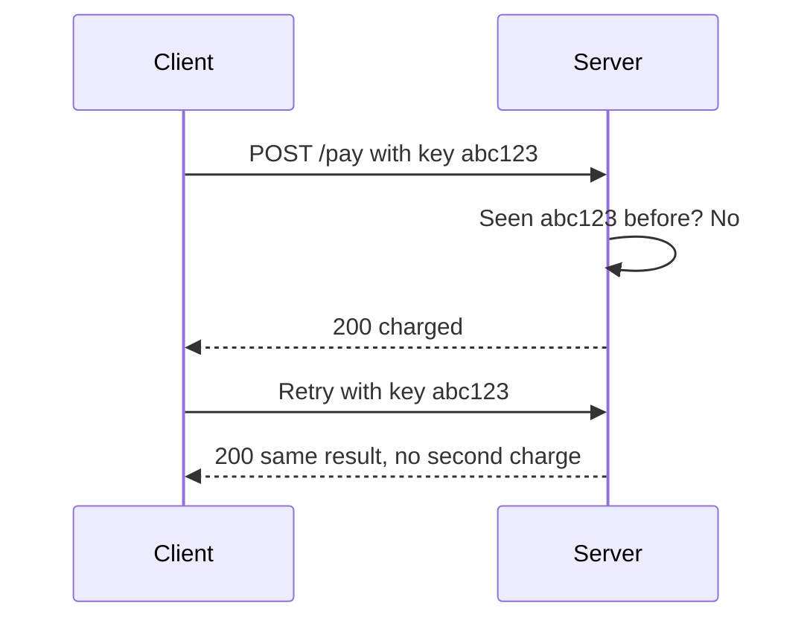

# what-breaks-in-prod: Master Plan

A complete blueprint for a public knowledge repo that teaches 157 backend and system design concepts to beginners and working developers. The name is a placeholder, so swap it anywhere.

## 1. Goal and promise

- **For readers:** after each page they can explain the concept to a friend, spot it in real code, and know when NOT to use it.
- **For you:** proof that you can build, explain and ship. Recruiters see depth, consistency and runnable code.
- **The promise on the README:** every concept has the same five things: a plain-English explanation, an everyday analogy, a diagram, a runnable demo and a self-test.

## 2. Writing principles (the soul of the repo)

1. Write for someone smart but new. Never use a term before defining it.
2. Story first. Start from the failure (a double charge, a 3 AM outage), then reveal the concept.
3. One concept per page, one idea per section. A page reads in 5 to 8 minutes.
4. Analogy before technical detail, always from everyday life (shops, post offices, restaurants).
5. Show broken code and fixed code side by side.
6. Diagram everything that moves: request flows, retries, locks, queues.
7. Be honest about trade-offs. Every page says when NOT to use the concept.
8. Short sentences, active voice, no hype, no filler.
9. Never invent numbers, benchmarks or quotes. Cite a source or leave it out.
10. Tag every page Beginner, Intermediate or Advanced.

## 3. Repo structure

```
what-breaks-in-prod/
├── README.md                    pitch, how to learn, progress table
├── ROADMAP.md                   release plan and learning paths
├── CONTRIBUTING.md              how to add or fix a concept
├── STYLE-GUIDE.md               the writing principles above
├── LICENSE                      MIT
├── glossary.md                  every term in one line
├── _template/
│   ├── concept.md               page template (section 4)
│   └── demo.mjs                 demo template
├── prompts/
│   ├── master-prompt.md         AI writing prompt (section 5)
│   ├── review-prompt.md         AI fact-check and clarity prompt
│   └── diagram-prompt.md        Mermaid diagram prompt
├── docs/
│   ├── 01-foundations/
│   │   ├── README.md            category intro and concept table
│   │   ├── 001-http-basics-and-status-codes/
│   │   │   ├── README.md        the concept page
│   │   │   ├── demo.mjs         single file, zero dependencies
│   │   │   └── assets/          SVGs and screenshots
│   │   └── ...
│   ├── 02-api-reliability/
│   ├── 03-performance-and-caching/
│   ├── 04-databases/
│   ├── 05-concurrency/
│   ├── 06-distributed-systems/
│   ├── 07-messaging-and-events/
│   ├── 08-security/
│   ├── 09-networking-and-realtime/
│   ├── 10-devops-and-deployment/
│   ├── 11-scaling-and-resilience/
│   ├── 12-observability-and-operations/
│   └── 13-ai-era-backend/
├── paths/                       guided reading orders
│   ├── what-breaks-first.md
│   ├── interview-sprint.md
│   ├── backend-junior-to-mid.md
│   └── production-readiness-checklist.md
├── cheatsheets/                 one-page summary per category
├── interview/                   questions grouped by category
├── scripts/
│   ├── build-index.mjs          rebuilds README progress table and category indexes from frontmatter
│   └── check-demos.mjs          runs every demo.mjs and fails on error
└── .github/
    ├── workflows/ci.yml         markdown lint, link check, run demos, build index
    ├── ISSUE_TEMPLATE/
    └── PULL_REQUEST_TEMPLATE.md
```

Naming rules: categories are numbered 01 to 13. Concepts are numbered globally (001 to 157) and use a lowercase-hyphen slug. Numbers never change once published, so links never break.

Scripts are single-file, zero-dependency Node scripts. No package.json is needed to run the repo.

## 4. The concept page template

Every page follows this exactly. Consistency is what makes the repo feel professional and easy to learn from.

````markdown
---
id: 001
title: Idempotency Keys
slug: idempotency-keys
category: api-reliability
level: beginner
status: draft
prerequisites: []
related: [retries, webhooks]
tags: [payments, apis]
last_reviewed: 2026-10-19
---

# Idempotency Keys

> **In 30 seconds:** one or two sentences a total beginner understands.

## The story
A short real-world failure. What went wrong, who got hurt.

## The analogy
One everyday comparison, reused through the page.

## What it is
Plain-English definition. Define every new term here.

## How it works

Then a numbered walkthrough of the diagram.

## Broken vs fixed
### Broken
```js
// short code that shows the bug
```
### Fixed
```js
// short code that fixes it
```

## Try it yourself
Run `node demo.mjs` and read the output.

## Where you have seen it
Real products or tools that use it.

## When to use it
## When to skip it

## Common mistakes
- mistake and how to avoid it

## Self-test
<details><summary>Question 1</summary>Answer</details>
(3 questions)

## Interview angle
2 questions with short model answers.

## Cheat sheet
5 lines the reader can screenshot.

## Related concepts
Links both ways.

## Sources
2 to 3 official docs or trusted references.
````

## 5. AI workflow for writing each concept

The rule: **AI drafts, you own the facts.** Never publish a page you could not explain in an interview.

Per concept, about 30 to 45 minutes:

1. **Generate.** Paste the master prompt below with the concept name, category, level and related concepts. Add your 3 hand-edited gold-standard pages as examples (this is the biggest quality boost).
2. **Fact-check.** Run the review prompt in a fresh chat. Verify every claim and number against official docs.
3. **Run the demo.** Execute `node demo.mjs`. If it does not run on the current Node LTS with zero installs, fix it.
4. **Read-aloud test.** Any sentence that makes you pause gets rewritten. Show tricky pages to a non-developer friend.
5. **Render check.** Preview on GitHub to confirm the Mermaid diagram and links work.
6. **Ship.** Set status to reviewed, run `node scripts/build-index.mjs`, commit as `docs(001): add idempotency keys`.

### Master prompt

```
You are writing one page of an open-source teaching repo called what-breaks-in-prod.
The readers are developers who build with AI tools and want to understand
what makes software survive production.

Concept: {CONCEPT}
Category: {CATEGORY}
Level: {LEVEL}
Related concepts: {RELATED}

Follow the page template exactly (pasted below), including the frontmatter.

Rules:
- Audience: smart beginner with no prior knowledge. Define every term on first use.
- Open with a short real-world failure story, then name the concept.
- Use one everyday, non-technical analogy and reuse it through the page.
- Include a Mermaid diagram of the main flow. Valid syntax, simple labels.
- Code is Node.js with ES modules. demo.mjs must be a single file with zero
  dependencies, runnable with: node demo.mjs. It prints clear output that
  shows the problem first, then the fix.
- Show BROKEN and FIXED versions side by side.
- Always include when NOT to use the concept and the trade-offs.
- Never invent statistics, benchmarks, quotes or company claims. If unsure,
  say so or leave it out.
- Tone: friendly, direct, short sentences, no hype, no filler. No em dashes.
- Length: 800 to 1200 words, excluding code.
- End with 3 self-test questions with answers, 2 interview questions with
  short answers, and a 5-line cheat sheet.

Return two files: README.md and demo.mjs.

[PASTE TEMPLATE]
[PASTE ONE GOLD-STANDARD PAGE]
```

### Review prompt

```
Act as a senior backend engineer reviewing this page. Check for: factual
errors, missing trade-offs, undefined jargon, unclear sentences, code that
would not run, and unsafe practices in examples. List issues by severity,
quote the exact line for each, and propose a fix. Do not rewrite the whole
page.
```

## 6. Definition of done (quality gate)

A page is only published when all of these are true:

- A beginner can explain the concept after 5 minutes of reading.
- Story, analogy, diagram, broken vs fixed code, and trade-offs are all present.
- demo.mjs runs on the current Node LTS with no installs.
- Claims are checked against official docs and sources are listed.
- Links work and the Mermaid diagram renders on GitHub.
- Frontmatter is complete and related concepts link both ways.
- Self-test answers are correct.

## 7. Full concept list (157)

Your original 111 are all covered. Some were merged for clarity (TLS and both encryption items became one, horizontal and vertical scaling became one, CDN and edge caching became one, latency and throughput became one, P99 and tail latency became one). New concepts fill the gaps.

### 01 Foundations (12)

HTTP basics and status codes, REST vs GraphQL, Serialization (JSON and Protobuf), Authentication vs authorization, Environment config and the 12-factor app, Monolith vs modular monolith vs microservices, Input validation and sanitization, Pagination (offset vs cursor), Time and timezones, Money handling, File uploads and object storage, Testing strategy.

### 02 API reliability (16)

Idempotency keys, Rate limiting, Reverse proxies, API gateways, Timeouts, Retries, Exponential backoff, Circuit breakers, Bulkheads, Load shedding, Graceful degradation, Webhooks, CORS, API versioning, Semantic versioning, Error handling conventions.

### 03 Performance and caching (12)

Connection pooling, N+1 queries, Caching strategies, Cache invalidation, Cache stampede, Load balancing, CDN and edge caching, Latency and throughput, P99 and tail latency, Profiling and load testing, Memory leaks, Garbage collection.

### 04 Databases (13)

SQL vs NoSQL, Normalization vs denormalization, ACID and isolation levels, Database indexing, Query optimization, Read replicas, Database migrations, Zero-downtime migrations, Schema versioning, Soft deletes and audit logs, Multi-tenancy, Full-text search, OLTP vs OLAP.

### 05 Concurrency (9)

Concurrency vs parallelism, Async and the event loop, Race conditions, Deadlocks, Optimistic locking, Pessimistic locking, Distributed locks, Thread safety, Background workers and job queues.

### 06 Distributed systems (15)

Sharding, Partitioning, Replication, Leader election, CAP theorem, Eventual consistency, Consensus and quorum, Consistent hashing, Hot keys and hot partitions, Distributed transactions, Saga pattern, Outbox pattern, Network partitions, Clock skew, Bloom filters.

### 07 Messaging and events (7)

Message queues, Pub/Sub, Event-driven architecture, CQRS and event sourcing, Dead letter queues, Backpressure, Cron jobs and scheduling.

### 08 Security (17)

SQL injection, XSS, CSRF, SSRF, OWASP Top 10 and broken access control, OAuth, JWT and token rotation, Password hashing, Secrets management, IAM and least privilege, MFA, TLS and encryption (at rest and in transit), Security headers and CSP, WAF, DDoS protection, Supply chain security, PII and data privacy.

### 09 Networking and real-time (7)

TCP vs UDP, DNS, HTTP/2 and HTTP/3, WebSockets, Server-Sent Events, Long polling, gRPC.

### 10 DevOps and deployment (18)

Docker, Kubernetes, Helm charts, Service discovery, CI/CD, Build caching, Infrastructure as code, Terraform, Feature flags, Blue-green deployment, Canary releases, Rolling deployments, Rollbacks, Health checks, Liveness and readiness probes, Dependency hell, Graceful shutdown, Git branching and trunk-based development.

### 11 Scaling and resilience (12)

Autoscaling, Horizontal vs vertical scaling, Cost optimization, Cold starts, Serverless limits, Capacity planning, Multi-region deployment, Failover, Backups, Disaster recovery, Chaos engineering, Connection exhaustion.

### 12 Observability and operations (14)

Structured logging and correlation IDs, Monitoring, Metrics, Alerts, Distributed tracing, Observability, SLIs/SLOs/SLAs, Error budgets, Production incidents, On-call, Runbooks, Postmortems, Code review, Tech debt.

### 13 AI-era backend (5)

LLM cost and token limits, Rate limits and retries for AI APIs, Embeddings and vector databases, Streaming responses, Prompt injection.

## 8. Launch set: the first 30 pages

Write these first. They are the concepts developers hit hardest when shipping to production, and they give the repo real value on day one.

Idempotency keys, Rate limiting, Timeouts, Retries, Exponential backoff, Circuit breakers, N+1 queries, Connection pooling, Caching strategies, Cache invalidation, Database indexing, ACID and isolation levels, Race conditions, Optimistic locking, Pagination, Money handling, Authentication vs authorization, Password hashing, SQL injection, XSS, CSRF, JWT and token rotation, Secrets management, CORS, Webhooks, Message queues, Docker, CI/CD, Structured logging, P99 and tail latency.

## 9. Learning paths

- **What breaks first (Prototype to Production):** the 30 launch pages in the order above.
- **Interview sprint:** CAP, ACID, caching, indexing, queues, sharding, rate limiting, consistency, plus the interview folder.
- **Backend junior to mid:** categories 01, 02, 03, 04, 05 in order.
- **Production readiness checklist:** one page of yes/no questions that links to the concept for every no.

## 10. Release roadmap

- **Phase 0, day 1:** create the repo, folder skeleton, template, prompts, scripts and CI. Write the README with an empty progress table.
- **Phase 1, week 1:** hand-polish 3 gold-standard pages: Idempotency keys, N+1 queries, Rate limiting. These become the examples inside your master prompt.
- **Phase 2, weeks 2 to 4:** finish the 30 launch pages, then announce with a v0.1 release.
- **Phase 3, ongoing:** one category per week, a cheatsheet per finished category, tag a release after each.
- **Phase 4:** interview folder, glossary, learning paths, optional website (GitHub Pages or VitePress), translations.

## 11. README outline

1. Title, one-line tagline, badges (license, concepts done, last updated).
2. Why this exists: one short paragraph about rapid prototyping, AI-generated code, and the production gap.
3. How to use it: pick a learning path, or browse by category.
4. Progress table generated by build-index.mjs.
5. What every page contains (the five-part promise).
6. Contributing and license.

## 12. Making it count for hiring

- Pin the repo and link it from your portfolio and LinkedIn.
- Add GitHub topics: system-design, backend, interview-prep, devops, learning.
- Add a short **Seen in real life** note on pages where you used the concept at work (queues, caching, indexing). Never include confidential details.
- Post a short summary of each batch. Consistent weekly progress is visible in the commit graph.
- Label small issues good first issue to attract contributors.
- Keep quality over count. Ten excellent pages beat 157 thin ones.
