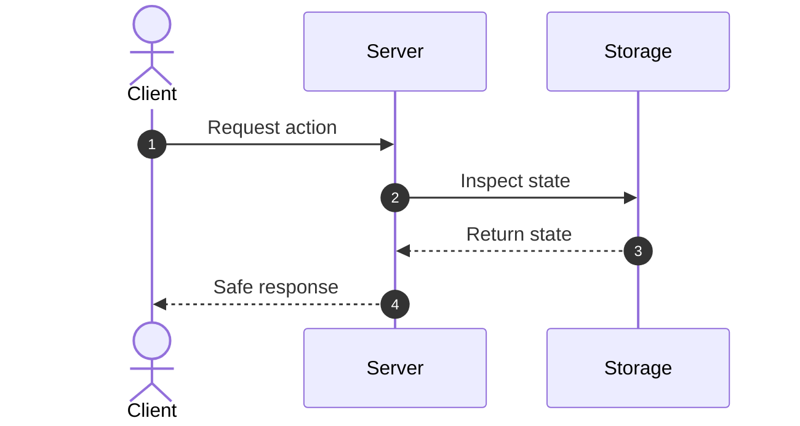

# Concept Title

> **In 30 seconds:** One or two clear sentences a total beginner understands without technical jargon.

## The story
A short real-world failure story. What went wrong, what broke in production, and who was affected before this concept was applied.

## The analogy
One everyday non-technical comparison (such as a coffee shop, post office, restaurant ticket system) that will be reused consistently throughout the page.

## What it is
A plain-English definition. Every technical term introduced here must be clearly defined on first use.

## How it works


A clear, numbered walkthrough explaining the steps in the diagram:
1. Step 1 explanation.
2. Step 2 explanation.
3. Step 3 explanation.

## Broken vs fixed

### Broken
Here is the naive code that causes problems under production traffic:

```javascript
// Broken implementation example
function handleRequest(order) {
  // Vulnerable to duplicates, races, or unhandled failures
  return processOrder(order);
}
```

### Fixed
Here is the resilient production-safe implementation:

```javascript
// Fixed implementation example
async function handleRequest(order, idempotencyKey) {
  const existing = await checkRecord(idempotencyKey);
  if (existing) {
    return existing.response;
  }
  return await processOrderWithLock(order, idempotencyKey);
}
```

## Try it yourself
Run the accompanying zero-dependency demo:

```bash
node demo.mjs
```

Observe the console output: it demonstrates the broken failure mode first, followed by the resilient fix.

## Where you have seen it
- Real-world production service 1 (e.g., Stripe, AWS, GitHub)
- Real-world production service 2

## When to use it
- Production scenario 1
- Production scenario 2

## When to skip it
- Scenarios where simpler patterns suffice
- Situations where the overhead or complexity is not justified

## Common mistakes
- **Mistake 1:** Explanation of the mistake and how to prevent it.
- **Mistake 2:** Explanation of the mistake and how to prevent it.

## Self-test
<details>
<summary>Question 1: What is the primary problem solved by this concept?</summary>
Detailed answer explaining the core benefit and typical symptoms seen when it is missing.
</details>

<details>
<summary>Question 2: What is the primary trade-off or cost of adopting this concept?</summary>
Detailed answer discussing complexity, latency, storage, or operational burden.
</details>

<details>
<summary>Question 3: In which scenario should you deliberately avoid implementing this?</summary>
Detailed answer showing nuance and understanding of when simpler approaches are better.
</details>

## Interview angle
1. **How would you handle [common scenario related to concept] at scale?**
   Model answer addressing trade-offs, edge cases, and failure modes.

2. **What happens if [failure mode occurs]?**
   Model answer demonstrating practical production troubleshooting.

## Cheat sheet
- Core rule 1 in one line.
- Core rule 2 in one line.
- Core rule 3 in one line.
- Trade-off warning in one line.
- Production golden rule in one line.

## Related concepts
- [Related Concept 1](../../category/slug/README.md)
- [Related Concept 2](../../category/slug/README.md)

## Sources
- [Official Documentation / RFC](https://example.com)
- [Engineering Blog Case Study](https://example.com)
