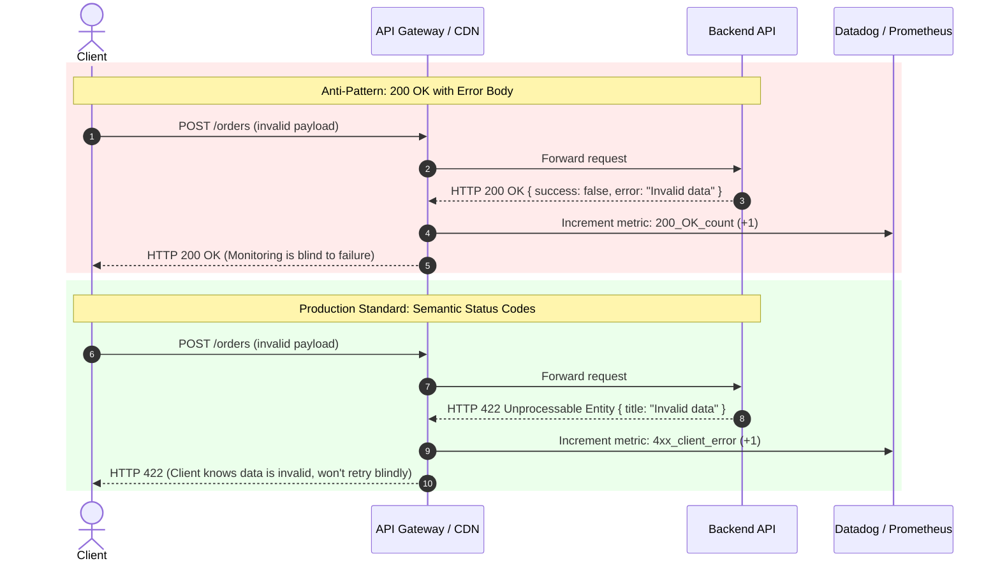

# HTTP Status Codes and Error Semantics

> **In 30 seconds:** An HTTP status code is a three-digit contract between client and server. If your server returns `200 OK` when a payment fails, or `500 Internal Server Error` when a user types an invalid email, your monitoring goes blind, caches store bad data, and clients trigger destructive retry storms.

---

## The story

In 2021, an e-commerce platform suffered a four-hour checkout blackout during a seasonal flash sale. Over 30,000 customers attempted to check out with expired credit cards or invalid coupon codes.

The backend service was programmed to never throw unhandled exceptions. Instead, for every request, it returned `HTTP 200 OK` with a JSON payload:

```json
{
  "success": false,
  "error": "Card declined: insufficient funds",
  "code": 4002
}
```

The consequences cascaded across the entire platform:

1. **Silent monitoring:** The site reliability engineering (SRE) dashboard tracked HTTP 5xx error rates to trigger alerts. Because every failed payment returned `HTTP 200 OK`, the dashboard showed 99.99% system health. The engineering team had no idea checkout was broken.
2. **Aggressive browser caching:** Cloudflare was configured to cache static `200 OK` responses for product bundle recommendations. Because coupon validation endpoints returned `200 OK`, intermediary proxies cached failed coupon lookups for distinct user sessions.
3. **No automated retries:** Mobile apps were programmed to retry transient network hiccups whenever they received `503 Service Unavailable`. Because the API returned `200 OK`, mobile apps displayed generic error messages and aborted purchases instead of retrying temporary database glitches.

The company lost hundreds of thousands of dollars in revenue while their health monitors reported perfect uptime.

---

## The analogy

Imagine mailing a parcel at a post office counter:

- **HTTP 200 OK:** The clerk accepts the parcel, hands you a tracking receipt, and files it for delivery.
- **The "200 with Error Payload" bug:** The clerk smiles, stamps your receipt "Package Accepted", hands you the stamped receipt, but tosses your parcel into the lobby trash bin. As you walk out, the tracking portal logs "Delivered successfully", yet the recipient receives nothing.
- **HTTP 4xx (Client Error):** You addressed the envelope to an address that does not exist, forgot a stamp, or arrived outside business hours. The clerk rejects the envelope and tells you what to fix. Retrying the exact same envelope 50 times without fixing the address will produce the exact same rejection 50 times.
- **HTTP 5xx (Server Error):** The sorting conveyor belt snapped or the post office ceiling caved in. Your envelope is flawless, but the post office cannot process it right now. You should wait a moment and try again.

---

## What it is

An **HTTP status code** is a standardized three-digit integer returned in the header of an HTTP response (defined by IETF RFC 9110). It tells every intermediary in the network (browsers, CDNs, API gateways, load balancers, and monitoring agents) what happened before anyone reads a single byte of the response body.

The first digit defines the status class:

- **1xx (Informational):** Request received, continuing process (for example, `101 Switching Protocols` during a WebSocket handshake).
- **2xx (Success):** The action requested by the client was received, understood, and accepted (for example, `200 OK`, `201 Created`, `204 No Content`).
- **3xx (Redirection):** Further action must be taken by the client to complete the request (for example, `301 Moved Permanently`, `304 Not Modified`).
- **4xx (Client Error):** The client sent something wrong. The request contains bad syntax, invalid data, or lacks authorization. The client should not repeat the identical request without modifications (for example, `400 Bad Request`, `401 Unauthorized`, `403 Forbidden`, `404 Not Found`, `422 Unprocessable Entity`, `429 Too Many Requests`).
- **5xx (Server Error):** The server failed to fulfill an apparently valid request due to an internal crash, timeout, or downstream dependency failure. The client may retry the request using exponential backoff (for example, `500 Internal Server Error`, `502 Bad Gateway`, `503 Service Unavailable`, `504 Gateway Timeout`).

---

## How it works

The diagram below contrasts how an API Gateway and an SRE Monitoring system react when an API uses semantic HTTP status codes versus when it hides failures inside `200 OK` responses:



### Walkthrough of the response lifecycle

1. In the anti-pattern, the client submits an invalid request.
2. The server detects the validation failure but writes a `200 OK` header with an error message in the JSON body.
3. The API Gateway and Prometheus parser only inspect HTTP status headers. They record the request as successful.
4. Alerts never fire. CDNs may cache the response, serving an error payload to subsequent customers.
5. In the production-standard flow, the server responds with `HTTP 422 Unprocessable Entity`.
6. The Gateway increments the 4xx client error metrics immediately.
7. The client SDK inspects `response.ok`, detects the failure, and alerts the user without retrying a doomed payload.

---

## Broken vs fixed

### Broken: The "Always 200" anti-pattern

Here is naive code written by developers who treat HTTP as an invisible pipe rather than a semantic protocol:

```javascript
// BROKEN: Everything returns 200 OK
app.post("/api/checkout", async (req, res) => {
  try {
    const { email, amount, cardNumber } = req.body;

    if (!email || !amount) {
      // Problem 1: Client error disguised as success
      return res.status(200).json({
        success: false,
        error: "Missing required fields"
      });
    }

    const charge = await chargeCard(cardNumber, amount);
    return res.status(200).json({ success: true, charge });
  } catch (err) {
    // Problem 2: Infrastructure crash disguised as success
    return res.status(200).json({
      success: false,
      error: "Payment gateway crashed"
    });
  }
});
```

### Fixed: Semantic status codes with RFC 7807 problem details

Here is the production-ready implementation adhering to standard status codes and structured problem objects:

```javascript
// FIXED: Accurate semantic status codes
app.post("/api/checkout", async (req, res) => {
  try {
    const { email, amount, cardNumber } = req.body;

    if (!email || !amount) {
      // 400 Bad Request / 422 Unprocessable Entity
      return res.status(422).json({
        type: "https://api.example.com/errors/validation-failed",
        title: "Validation Error",
        status: 422,
        detail: "The fields 'email' and 'amount' are mandatory.",
        instance: req.originalUrl
      });
    }

    const charge = await chargeCard(cardNumber, amount);
    // 201 Created for new resources, or 200 OK
    return res.status(201).json({
      id: charge.id,
      amount: charge.amount,
      status: "completed"
    });
  } catch (err) {
    if (err.name === "CardDeclinedException") {
      // 402 Payment Required: Client-actionable issue
      return res.status(402).json({
        type: "https://api.example.com/errors/card-declined",
        title: "Payment Required",
        status: 402,
        detail: err.message
      });
    }

    // 502 Bad Gateway / 503 Service Unavailable: Upstream failure
    return res.status(502).json({
      type: "https://api.example.com/errors/bad-gateway",
      title: "Upstream Payment Processor Unavailable",
      status: 502,
      detail: "The upstream banking network failed to respond in time."
    });
  }
});
```

---

## Try it yourself

Run the zero-dependency demonstration script in this directory:

```bash
node docs/01-foundations/001-http-status-codes-and-error-semantics/demo.mjs
```

### What the demo proves

The script starts a lightweight HTTP server on your machine, sends requests simulating both broken and fixed endpoints, and evaluates how a client-side SDK and an automated observability layer react.

You will see:
1. How a `200 OK` error payload passes silently through `res.ok`, inflating success metrics.
2. How proper 4xx/5xx status codes trigger client error boundaries and allow telemetry agents to categorize bugs immediately.

---

## Where you have seen it

- **Stripe API:** The gold standard in HTTP semantics. Invalid requests return `400` or `422`. Rate limits return `429 Too Many Requests`. Expired authentication tokens return `401 Unauthorized`.
- **GitHub REST API:** Every rate-limited client receives `HTTP 429` with `Retry-After` headers, allowing automated CLI tools to pause execution cleanly.
- **AWS S3:** A request to upload a 6 GB file via a single PUT returns `HTTP 400 Bad Request` with an explicit XML error code `EntityTooLarge`, guiding developers toward multipart uploads.

---

## The Core Status Codes You Must Know

| Code | Name | Category | Meaning in Production |
| :--- | :--- | :---: | :--- |
| **`200`** | OK | Success | Standard response for successful GET, PUT, or PATCH requests. |
| **`201`** | Created | Success | A new record was stored (POST). Includes `Location` header or payload ID. |
| **`204`** | No Content | Success | Operation succeeded, but there is no body to return (common for DELETE). |
| **`304`** | Not Modified | Redirection | ETag or cache header matches. Client should read from local cache. |
| **`400`** | Bad Request | Client Error | Malformed JSON or syntax that the parser cannot read. |
| **`401`** | Unauthorized | Client Error | Identity is missing or invalid. The user needs to authenticate. |
| **`403`** | Forbidden | Client Error | Identity is known, but permissions do not allow this action. |
| **`404`** | Not Found | Client Error | Resource does not exist, or hidden for security to prevent ID enumeration. |
| **`409`** | Conflict | Client Error | Edit conflict or duplicate key violation (e.g., username already taken). |
| **`422`** | Unprocessable Entity | Client Error | Syntax is valid JSON, but business logic fails (e.g., negative balance). |
| **`429`** | Too Many Requests | Client Error | Rate limit breached. Always include a `Retry-After` header. |
| **`500`** | Internal Server Error | Server Error | Unhandled code exception or crash in your application. |
| **`502`** | Bad Gateway | Server Error | Your server received an invalid or crashed response from an upstream server (e.g., Node behind NGINX). |
| **`503`** | Service Unavailable | Server Error | Server is overloaded, running maintenance, or shutting down gracefully. |
| **`504`** | Gateway Timeout | Server Error | Upstream database or external API took too long to reply before proxy timeout. |

---

## When to use it

- On **every single HTTP endpoint** you expose to clients, internal microservices, or webhooks.
- When configuring **load balancer health checks**: Route monitors against an endpoint that returns `200` only when internal dependencies are alive, and `503` during startup or shutdown.
- When designing **frontend and mobile SDKs**: SDKs should switch behavior based on status code ranges:
  - `4xx`: Alert the user to change their input. Never retry automatically.
  - `429`: Pause execution until the duration specified in `Retry-After`.
  - `5xx`: Trigger retry logic using exponential backoff.

---

## When to skip it

- **Internal non-HTTP transports:** When using native RPC frameworks like raw gRPC (which uses its own 16-code canonical status model: `OK`, `CANCELLED`, `UNAVAILABLE`, etc.), AMQP message queues, or WebSockets.
- **GraphQL query execution:** By specification, GraphQL queries often return `200 OK` with an `errors` array in the JSON body. However, authentication failures, transport timeouts, or gateway rejections before GraphQL execution must still emit proper 4xx/5xx HTTP status codes.

---

## Common mistakes

- **Returning `500` for user validation errors:** When an end-user submits a password that is too short, returning `500` tells automated SDKs that the server crashed. SDKs will retry five times, creating unnecessary load and triggering bogus SRE pagers. Return `400` or `422`.
- **Confusing `401 Unauthorized` with `403 Forbidden`:** `401` means "Who are you? Please log in." `403` means "I know who you are, but you do not have permission to view this resource." Returning `401` to a logged-in user causes frontends to clear the session and force an unnecessary re-login.
- **Inventing non-standard status codes:** Using `209`, `490`, or custom numbers breaks proxies, web application firewalls, and client HTTP libraries. Stick strictly to standard IANA / RFC status codes.

---

## Self-test

<details>
<summary>Question 1: A user submits a registration form with an email that already exists in the database. What HTTP status code should the API return?</summary>
<strong>Answer:</strong> <code>HTTP 409 Conflict</code> (or <code>422 Unprocessable Entity</code>). The request is syntactically valid, but processing it would violate a unique constraint on the database. Returning <code>400 Bad Request</code> is acceptable but less specific. Returning <code>500</code> is completely wrong because the server did not fail.
</details>

<details>
<summary>Question 2: An NGINX reverse proxy receives a request, forwards it to a Node.js backend, but the Node.js process crashes immediately with a memory leak before responding. What status code will NGINX return to the client?</summary>
<strong>Answer:</strong> <code>HTTP 502 Bad Gateway</code>. NGINX was acting as a gateway/proxy and received an abrupt connection reset or invalid packet from the upstream Node.js application server. If Node.js stayed alive but hung for 60 seconds without responding, NGINX would return <code>HTTP 504 Gateway Timeout</code>.
</details>

<details>
<summary>Question 3: Why should client libraries NEVER automatically retry an HTTP 422 or HTTP 400 response without modifications?</summary>
<strong>Answer:</strong> 4xx status codes indicate client-side errors. Because the payload itself is invalid or violates business constraints, resending the identical payload 1,000 times will produce the identical rejection 1,000 times while burning server CPU and network bandwidth. Only 5xx errors or transient 429 errors should be retried.
</details>

---

## Interview angle

1. **"What is the difference between 502 Bad Gateway and 504 Gateway Timeout?"**
   *Model answer:* Both indicate problems between a reverse proxy (like NGINX, Cloudflare, or AWS ALB) and an upstream origin server. `502 Bad Gateway` means the proxy contacted the upstream server, but the upstream server returned an invalid response, crashed, or terminated the TCP connection abruptly. `504 Gateway Timeout` means the proxy contacted the upstream server, but the upstream server did not respond before the proxy's configured read timeout elapsed.

2. **"Why is returning HTTP 200 with an error object considered a severe architectural defect in distributed systems?"**
   *Model answer:* It breaks the layered architecture of the web. Reverse proxies, CDNs, API gateways, service meshes, and observability agents inspect HTTP response headers without parsing JSON bodies. Disguising failures as `200 OK` breaks automated caching, disables circuit breakers, conceals error spikes from monitoring systems, and prevents client HTTP clients from executing standard retry logic.

---

## Cheat sheet

- `2xx` means the client did well and the server succeeded.
- `4xx` means the client made a mistake; never retry the exact same request automatically.
- `5xx` means the server or an upstream service crashed; retry with exponential backoff and jitter.
- Use `401` for unauthenticated requests and `403` for unauthorized permissions.
- Never return `200 OK` for an error; it blinds monitoring and corrupts intermediate caches.

---

## Related concepts

- [Error Handling Conventions](../../02-api-reliability/028-error-handling-conventions/README.md)
- [Idempotency Keys](../../02-api-reliability/013-idempotency-keys/README.md)
- [Timeouts](../../02-api-reliability/017-timeouts/README.md)

---

## Sources

- [RFC 9110: HTTP Semantics (IETF Standard)](https://www.rfc-editor.org/rfc/rfc9110.html)
- [RFC 7807: Problem Details for HTTP APIs](https://www.rfc-editor.org/rfc/rfc7807.html)
- [MDN Web Docs: HTTP Response Status Codes](https://developer.mozilla.org/en-US/docs/Web/HTTP/Status)
