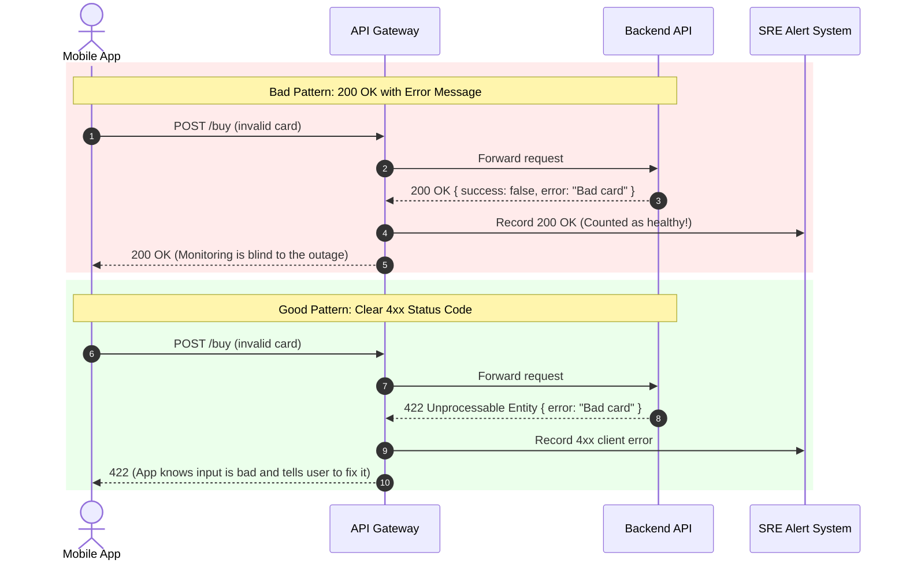
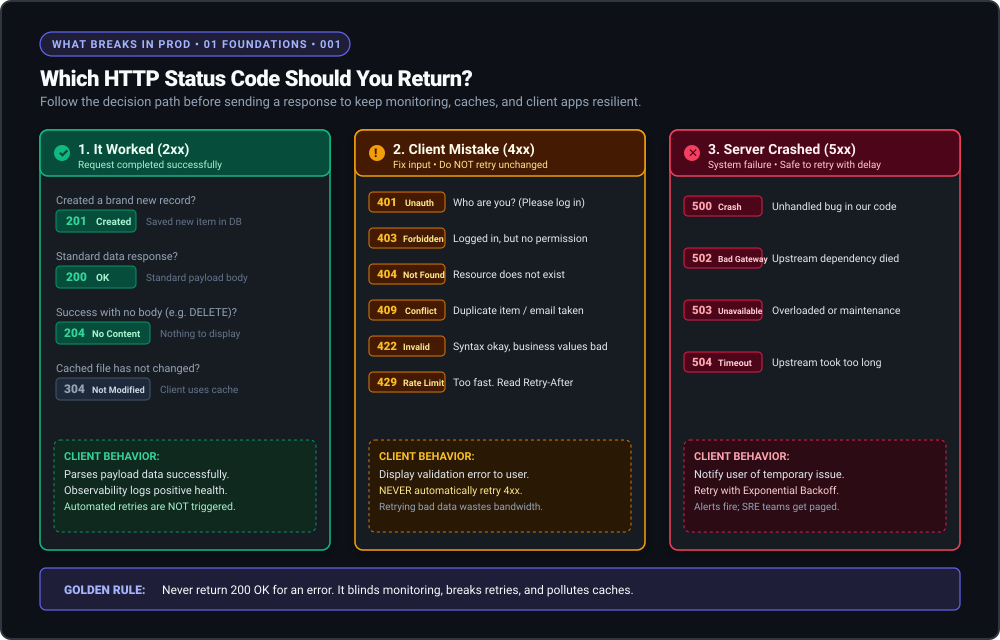

# HTTP Status Codes and Error Semantics

> **In 30 seconds:** An HTTP status code is a 3-digit number a server sends back to say what happened. If your server sends back `200 OK` when a payment fails, your monitoring tools think everything is fine, your alerts stay silent, and your users get stuck.

---

## The story

In 2021, an online store had a 4-hour checkout outage during a big sale. Over 30,000 shoppers tried to buy items with expired cards or invalid coupon codes.

The developers wanted to be safe. They wrote code that caught every error and always returned `HTTP 200 OK` with a JSON message:

```json
{
  "success": false,
  "error": "Card declined: insufficient funds"
}
```

This tiny choice broke three separate systems at once:

1. **The monitoring dashboard went blind:** The team's alert system only checked the 3-digit status code. It saw `200 OK` on every single request. The dashboard showed 99.99% uptime. The team thought everything was running smoothly while 30,000 customers were unable to buy anything.
2. **Caches saved the error:** The caching layer saw `200 OK` and assumed the response was good data. It saved the error page and served that same "Card declined" message to other shoppers who had not even entered their card details yet.
3. **The mobile app gave up:** Mobile apps can automatically retry temporary server hiccups when they see a `503 Service Unavailable`. Because the API sent back `200 OK`, the app thought the conversation was finished and gave up immediately.

The company lost hundreds of thousands of dollars while their screens showed green checkmarks.

---

## The analogy

Think of mailing a letter at the post office:

- **200 OK:** The clerk takes your letter, stamps it "Accepted", and files it. Everything worked.
- **The "200 with error" bug:** The clerk smiles, stamps your receipt "Accepted", but drops your letter into the trash can behind the desk. The tracking screen says "Delivered", but your friend never gets the letter.
- **4xx (Your mistake):** You forgot to write an address or you did not put a stamp on the envelope. The clerk gives it back to you. If you bring that exact same envelope back 50 times without fixing it, it will fail 50 times.
- **5xx (Their mistake):** The post office roof fell in or their sorting machines caught fire. Your letter is fine, but the building cannot work right now. You should wait 10 minutes and try again.

---

## What it is

An **HTTP status code** is a standardized 3-digit number sent at the very top of a server response. It tells everyone in the network (your browser, your mobile app, CDNs, load balancers, and monitoring tools) what happened before anyone reads the message body.

There are 5 number families based on the first digit:

- **1xx (Hold on):** "I got your request. I am still working on it."
- **2xx (Success):** "Done! Everything worked as expected."
- **3xx (Go over there):** "The thing you want has moved. Go to this other link instead."
- **4xx (You made a mistake):** "The request is bad. Fix your input before trying again."
- **5xx (I crashed):** "The server or database broke. It is not your fault. Try again later."

---

## How it works

Here is what happens inside your system when you use a real status code versus when you hide errors inside `200 OK`:



### What happens step by step

1. In the bad pattern, the server sees bad input but still sends a `200 OK` header with an error written inside the body.
2. The API Gateway and alert systems only look at the header. They count the request as a success.
3. Your alerts do not go off. The engineering team has no idea users are failing.
4. In the good pattern, the server sends back `422 Unprocessable Entity`.
5. The gateway records a client error.
6. The app sees `422`, knows the user entered bad data, shows a clear form warning, and does not retry blindly.

---

## Broken vs fixed

### Broken: Everything returns 200 OK

This code hides every problem behind a fake success message:

```javascript
// BROKEN: Everything returns 200 OK
app.post("/api/checkout", async (req, res) => {
  try {
    const { email, amount, cardNumber } = req.body;

    if (!email || !amount) {
      // Problem: The user forgot an input, but the status says OK
      return res.status(200).json({
        success: false,
        error: "Missing required fields"
      });
    }

    const charge = await chargeCard(cardNumber, amount);
    return res.status(200).json({ success: true, charge });
  } catch (err) {
    // Problem: The payment system crashed, but the status says OK
    return res.status(200).json({
      success: false,
      error: "Payment service crashed"
    });
  }
});
```

### Fixed: Return the right status code for each situation

This code tells the network exactly what happened:

```javascript
// FIXED: Real status codes that match reality
app.post("/api/checkout", async (req, res) => {
  try {
    const { email, amount, cardNumber } = req.body;

    if (!email || !amount) {
      // 422: The input is missing or invalid. Client must fix it.
      return res.status(422).json({
        title: "Validation Error",
        status: 422,
        detail: "The fields 'email' and 'amount' are required."
      });
    }

    const charge = await chargeCard(cardNumber, amount);
    // 201: A brand new payment record was created.
    return res.status(201).json({
      id: charge.id,
      amount: charge.amount,
      status: "completed"
    });
  } catch (err) {
    if (err.name === "CardDeclinedException") {
      // 402: The card had no money. The user must fix their card.
      return res.status(402).json({
        title: "Payment Required",
        status: 402,
        detail: err.message
      });
    }

    // 502: The bank's server did not answer. Our server did not cause this.
    return res.status(502).json({
      title: "Bad Gateway",
      status: 502,
      detail: "The bank did not respond. Please try again in a minute."
    });
  }
});
```

---

## Try it yourself

Run the demo script in this folder:

```bash
node docs/01-foundations/001-http-status-codes-and-error-semantics/demo.mjs
```

### What you will see

The demo runs a small server on your machine and sends 3 test requests:
1. It sends bad data to a broken endpoint. You will see the server send back `200 OK`. The monitoring counter records `Success: 1`. The failure is completely hidden.
2. It sends bad data to a fixed endpoint. The server sends back `422`. The monitoring counter records `Client Error: 1`. The issue is visible right away.
3. It simulates an upstream server crash. The server sends back `502`. The monitoring counter records `Server Error: 1`, showing how real alerts get triggered.

## The decision flow



---

## The 14 Status Codes You Will Use 99% of the Time

| Code | Name | Family | What it actually means |
| :--- | :--- | :---: | :--- |
| **`200`** | OK | Success | "It worked. Here is your data." |
| **`201`** | Created | Success | "It worked. I created the new record you asked for." |
| **`204`** | No Content | Success | "It worked, but I have nothing to show you (common after deleting something)." |
| **`304`** | Not Modified | Redirect | "This file has not changed since you last checked. Use your local copy." |
| **`400`** | Bad Request | Client Error | "Your request is broken or not readable (like bad JSON syntax)." |
| **`401`** | Unauthorized | Client Error | "I do not know who you are. Please log in first." |
| **`403`** | Forbidden | Client Error | "I know who you are, but you do not have permission to do this." |
| **`404`** | Not Found | Client Error | "That item or page does not exist." |
| **`409`** | Conflict | Client Error | "That username or email is already taken in the database." |
| **`422`** | Unprocessable Entity | Client Error | "Your data is readable, but the values do not make sense (like age = -5)." |
| **`429`** | Too Many Requests | Client Error | "You are sending requests too fast. Slow down." |
| **`500`** | Internal Server Error | Server Error | "My code crashed unexpectedly. Check the server logs." |
| **`502`** | Bad Gateway | Server Error | "I tried to talk to another service (like a database or bank), but it crashed." |
| **`504`** | Gateway Timeout | Server Error | "I asked another service for data, but it took too long to answer." |

---

## When to use them

- On **every API endpoint** you create.
- On **health check endpoints**: Make your `/health` route return `200` when ready, and `503` when starting up or shutting down.
- In **frontend code**: Check `response.ok` or the status number:
  - If it starts with `4`, show the error to the user so they can fix their input.
  - If it starts with `5`, tell the user to wait a moment and let your app retry automatically.

---

## When to skip them

- When using tools that do not use HTTP, like WebSockets, raw gRPC, or message queues (like RabbitMQ or Kafka). Those tools have their own error systems.
- When writing GraphQL query resolvers. In GraphQL, queries often return `200 OK` with an `errors` list inside the JSON. However, your main web server should still send 4xx or 5xx if the user is not logged in or the server is down.

---

## Common mistakes

- **Returning `500` when the user types a short password:** If the user made a typo, that is a client mistake, not a server crash. If you send `500`, automated client apps will think your server is broken and retry 5 times. Return `422` or `400`.
- **Mixing up `401` and `403`:** `401` means "Who are you? Please log in." `403` means "I know who you are, but you are not allowed in this room." If you send `401` to an already logged-in user, your frontend might log them out by accident.
- **Making up fake status codes:** Do not invent numbers like `209` or `499`. Stick strictly to the standard list. Outside tools will not understand your custom numbers.

---

## Self-test

<details>
<summary>Question 1: A user tries to create an account with an email that is already registered. What status code should you return?</summary>
<strong>Answer:</strong> <code>409 Conflict</code> (or <code>422 Unprocessable Entity</code>). The data format was fine, but that email is already in the database. Never send <code>500</code> because the server did not break.
</details>

<details>
<summary>Question 2: Your web server contacts your database, but the database takes 30 seconds and never answers. What status code should your web server send back to the user?</summary>
<strong>Answer:</strong> <code>504 Gateway Timeout</code>. Your web server was waiting on another computer behind it, and that computer took too long.
</details>

<details>
<summary>Question 3: Why should a mobile app NEVER automatically retry a 400 or 422 error?</summary>
<strong>Answer:</strong> Because 4xx means the input data was wrong. If you send the exact same bad data 10,000 times, it will fail 10,000 times. You are just wasting battery and server bandwidth. Only retry 5xx errors or 429 rate limits.
</details>

---

## Interview angle

1. **"What is the difference between 502 Bad Gateway and 504 Gateway Timeout?"**
   *Model answer:* Both happen when a front proxy (like NGINX or Cloudflare) talks to a backend service. A `502` means the backend service answered, but it crashed or sent back broken data immediately. A `504` means the backend service never answered at all before the proxy gave up waiting.

2. **"Why is returning 200 OK with an error message in the JSON body bad for system architecture?"**
   *Model answer:* Because caching systems, load balancers, and monitoring tools do not read your JSON body. They only look at the 3-digit number in the header. If you return `200`, monitoring tools mark the request as healthy, alerts stay silent during outages, and CDNs might cache the error page and show it to other users.

---

## Cheat sheet

- `2xx`: The client succeeded and got what it wanted.
- `4xx`: The client made a mistake; do not retry the exact same request.
- `5xx`: The server broke; wait a few seconds and try again.
- Use `401` when they need to log in; use `403` when they do not have permission.
- Never send `200 OK` for an error. It hides crashes from your monitoring tools.

---

## Related concepts

- [Error Handling Conventions](../../02-api-reliability/028-error-handling-conventions/README.md)
- [Idempotency Keys](../../02-api-reliability/013-idempotency-keys/README.md)
- [Timeouts](../../02-api-reliability/017-timeouts/README.md)

---

## Sources

- [RFC 9110: HTTP Semantics (Official IETF Standard)](https://www.rfc-editor.org/rfc/rfc9110.html)
- [RFC 7807: Problem Details for HTTP APIs](https://www.rfc-editor.org/rfc/rfc7807.html)
- [MDN Web Docs: HTTP Response Status Codes](https://developer.mozilla.org/en-US/docs/Web/HTTP/Status)
