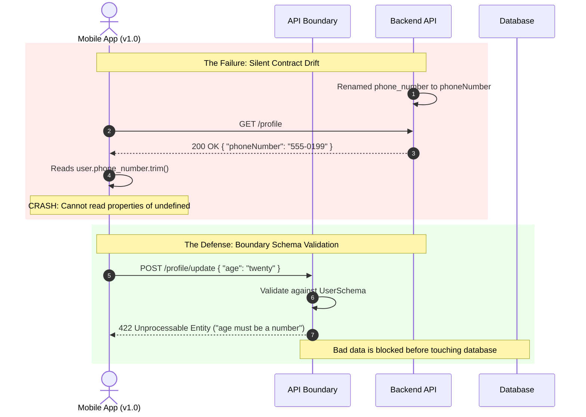

# API Contract Drift and Schema Validation

> **In 30 seconds:** An API contract is a shared agreement between client and server on what data looks like. Contract drift happens when the backend changes a field name, removes a key, or changes a type without warning. When that happens, old mobile apps crash, frontend screens go blank, and databases fill up with broken data.

---

## The story

Consider a common production failure scenario: A team is building a ride-sharing mobile app and pushes a routine backend update on a Friday afternoon.

A backend engineer wanted to clean up user data. They renamed a single field in the user profile endpoint from `phone_number` to `phoneNumber`.

On their local machine, everything worked because they updated both the frontend and backend code at the same time.

In production, things went wrong immediately:

1. **Millions of old mobile apps were still running:** Users do not update mobile apps instantly. Many users were still running a version of the app from two weeks prior.
2. **The app crashed on startup:** The mobile app had code that looked like this: `user.phone_number.trim()`. Because `phone_number` was now missing, JavaScript evaluated `undefined.trim()` and crashed.
3. **App crashes cannot be rolled back quickly:** The backend could roll back, but users whose apps had already crashed were stuck until the backend fix went live.

A single field rename instantly crashes active mobile apps across the user base and halts operations.

---

## The analogy

Imagine ordering parts for your car from a factory:

- **The contract:** You tell the factory: "I need bolt model B-10. It must be exactly 10 millimeters wide."
- **Contract drift:** One day, the factory engineers decide 12 millimeters is stronger. They change bolt B-10 to 12 millimeters without telling anyone.
- **What breaks:** The shipment arrives at your garage. Your mechanic tries to push a 12mm bolt into a 10mm hole. It does not fit. The entire car assembly line stops working.
- **Schema validation:** Before the mechanic touches a car, they measure every incoming bolt with a metal gauge. If a bolt is 12mm instead of 10mm, the gauge rejects it immediately at the loading dock. It never gets near the engine.

---

## What it is

An **API contract** is the agreement between a client (like a website or iOS app) and a server on what requests and responses must contain. It defines:
- Field names (for example, `userId` vs `user_id`).
- Data types (for example, string vs number vs boolean).
- Required versus optional fields.

**Contract drift** is what happens when one side changes the agreement without the other side knowing. This is common when:
- Backend teams rename fields to clean up tech debt.
- A field that used to be optional suddenly becomes required.
- A single string (like `"123 Main St"`) is turned into an object (`{ street: "123 Main St", city: "Denver" }`).

**Schema validation** is code that checks incoming and outgoing data at runtime. It inspects the data at the door and verifies that every field matches the contract before your application logic touches it.

---

## How it works

The diagram below shows how an unexpected change crashes an unvalidated client, and how runtime schema validation protects both sides:



### Walkthrough of the protection flow

1. When a client sends data to your API, the request hits the validation layer first.
2. The validator checks every field against your schema definition.
3. If a field has the wrong type (like `"twenty"` instead of `20`), the validator halts the request immediately.
4. The server returns `422 Unprocessable Entity` with a clear message explaining which field failed.
5. Bad data never reaches your database, and your backend functions never crash on unexpected `undefined` values.

---

## Broken vs fixed

### Broken: Naive code assuming data is always formatted correctly

This backend code blindly trusts incoming data and crashes when fields change:

```javascript
// BROKEN: Blind trust with zero validation
app.post("/api/users", async (req, res) => {
  const { name, age, address } = req.body;

  // Bug 1: If age is a string like "twenty", math operations create NaN
  const birthYear = 2026 - age;

  // Bug 2: If address changed from a string to an object, this crashes!
  const formattedAddress = address.trim().toLowerCase();

  // Bug 3: Corrupted data is written directly to the database
  const user = await db.users.insert({
    name,
    birthYear,
    address: formattedAddress
  });

  return res.status(201).json(user);
});
```

### Fixed: Runtime validation at the API boundary

This code validates the incoming data against a strict schema before executing any business logic:

```javascript
// FIXED: Runtime schema validation at the door
import { z } from "zod"; // Popular lightweight schema validator

// 1. Define the contract explicitly
const CreateUserSchema = z.object({
  name: z.string().min(1, "Name is required"),
  age: z.number().int().positive("Age must be a positive integer"),
  // Support backward compatibility: accept string or object
  address: z.union([
    z.string(),
    z.object({
      street: z.string(),
      city: z.string()
    })
  ])
});

app.post("/api/users", async (req, res) => {
  // 2. Validate at runtime
  const result = CreateUserSchema.safeParse(req.body);

  if (!result.success) {
    // Return clean 422 with the exact field that failed
    return res.status(422).json({
      title: "Validation Error",
      status: 422,
      errors: result.error.flatten().fieldErrors
    });
  }

  // 3. result.data is 100% type-safe and guaranteed clean
  const { name, age, address } = result.data;
  const birthYear = 2026 - age;
  const cleanAddress = typeof address === "string" ? address : `${address.street}, ${address.city}`;

  const user = await db.users.insert({
    name,
    birthYear,
    address: cleanAddress
  });

  return res.status(201).json(user);
});
```

---

## Try it yourself

Run the demo script in this folder:

```bash
node docs/01-foundations/002-api-contract-drift-and-schema-validation/demo.mjs
```

### What the demo proves

The demo script runs two tests:
1. It sends an invalid request (with a string for `age` and a missing `email`) to an unvalidated endpoint. You will see how the server computes `NaN` (Not a Number) and saves corrupted data to memory without realizing it.
2. It sends the same request to a schema-validated endpoint. You will see how the validator halts execution, protects the database, and returns a detailed `422` error payload telling the client exactly what to fix.

---

## The 4 Rules for Safe API Evolution

When you need to change your backend API in production, follow these 4 rules to avoid breaking clients:

| Rule | What it means | Bad Example | Good Example |
| :--- | :--- | :--- | :--- |
| **1. Never rename a field** | Add a new field instead. Keep the old field for at least 6 months. | Renaming `phone_number` to `phoneNumber`. | Return both `phone_number` and `phoneNumber` until old apps retire. |
| **2. Never make an optional field required** | If old clients did not send it before, they will not send it now. | Demanding `postalCode` on an existing checkout endpoint. | Give `postalCode` a default value if missing. |
| **3. Never change a data type** | If a field was a number, do not turn it into a string or object. | Changing `price: 19.99` to `price: { amount: 19.99, currency: "USD" }`. | Keep `price: 19.99` and add `priceDetails: { ... }`. |
| **4. Ignore unknown fields** | Configure your parsers to strip extra fields rather than crashing. | Client sends `{ name, age, theme }`; server throws error because of `theme`. | Server reads `name` and `age`, ignoring `theme`. |

---

## When to use it

- On **every incoming HTTP request body, query parameter, and URL route param**.
- On **webhook handlers**: When third-party services (like Stripe or GitHub) send webhooks to your server, validate the payload before processing to guard against vendor schema changes.
- At **microservice boundaries**: When service A calls service B, validate both the incoming request and the outgoing response.

---

## When to skip it

- On **high-frequency binary streaming**: In real-time video frames, raw UDP audio streams, or raw telemetry logging with hundreds of thousands of events per second, validating complex JSON schemas per event adds CPU overhead. Use typed binary protocols like Protobuf or FlatBuffers instead.
- On **internal helper functions**: Once data has passed through the API boundary and been validated, avoid re-validating the exact same object inside every nested private function in that request.

---

## Common mistakes

- **Relying solely on TypeScript:** TypeScript types only exist while writing code. When your code compiles to JavaScript and runs in production, TypeScript disappears completely. It cannot validate data sent over the network from an external user. You need runtime validation.
- **Changing fields without a sunset period:** Removing a field the day you deploy a new website will crash mobile users who have not updated their app from the App Store.
- **Cryptic validation messages:** Returning `"Validation failed"` with no details leaves API consumers guessing. Always list the exact field name and the expected rule.

---

## Self-test

<details>
<summary>Question 1: Why does TypeScript alone NOT protect your backend from contract drift?</summary>
<strong>Answer:</strong> TypeScript performs compile-time checking only. When code is built and deployed, all types are erased. If an external client sends unexpected JSON at runtime, TypeScript cannot inspect or block it. You must use a runtime schema validator (like Zod or Joi) to inspect live network data.
</details>

<details>
<summary>Question 2: You want to change an API field from 'name: string' to 'name: { first: string, last: string }'. How do you deploy this without breaking old clients?</summary>
<strong>Answer:</strong> Do not replace the existing field. Keep the old <code>name</code> string field as a computed combination of first and last name, and add the new object under a new key (or accept both formats in your schema using a union). Deprecate the old field and only remove it after monitoring shows zero traffic on old client versions.
</details>

<details>
<summary>Question 3: What HTTP status code should your server return when an incoming request fails schema validation?</summary>
<strong>Answer:</strong> <code>422 Unprocessable Entity</code> (or <code>400 Bad Request</code>). It tells the client that the server understood the syntax, but the specific values violated business or contract rules.
</details>

---

## Interview angle

1. **"How do you safely evolve an API schema consumed by hundreds of third-party clients without taking downtime or breaking integrations?"**
   *Model answer:* Follow the Expand and Contract pattern (also known as parallel run). First, expand the schema by adding new fields alongside old fields, keeping old fields populated. Second, update clients to migrate to the new fields over a published deprecation window. Third, monitor access logs to confirm old fields have zero traffic. Finally, contract the schema by removing the deprecated fields in a major version release.

2. **"What is the difference between compile-time type safety and runtime schema validation?"**
   *Model answer:* Compile-time safety (like TypeScript or Java) guarantees that your internal code agrees with itself based on assumed shapes. Runtime validation (like Zod, Yup, or JSON Schema) inspects untrusted external data arriving across the network boundary to verify that the assumed shape actually matches reality before executing business logic.

---

## Cheat sheet

- TypeScript types vanish at runtime; use runtime schema validation at every network boundary.
- Never rename an existing field; add the new field and support both in parallel.
- If data fails validation, return `422 Unprocessable Entity` with exact field error messages.
- Always strip or ignore unexpected extra fields instead of crashing.
- Old mobile apps live for months; treat every API change as a permanent contract.

---

## Related concepts

- [HTTP Status Codes and Error Semantics](../001-http-status-codes-and-error-semantics/README.md)
- [Input Validation and Sanitization](../007-input-validation-and-sanitization/README.md)
- [API Versioning and Deprecation](../../02-api-reliability/026-api-versioning-and-deprecation/README.md)

---

## Sources

- [IETF RFC 7662: JSON Schema Specification](https://json-schema.org/)
- [Zod: TypeScript-first schema validation with static type inference](https://zod.dev/)
- [Martin Fowler: Evolutionary Database Design and Expand-Contract Pattern](https://martinfowler.com/bliki/ParallelRun.html)
