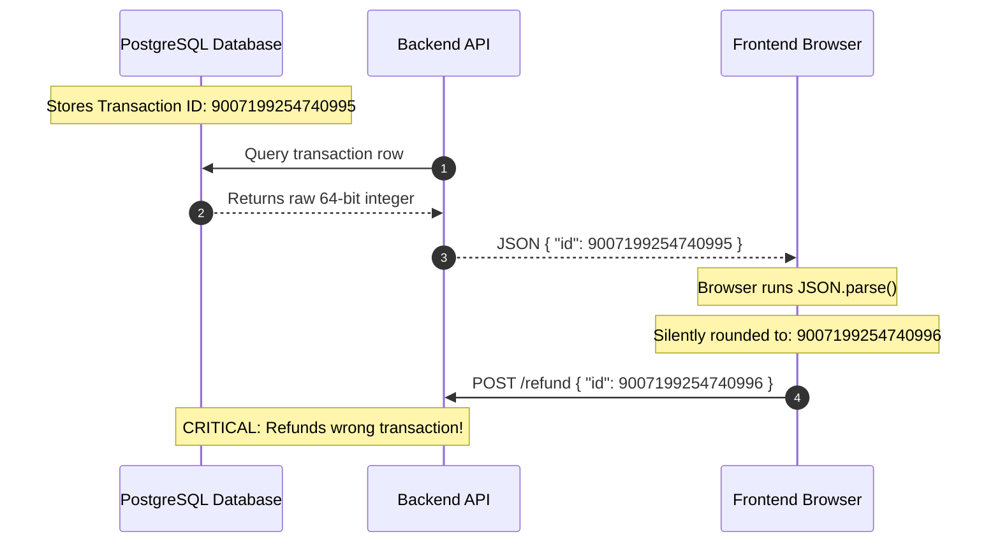

# Serialization (JSON, Protobuf, and BigInt Precision)

> **In 30 seconds:** Serialization converts an in-memory object into a stream of text or bytes so you can send it across a network or save it to disk. If you send large 64-bit database IDs over standard JSON, JavaScript silently rounds the last digits. Two different users end up with the same ID, and your app updates the wrong bank account.

---

## The story

Consider this realistic engineering scenario: A fintech payment startup uses PostgreSQL to store account balances.

PostgreSQL generates 64-bit integers (`BIGINT`) for transaction IDs. The database reaches transaction number `9007199254740995`.

A customer requests a refund for that transaction. The backend pulls the row from the database and sends it to the customer dashboard as standard JSON:

```json
{
  "transactionId": 9007199254740995,
  "amount": 250.00
}
```

The web dashboard uses standard JavaScript:

```javascript
const data = JSON.parse(responseBody);
console.log(data.transactionId);
// Outputs: 9007199254740996 (Notice the last digit changed from 5 to 6!)
```

JavaScript silently rounded the number because standard JavaScript numbers cannot safely hold integers larger than $2^{53} - 1$.

When the customer clicks "Confirm Refund", the frontend sends back the rounded ID `9007199254740996`. That ID belongs to a completely different customer. The server processes the refund against the wrong person's balance.

In real life, Twitter hit this exact issue in 2010. Tweet IDs grew so large that third-party JavaScript clients began opening the wrong tweets. Twitter had to add an extra `id_str` field to every single API response to send the ID as a string.

---

## The analogy

Think of flat-pack furniture:

- **An in-memory object:** A fully assembled wooden wardrobe standing in your bedroom. You cannot shove an entire assembled wardrobe through a small car window.
- **Serialization:** Taking the wardrobe apart, putting the wooden boards and screws into a flat cardboard box, and sealing it with tape.
- **Deserialization:** Unpacking the box at your friend's house and assembling the wardrobe again using the manual.
- **The BigInt bug:** Imagine your tape measure has millimeter marks up to 90 inches. Above 90 inches, the manufacturer only printed marks every two inches. If a wooden beam is 91 inches long, your tape forces you to guess 90 or 92. Two different boards get cut to the same wrong length, and the wardrobe collapses.

---

## What it is

**Serialization** turns data stored in computer memory (like JavaScript objects, arrays, and maps) into a flat format (like text or raw bytes) so it can travel across a network wire or sit in a file.

**Deserialization** is the reverse process. It reads that flat format and reconstructs it back into live objects in memory.

### The 3 major formats in production:

1. **JSON (JavaScript Object Notation):** Text-based, human-readable, and supported by every programming language. Every message repeats field names (`"user_id"`, `"email"`), making payloads larger and slower to parse at massive scale.
2. **Protobuf (Protocol Buffers):** Binary format created by Google. Instead of repeating field names as text, it uses tiny numeric tags (like `1` for ID, `2` for email). Messages are 60% to 80% smaller and parse up to 6 times faster than JSON.
3. **MessagePack:** A binary format that keeps JSON-like flexibility without requiring a schema definition file.

---

## The BigInt Trap: Why 9007199254740995 breaks in JSON

In JavaScript, all standard numbers are 64-bit floating-point numbers (following the IEEE-754 standard).

This means JavaScript has a hard limit for exact integers:
- Maximum safe integer: `Number.MAX_SAFE_INTEGER` = $2^{53} - 1$ = **`9,007,199,254,740,991`**
- Beyond this number, JavaScript loses precision. It rounds odd numbers to the nearest even number.
- Databases like PostgreSQL, MySQL, and Snowflake use 64-bit integers (`BIGINT`), which go up to **`9,223,372,036,854,775,807`**.

When a database sends a 64-bit integer inside standard JSON, `JSON.parse()` converts it to a standard JavaScript float before your code ever touches it. The number is corrupted before you can even run a check.

---

## How it works

The diagrams below contrast how precision loss corrupts data, and how string serialization protects it:

### Scenario A: The Silent Precision Trap (JSON Numbers)

When large database IDs travel as plain numbers in JSON, JavaScript runtimes round the values:



### Scenario B: The Production Defense (String or Protobuf Encoding)

When 64-bit IDs travel as strings, text preserves every single digit accurately:


---

## Broken vs fixed

### Broken: Sending large 64-bit integers as JSON numbers

This code looks clean, but silently corrupts IDs larger than 9 quadrillion:

```javascript
// BROKEN: Raw numbers in JSON lose precision
app.get("/api/orders/:id", async (req, res) => {
  const order = await db.orders.findById(req.params.id);
  // order.id is a BigInt from the database: 9007199254740995n

  // Serializing BigInt directly throws a TypeError in Node.js:
  // "Do not know how to serialize a BigInt"
  // If converted to Number(order.id), it silently rounds!
  return res.json({
    id: Number(order.id), // Corrupted to 9007199254740996
    total: order.total
  });
});
```

### Fixed: Serialize 64-bit numbers as strings

This code ensures that every digit survives the network transit unchanged:

```javascript
// FIXED: Convert 64-bit BigInts to strings before JSON serialization
app.get("/api/orders/:id", async (req, res) => {
  const order = await db.orders.findById(req.params.id);

  return res.json({
    // Always transmit 64-bit IDs as strings
    id: order.id.toString(), // "9007199254740995"
    total: order.total
  });
});

// If using custom JSON stringification, teach it how to handle BigInt:
BigInt.prototype.toJSON = function () {
  return this.toString();
};
```

---

## Try it yourself

Run the demo script in this folder:

```bash
node docs/01-foundations/003-serialization-json-protobuf-and-bigint-precision/demo.mjs
```

### What the demo proves

The demo script runs three comparisons:
1. It parses a raw JSON payload with a large ID as a number. You will see JavaScript change the value in real time.
2. It parses the same ID sent as a string and wraps it in a native `BigInt()`. The value remains 100% exact.
3. It compares payload sizes: sending a collection of records as JSON text versus packed binary tags, showing why high-scale systems switch to Protobuf.

---

## Comparison: JSON vs Protobuf vs MessagePack

| Feature | JSON | Protobuf | MessagePack |
| :--- | :--- | :--- | :--- |
| **Data Format** | Plain text | Compact binary | Compact binary |
| **Human Readable?** | Yes, open in any editor | No, requires schema to decode | No, binary viewer needed |
| **Field Names Sent?** | Yes, full text every time | No, uses 1-byte number tags | Yes, but compressed |
| **Payload Size** | 100% (Baseline) | ~20% to 40% of JSON | ~50% to 70% of JSON |
| **Parsing Speed** | Moderate (CPU heavy on 10MB+) | Up to 6x faster | Up to 2x faster |
| **Schema Required?** | Optional | Required (`.proto` file) | Optional |
| **Best Used For** | Public APIs, web dashboards | Internal microservices, gRPC | Caching layers, Redis values |

---

## When to use it

- Use **JSON with string IDs** for public web APIs, customer-facing mobile apps, and third-party webhook integrations. It is universal and easy to inspect.
- Use **Protobuf** when internal backend microservices exchange thousands of requests per second, or when network bandwidth between data centers is a major cloud cost.
- Use **native `BigInt`** in Node.js and modern browsers whenever you perform arithmetic or equality comparisons on database IDs, Snowflake identifiers, or financial timestamps.

---

## When to skip it

- Do not use Protobuf for public-facing browser APIs unless you have a dedicated toolchain. Browsers cannot natively parse Protobuf without extra JavaScript libraries, which adds bundle weight.
- Do not convert every small integer (like `status: 1` or `quantity: 3`) to a string. Only 64-bit numbers that exceed `9,007,199,254,740,991` require string wrapping.

---

## Common mistakes

- **Assuming TypeScript types protect JSON data:** TypeScript types disappear when your code runs. A type of `id: number` in TypeScript will not prevent JavaScript from corrupting a 64-bit float at runtime.
- **Forgetting that Date objects serialize to strings:** When you run `JSON.stringify({ date: new Date() })`, the Date turns into an ISO string. When you run `JSON.parse()`, it does not turn back into a Date object; it stays a string.
- **Serializing sensitive internal fields:** Calling `JSON.stringify(user)` directly on a database model can leak `password_hash` or `internal_notes` to the client. Always pick explicit fields to serialize.

---

## Self-test

<details>
<summary>Question 1: What is the exact maximum safe integer in standard JavaScript, and why does this limit exist?</summary>
<strong>Answer:</strong> <code>9,007,199,254,740,991</code> (which is <code>2^53 - 1</code>). This limit exists because JavaScript represents all numbers using the IEEE-754 double-precision floating-point format, which allocates 53 bits for the integer significand.
</details>

<details>
<summary>Question 2: Why did Twitter introduce an 'id_str' field alongside their numeric 'id' field in API responses?</summary>
<strong>Answer:</strong> As Twitter grew, tweet IDs exceeded <code>2^53 - 1</code>. When third-party JavaScript clients ran <code>JSON.parse()</code> on the numeric IDs, the numbers were silently rounded, causing links and retweets to target the wrong tweets. Providing <code>id_str</code> allowed JavaScript clients to read the exact ID without float corruption.
</details>

<details>
<summary>Question 3: Why does Protobuf serialize data into smaller payloads than JSON?</summary>
<strong>Answer:</strong> JSON repeats every field name in plain text across every message (for example: <code>"transaction_id"</code>). Protobuf compiles field names into small integer tags (for example: field tag <code>1</code>) and encodes numbers using variable-length zigzag binary encodings, stripping out redundant text and formatting whitespace.
</details>

---

## Interview angle

1. **"How would you handle a situation where a PostgreSQL table uses 64-bit BIGINT primary keys, but your web frontend is written in React?"**
   *Model answer:* In the backend API serialization layer, ensure that all 64-bit IDs are cast to strings before emitting JSON responses. In the React frontend, store and pass the IDs as strings. If numerical comparisons are necessary, parse them using native JavaScript <code>BigInt("...")</code> rather than standard <code>Number()</code> or <code>parseInt()</code>.

2. **"When would you recommend migrating an internal service-to-service architecture from REST/JSON to gRPC/Protobuf?"**
   *Model answer:* When internal services exchange high volumes of RPC calls where JSON parsing CPU overhead or payload network bandwidth becomes a bottleneck. Protobuf provides strict backwards-compatible contract enforcement via schemas, eliminates field name redundancy, and parses significantly faster, freeing up server CPU for business logic.

---

## Cheat sheet

- Numbers above `9,007,199,254,740,991` lose precision in JavaScript; always send 64-bit IDs as strings.
- Standard `JSON.parse()` corrupts large numbers before you can inspect them.
- JSON repeats field names; Protobuf uses binary numeric tags, saving 60% or more in bandwidth.
- Dates turn into strings in JSON; they do not automatically convert back into Date objects.
- Never blindly serialize raw database models; always select explicit fields to prevent data leaks.

---

## Related concepts

- [HTTP Status Codes and Error Semantics](../001-http-status-codes-and-error-semantics/README.md)
- [API Contract Drift and Schema Validation](../002-api-contract-drift-and-schema-validation/README.md)
- [Money Handling and Fixed-Point Math](../010-money-handling/README.md)

---

## Sources

- [ECMAScript Specification: Number.MAX_SAFE_INTEGER](https://developer.mozilla.org/en-US/docs/Web/JavaScript/Reference/Global_Objects/Number/MAX_SAFE_INTEGER)
- [Google Protocol Buffers Documentation](https://protobuf.dev/)
- [Twitter Developer Documentation: The BigInt ID Issue (id_str)](https://developer.twitter.com/en/docs/twitter-ids)
