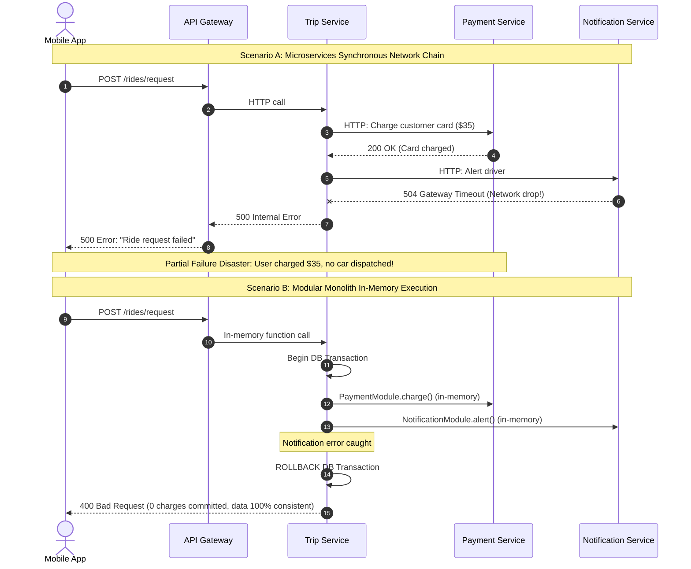

# Monolith vs Modular Monolith vs Microservices

> **In 30 seconds:** A monolith runs your entire backend as a single application on one server. Microservices split your backend into dozens of tiny independent servers communicating over the network. A modular monolith gives you the clean domain boundaries of microservices without the network latency, partial outages, or operational overhead of running 40 separate servers.

---

## The story

Consider this realistic engineering scenario: A fast-growing ride-sharing startup with six engineers decides their single Node.js codebase is too big. Inspired by tech conference talks from giant tech companies, they decide to rewrite everything into microservices.

They split the backend into fourteen distinct services: `auth-service`, `driver-service`, `rider-service`, `trip-service`, `pricing-service`, `payment-service`, and `notification-service`. Each service gets its own GitHub repository and its own independent database.

At first, the team feels excited. But three weeks after shipping to production, problems begin.

When a customer opens the mobile app and taps "Request Ride", the request triggers a chain of nine synchronous HTTP requests across seven different microservices:

1. `trip-service` calls `rider-service` to verify the rider account.
2. `trip-service` calls `pricing-service` to calculate the fare.
3. `pricing-service` calls `driver-service` to find the nearest three drivers.
4. `trip-service` calls `payment-service` to hold funds on the customer's credit card.
5. `trip-service` calls `notification-service` to send a push alert to the selected driver.

On a busy Friday night, `notification-service` suffers a minor database connection slowdown, adding a 400 millisecond delay to each request.

Because `trip-service` waits synchronously for `notification-service`, requests pile up. Within three minutes, the server thread pool on `trip-service` exhausts all available memory. Then the API gateway starts timing out with `504 Gateway Timeout`. The entire ride-sharing platform collapses.

Worse, when `notification-service` crashed, `payment-service` had already charged the customer $35.00, but `trip-service` never finished dispatching the driver. The customer was charged, but no car ever arrived. Because the data was split across separate databases, there was no single database transaction to roll back the charge.

The engineering team spent the next six months debugging Kubernetes manifests, distributed tracing, network retries, and reconciliation scripts instead of building features for riders.

---

## The analogy

Think of preparing dinner in a kitchen:

- **Monolith:** You are in a home kitchen. The refrigerator, cutting board, stove, and spice rack are all in the same room. Reaching for the salt takes one second. Everything is within arm's reach.
- **Microservices:** You move every appliance into a different house on your street. The stove is at house #12, the cutting board is at house #18, and the salt is at house #44. Every time you slice an onion, you put on your coat, walk down the street, knock on your neighbor's door, wait for them to answer, and walk back. If house #18 is locked, your entire dinner is ruined.
- **Modular Monolith:** You stay in your single kitchen, but you organize your drawers with strict labels: "Baking", "Spices", "Knives". Nobody throws frying pans into the silverware drawer. You have clean organization, but reaching for salt is still an instant, in-memory reach that never fails due to bad weather or locked doors.

---

## What it is

Architectures fall into three primary categories:

| Dimension | Monolith | Modular Monolith | Microservices |
| :--- | :--- | :--- | :--- |
| **Deployment units** | 1 single application | 1 single application | Dozens of independent services |
| **Communication** | In-memory function calls | In-memory function calls | Network calls (HTTP, gRPC, Queues) |
| **Communication latency** | Nanoseconds (0 ms) | Nanoseconds (0 ms) | Milliseconds (10 to 200 ms per hop) |
| **Data consistency** | Strong ACID transactions | Strong ACID transactions | Eventual consistency (Sagas) |
| **Failure modes** | Process crash affects all | Process crash affects all | Network timeouts, cascading outages |
| **Operational complexity** | Low (Single CI/CD, simple logs) | Low (Single CI/CD, simple logs) | Extremely high (Kubernetes, mesh, tracing) |
| **Team size sweet spot** | 1 to 20 engineers | 1 to 100+ engineers | 100+ engineers across multiple teams |

### 1. Traditional Monolith

A single codebase where all code runs in one process and shares one database. In unmanaged monoliths, code often becomes tightly coupled (known as a "big ball of mud"), where any controller can query any database table directly.

### 2. Modular Monolith

A single codebase and single deployable process, but with strictly enforced module boundaries inside the code.
- Module A cannot import internal files from Module B.
- Module A cannot query Module B's database tables directly.
- Communication between modules happens through explicit public interfaces or internal domain events.
- Because everything runs in one process, calls between modules are instant in-memory function calls, and multi-step actions can share a single ACID database transaction.

### 3. Microservices

An architecture where business domains are split into independently deployable applications. Each microservice owns its private database. Services communicate across physical networks using HTTP, gRPC, or message brokers like Kafka or RabbitMQ.

---

## How it works

The sequence diagram below illustrates the fragility of microservice network chains compared to the resilience of in-memory modular execution:



### Walkthrough of the Steps

1. **User requests an action:** A user submits an order or ride request.
2. **Scenario A (Microservices Chain):**
   - The request hops across the network to `Trip Service`.
   - `Trip Service` calls `Payment Service` over HTTP. The credit card is charged.
   - `Trip Service` calls `Notification Service` over HTTP.
   - The network drops or the notification server times out.
   - The call fails halfway through. The customer was charged, but the ride record was never created. Because the services have separate databases, rolling back requires building complex compensating transactions (the Saga pattern).
3. **Scenario B (Modular Monolith):**
   - The controller opens a single database transaction.
   - It calls `PaymentModule` and `NotificationModule` as regular in-memory function calls. There is zero network delay.
   - If an error occurs at any point, the catch block issues a standard SQL `ROLLBACK`. All changes undo instantly and completely.

---

## Broken vs fixed

### Broken: The distributed HTTP call cascade

Here is the microservice approach where simple operations are split across network boundaries, introducing network latency and partial failure states:

```javascript
// order-service/checkout.js (MICROSERVICES ANTI-PATTERN)
export async function checkout(userId, cart) {
  // Network Hop 1: Call payment service over HTTP
  const paymentRes = await fetch('http://payment-service.internal/charge', {
    method: 'POST',
    body: JSON.stringify({ userId, amount: cart.total }),
  });
  const payment = await paymentRes.json();

  // Network Hop 2: Call inventory service over HTTP
  // DANGER: If this call fails or times out, the user has already been charged!
  const inventoryRes = await fetch('http://inventory-service.internal/reserve', {
    method: 'POST',
    body: JSON.stringify({ items: cart.items }),
  });

  if (!inventoryRes.ok) {
    // Handling distributed rollback over HTTP is notoriously fragile
    await fetch('http://payment-service.internal/refund', {
      method: 'POST',
      body: JSON.stringify({ transactionId: payment.id }),
    });
    throw new Error('Inventory reservation failed. Refund attempted.');
  }

  return { success: true };
}
```

### Fixed: Clean modular monolith with atomic transactions

Here is the modular monolith approach. Modules have clean boundaries, but run in the same process and use an ACID database transaction:

```javascript
// monolith/modules/orders/checkout.js (MODULAR MONOLITH)
import { paymentModule } from '../payment/index.js';
import { inventoryModule } from '../inventory/index.js';
import { db } from '../../database/index.js';

export async function checkout(userId, cart) {
  // Wrap the entire multi-step process in a single ACID transaction
  return await db.transaction(async (tx) => {
    // Step 1: In-memory call (0 ms network overhead)
    const payment = await paymentModule.stageCharge(tx, {
      userId,
      amount: cart.total,
    });

    // Step 2: In-memory inventory reservation
    // If this throws an error, the database transaction rolls back automatically!
    await inventoryModule.reserveItems(tx, {
      items: cart.items,
    });

    // Step 3: Record order
    const order = await tx.orders.create({
      userId,
      total: cart.total,
      paymentId: payment.id,
    });

    return order;
  });
}
```

---

## Try it yourself

Run the zero-dependency demonstration script included in this folder:

```bash
node docs/01-foundations/006-monolith-vs-modular-monolith-vs-microservices/demo.mjs
```

### What the demo shows

1. **Microservices Failure Mode:** Demonstrates 3 sequential network hops. When hop 3 suffers a network timeout, the user is left in a broken partial state: money was charged, but no order was created.
2. **Modular Monolith Execution:** Runs the exact same checkout workflow using in-memory module calls inside a transaction. When an error occurs, the transaction rolls back cleanly in zero milliseconds with zero inconsistent data left behind.

---

## Where you have seen it

- **Shopify:** Powers over 10% of total US e-commerce on a massive, highly optimized modular Ruby on Rails monolith serving over 1 million requests per second.
- **Amazon Prime Video (2023):** Migrated their video quality monitoring service from distributed microservices and AWS Lambda functions back to a monolithic architecture, cutting infrastructure costs by 90% and eliminating scaling bottlenecks.
- **Basecamp and 37signals:** Famously left the public cloud and operates high-scale collaborative software with millions of users on monolithic application servers.
- **Stack Overflow:** Serves tens of millions of monthly developers using a small, highly efficient monolithic web application running on a handful of on-premise servers.

---

## When to use it

### When to choose a Monolith or Modular Monolith:
- You are an early-stage startup or building a new product from scratch.
- Your engineering team has fewer than 50 to 100 developers.
- Your business domain is still evolving rapidly and boundaries are shifting.
- You require strict, immediate consistency (such as banking balances or inventory reservations).
- You want to maximize developer velocity and minimize cloud hosting costs.

### When to choose Microservices:
- You have hundreds of engineers divided into independent teams that constantly step on each other's toes in a single git repository.
- A specific subsystem has drastically different hardware requirements (such as a GPU-intensive video transcoding pipeline compared to a lightweight CRUD API).
- Different teams require completely independent release cycles and deployment schedules.

---

## When to skip it

- **Do not adopt microservices to solve messy code:** If your team cannot write clean code in a single repository, splitting that code across 30 repositories will only produce a distributed messy codebase.
- **Do not adopt microservices for early scalability:** A well-tuned monolithic backend running on modern hardware can easily handle tens of thousands of requests per second.

---

## Common mistakes

- **The Distributed Monolith:** Splitting your code into 20 microservices, but having all of them connect to the same shared PostgreSQL database. You get all the network latency and deployment complexity of microservices, but none of the isolation or independent scaling.
- **Synchronous HTTP Cascades:** Chaining 5 to 10 HTTP requests sequentially to answer a single client request. The total latency is the sum of every hop, and the chance of failure multiplies with every server added to the chain.
- **Premature Decomposition:** Breaking a service apart before the business domain is understood. When boundaries are wrong, a single feature change requires modifying and coordinating deployments across four different repositories.
- **Neglecting Module Boundaries in Monoliths:** Allowing controllers to directly reach into internal private helpers of other features. Always enforce public module interfaces (for example, with ESLint import rules or package boundaries).

---

## Self-test

<details>
<summary>Question 1: What is a "distributed monolith", and why is it considered the worst possible backend architecture?</summary>

A distributed monolith occurs when a system is decomposed into separate microservice repositories and processes, but those services share a single database or require tightly coupled, coordinated deployments. You suffer all the operational pain of microservices (network latency, partial failure modes, complex deployments) while remaining handcuffed to a single database schema and deployment bottleneck.
</details>

<details>
<summary>Question 2: How does a Modular Monolith enforce domain boundaries without paying the performance cost of network calls?</summary>

A modular monolith enforces boundaries at compile-time or lint-time using module interfaces, package boundaries, or language visibility rules (such as internal exports). Module A can only call explicitly exposed functions from Module B's public interface. Because both modules compile into the same application process, function calls execute in nanoseconds in memory without network overhead.
</details>

<details>
<summary>Question 3: Why is achieving atomic data consistency so much harder in microservices than in a monolith?</summary>

In a monolith, multiple tables can be modified inside a single ACID database transaction. If any step fails, the database automatically rolls back every change. In microservices, each service has its own database. There is no distributed database transaction across network boundaries, so developers must implement compensating transactions (the Saga pattern) to manually undo earlier steps if a downstream call fails.
</details>

---

## Interview angle

1. **"Our leadership wants to migrate our monolithic backend to microservices to improve scalability. How would you evaluate whether this is the right decision?"**
   - Model answer: I would begin by identifying the specific bottleneck. Scalability is rarely solved by microservices alone; a monolith can be horizontally scaled by running multiple identical stateless instances behind a load balancer.
   - I would ask:
     1. Is the bottleneck organizational (too many developers causing deployment gridlock) or computational?
     2. Are there specific components with wildly different resource profiles (e.g. video processing vs CRUD APIs)?
   - If the issue is messy code or slow tests, I would recommend refactoring into a Modular Monolith first. Migrating to microservices before domain boundaries are stable almost always creates an expensive distributed monolith.

2. **How do you handle data consistency when an operation spans across two separate microservices without distributed locking?**
   - Model answer: The industry standard pattern is the Saga pattern. Instead of a single atomic transaction, the workflow is broken into a series of local transactions.
   - Each local transaction updates its own database and publishes an event or message.
   - If a step fails, the saga orchestrator publishes compensating events that execute compensating transactions (like issuing a refund) to undo the changes made by earlier steps.
   - This achieves eventual consistency, but requires handling idempotency, out-of-order events, and temporary inconsistent states.

---

## Cheat sheet

- **Default to Modular Monolith:** Start with a modular monolith. It gives you clean boundaries, instant function calls, and simple deployments.
- **Microservices are organizational:** Microservices solve team scaling problems for large companies, not technical problems for small teams.
- **Avoid the distributed monolith:** Never split services while sharing a single database.
- **Network calls fail:** Every microservice hop introduces latency, connection limits, and potential timeout failures.
- **Use ACID transactions:** Keep related business entities that require strict consistency inside the same database boundary.

---

## Related concepts

- [001: HTTP Status Codes and Error Semantics](../001-http-status-codes-and-error-semantics/README.md)
- [027: Cascading Failures and Thundering Herd](../../02-api-reliability/027-cascading-failures-and-thundering-herd/README.md)
- [008: Pagination (Offset vs Cursor)](../008-pagination-offset-vs-cursor/README.md)

---

## Sources

- [Martin Fowler: MonolithFirst](https://martinfowler.com/bliki/MonolithFirst.html)
- [Amazon Prime Video: Scaling video quality monitoring with Monolithic Architecture](https://www.primevideotech.com/video-streaming/scaling-up-the-prime-video-audio-video-monitoring-service-and-reducing-costs-by-90)
- [Shopify Engineering: Deconstructing the Monolith](https://shopify.engineering/deconstructing-the-monolith-designing-software-that-maximizes-developer-productivity)
