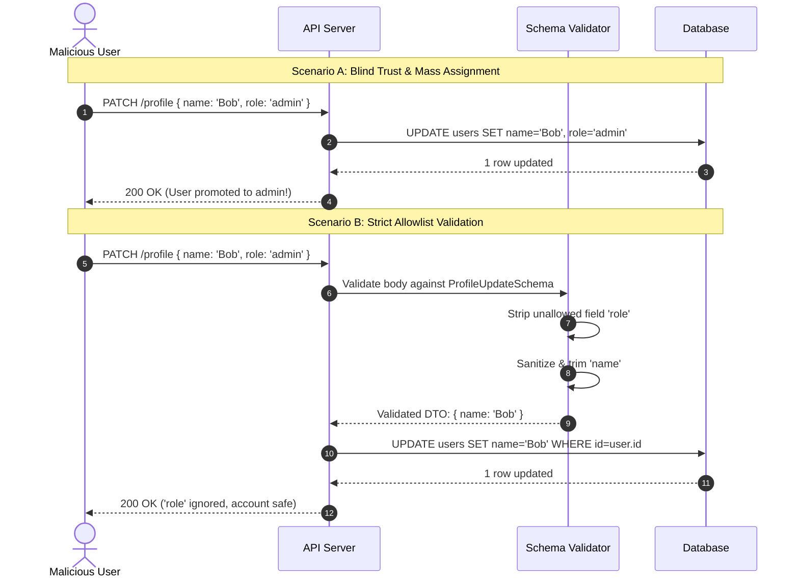

# Input Validation and Sanitization

> **In 30 seconds:** Validation checks whether incoming data conforms to strict rules before your code touches it (like a bouncer rejecting someone with a fake ID). Sanitization cleanses or neutralizes messy characters before storing or displaying them (like washing fruit before eating it). If you blindly trust incoming client data, attackers can hijack administrator accounts, inject malicious scripts, or crash your database.

---

## The story

Consider this realistic engineering scenario: A team builds an online developer community platform called DevCircle. The app has a settings page where users can update their profile bio and display name.

The backend endpoint is written with modern Express.js:

```javascript
app.patch('/api/users/profile', authenticateUser, async (req, res) => {
  // Grab the logged-in user from the session
  const user = req.user;

  // Update user with the incoming JSON body
  await db.users.update(user.id, req.body);

  res.json({ success: true });
});
```

The developer thinks: "This is completely safe. The user is logged in, so we know who they are. They are just updating their own profile."

A curious user opens their terminal and sends an HTTP request using `curl`:

```bash
curl -X PATCH https://devcircle.example.com/api/users/profile \
  -H "Authorization: Bearer my-session-token" \
  -H "Content-Type: application/json" \
  -d '{"name": "Carol", "role": "admin", "isVerified": true}'
```

Because the code blindly passed `req.body` directly to the database update query, the database updated `name`, but it also updated `role` to `"admin"` and `isVerified` to `true`.

Carol refreshes her browser. She now has full administrator access: she can view private user emails, ban other accounts, and download the entire customer database.

This classic security failure is called **Mass Assignment** (or Over-Posting). It happened because the backend never validated which fields the client was allowed to submit.

---

## The analogy

Think of going through airport security:

- **Validation:** The security officer at the metal detector. They check your passport and bag. If you try to bring a large canister of gasoline through security, they do not try to "clean" the gasoline or dilute it with water. They stop you immediately and say: "No, this is strictly forbidden." That is validation: rejecting bad data at the boundary.
- **Sanitization:** The customs inspection station that washes soil off the tires of vehicles arriving from overseas before letting them enter the country. The vehicle is allowed in, but dangerous foreign seeds and bacteria are scrubbed away.
- **Output Encoding:** Putting dangerous cargo into a sealed, shockproof shipping container. Even if the cargo inside is acid or broken glass, the container prevents it from interacting with the outside world during transport.

---

## What it is

Input defense consists of three distinct stages:

| Stage | What it does | When it runs | Action taken on failure |
| :--- | :--- | :--- | :--- |
| **Validation** | Checks format, type, range, and allowed keys against a strict schema | First (entry point) | Rejects request with `400 Bad Request` |
| **Sanitization** | Strips invisible control characters, null bytes, and trims whitespace | Second (processing) | Cleanses data silently |
| **Output Encoding** | Converts sensitive characters (like `<` or `>`) into safe entities | Third (rendering/storage) | Renders data safely in HTML, SQL, or logs |

### The Golden Rule: Allowlist over Blocklist

There are two ways to write validation rules:
1. **Blocklist (The Flawed Way):** Trying to list every bad thing you want to block (e.g. "Reject anything containing `<script>` or `DROP TABLE`"). Attackers always bypass blocklists using casing tricks (`<sCrIpT>`), URL encoding, or null byte injections.
2. **Allowlist (The Secure Way):** Defining the exact shape of what is allowed and rejecting everything else.
   - "The `age` field must be an integer between 18 and 120."
   - "The `username` field must be 3 to 20 alphanumeric characters."
   - "Only `name` and `bio` fields can be updated. All other keys are dropped."

---

## How it works

The sequence diagram below compares naive blind processing with strict allowlist validation:



### Walkthrough of the Steps

1. **Incoming Request:** An attacker sends a payload containing both legitimate profile data (`name`) and unauthorized system fields (`role: "admin"`).
2. **Scenario A (Broken):** The server blindly merges the request body into the database query. The user gains administrative privileges immediately.
3. **Scenario B (Secure):** The server passes the payload to a schema validator before running any business logic.
4. **Allowlist filtering:** The validator discards `role` because it does not exist in the allowed field list for profile updates.
5. **Sanitization:** The `name` string is trimmed and stripped of invisible control characters.
6. **Scoped execution:** Only the clean, validated fields are written to the database.

---

## Broken vs fixed

### Broken: Blindly merging request bodies into database queries

Here is the vulnerable pattern seen in many beginner Node.js applications:

```javascript
// routes/profile.js - VULNERABLE TO MASS ASSIGNMENT
app.patch('/api/profile', async (req, res) => {
  const userId = req.user.id;

  // DANGER: Blindly passing req.body to the database update
  // An attacker can overwrite account balance, role, or email verification status!
  const updatedUser = await db.user.update({
    where: { id: userId },
    data: req.body,
  });

  res.json(updatedUser);
});
```

### Fixed: Strict allowlist Data Transfer Object (DTO)

Here is the secure production implementation using explicit field allowlists and input boundaries:

```javascript
// routes/profile.js - PRODUCTION SAFE
function validateProfileInput(body) {
  const allowed = {};
  const errors = [];

  // 1. Only allow specific fields
  if (body.name !== undefined) {
    if (typeof body.name !== 'string') {
      errors.push('Name must be a string');
    } else {
      const trimmed = body.name.trim();
      if (trimmed.length < 2 || trimmed.length > 50) {
        errors.push('Name must be between 2 and 50 characters');
      } else {
        allowed.name = trimmed;
      }
    }
  }

  if (body.bio !== undefined) {
    if (typeof body.bio !== 'string') {
      errors.push('Bio must be a string');
    } else {
      const trimmed = body.bio.trim();
      if (trimmed.length > 250) {
        errors.push('Bio cannot exceed 250 characters');
      } else {
        allowed.bio = trimmed;
      }
    }
  }

  return { errors, data: allowed };
}

app.patch('/api/profile', async (req, res) => {
  const { errors, data } = validateProfileInput(req.body);

  if (errors.length > 0) {
    return res.status(400).json({ errors });
  }

  // SAFE: Only allowlisted, sanitized fields are passed to the database
  const updatedUser = await db.user.update({
    where: { id: req.user.id },
    data: data,
  });

  res.json({
    id: updatedUser.id,
    name: updatedUser.name,
    bio: updatedUser.bio,
  });
});
```

---

## Try it yourself

Run the zero-dependency demonstration script included in this folder:

```bash
node docs/01-foundations/007-input-validation-and-sanitization/demo.mjs
```

### What the demo shows

1. **Mass Assignment Attack:** Shows how a naive `Object.assign()` call allows a standard member to elevate themselves to a superuser with `isAdmin: true`.
2. **Oversized String Input:** Demonstrates how unbounded input strings consume excessive resources.
3. **Allowlist Validator in Action:** Proves how a strict schema drops unauthorized fields (`role`, `isAdmin`), safely encodes HTML in user bios, and rejects payloads that exceed length boundaries with a clean `400 Bad Request`.

---

## Where you have seen it

- **GitHub Mass Assignment (2012):** Security researcher Egor Homakov discovered that GitHub's public key upload form allowed mass assignment. By appending an extra form parameter, he added his own SSH public key directly to the official Ruby on Rails organization, proving he could push code to Rails core repositories.
- **Node.js ReDoS Outages:** Multiple open-source libraries experienced outages caused by catastrophic regex backtracking when validating unconstrained email or URL inputs.
- **Form Injection:** Cross-Site Scripting (XSS) attacks in customer support portals where unescaped user support tickets execute JavaScript inside support agents' browsers.

---

## When to use it

- **Every external entry point:** Every JSON request body, URL query parameter, URL path parameter, and incoming HTTP header.
- **Webhook consumers:** Webhooks from payment providers or external partners must be verified and validated before processing.
- **File uploads:** File names, MIME types, and file extensions must be strictly validated before saving files to disk or object storage.

---

## When to skip it

- **Never skip validation on untrusted input.**
- You can skip aggressive sanitization on internal binary payloads (like encrypted byte streams or images), but you must still validate their byte size and format signatures.

---

## Common mistakes

- **Relying on frontend validation:** HTML5 attributes like `<input required type="email" maxlength="50">` are for user convenience only. Anyone can bypass frontend validation in two seconds using `curl`, Postman, or browser developer tools.
- **Using blocklists instead of allowlists:** Checking if a string contains `"<script>"` will fail against `<svg onload=alert(1)>`, ``, or URL-encoded equivalents.
- **Sanitizing SQL inputs instead of using parameterized queries:** Trying to escape SQL quotes manually is a classic mistake. Always use parameterized prepared statements (`$1`, `$2` or `?`). Parameterization separates SQL code from data completely.
- **Forgetting max length limits:** Forgetting to limit string length allows attackers to send 50MB strings that choke JSON parsers and exhaust database memory.
- **Mass assignment in ORMs:** Using `User.create(req.body)` or `User.update(req.body)` directly without a Data Transfer Object (DTO) or parameter permit list.

---

## Self-test

<details>
<summary>Question 1: What is the difference between input validation and output encoding, and which one protects against Cross-Site Scripting (XSS)?</summary>

Input validation verifies that data conforms to expected rules (e.g., "is this a valid date?") at the API boundary. Output encoding translates special characters (like changing `<` into `&lt;`) at the moment data is rendered in a specific context (like HTML, SQL, or shell commands). Output encoding is the primary defense against XSS, because data that is valid in one context (like a user whose legal name contains an apostrophe) could be dangerous when rendered in HTML or SQL without encoding.
</details>

<details>
<summary>Question 2: Why are blocklists consistently bypassed by attackers when validating inputs?</summary>

Blocklists attempt to predict every possible malicious variation. Attackers frequently bypass blocklists by using character encoding (e.g. hex encoding, unicode homoglyphs), alternative HTML tags (`<body onload=...>` instead of `<script>`), or whitespace variations. An allowlist only permits known-safe characters and formats, rejecting everything else by default.
</details>

<details>
<summary>Question 3: How does the Mass Assignment vulnerability occur, and how do you prevent it?</summary>

Mass assignment occurs when a backend framework or ORM blindly accepts all fields from an HTTP request body and passes them directly to a database creation or update method. If an attacker includes extra fields (such as `role: "admin"` or `verified: true`), the database updates those columns. It is prevented by defining strict DTOs (Data Transfer Objects) or field allowlists that only copy explicitly permitted fields.
</details>

---

## Interview angle

1. **"How do you design a robust validation architecture across an entire backend API?"**
   - Model answer:
     - Enforce validation at the boundary before any business logic or database queries run.
     - Use a schema validation library (such as Zod, Joi, or JSON Schema) integrated into the web framework middleware.
     - Ensure the schema uses strict allowlists (stripping or rejecting unknown properties).
     - Return standardized RFC 7807 error responses indicating which fields failed and why.
     - Never rely on database-level constraint errors as the primary validation mechanism, because database errors reveal internal schema details and waste database connections.

2. **"Why is parameterization preferred over string sanitization for preventing SQL injection?"**
   - Model answer:
     - Sanitization attempts to strip or escape dangerous characters (like quotes) within a string before gluing it into a SQL statement. If an edge case is missed, injection occurs.
     - Parameterization (prepared statements) fundamentally separates code from data at the database protocol level. The SQL statement is sent to the database engine first and compiled into an execution plan. The user input is then sent separately as raw parameters.
     - Because the database engine treats parameters strictly as literal values, user input can never alter the structure of the SQL query, regardless of what characters it contains.

---

## Cheat sheet

- **Validate at the door:** Validate all input types, ranges, and formats before executing business logic.
- **Allowlists only:** Explicitly permit allowed fields and characters; reject or strip everything else.
- **Prevent mass assignment:** Never pass raw `req.body` directly into database creation or update methods.
- **Bound all lengths:** Always enforce maximum string lengths, array sizes, and payload limits.
- **Parameterize queries:** Never use string concatenation or template literals to construct database queries.

---

## Related concepts

- [001: HTTP Status Codes and Error Semantics](../001-http-status-codes-and-error-semantics/README.md)
- [002: API Contract Drift and Schema Validation](../002-api-contract-drift-and-schema-validation/README.md)
- [004: Authentication vs Authorization](../004-authentication-vs-authorization/README.md)

---

## Sources

- [OWASP Top 10: Injection Flaws](https://owasp.org/Top10/A03_2021-Injection/)
- [PortSwigger Web Security: Mass Assignment](https://portswigger.net/web-security/api-testing#mass-assignment-vulnerabilities)
- [OWASP Input Validation Cheat Sheet](https://cheatsheetseries.owasp.org/cheatsheets/Input_Validation_Cheat_Sheet.html)
