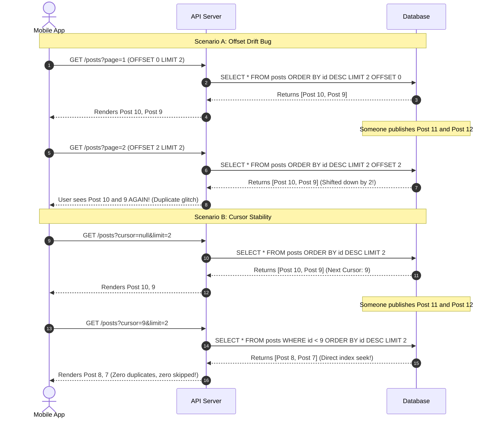

# Pagination (Offset vs Cursor)

> **In 30 seconds:** Offset pagination (`OFFSET 1000 LIMIT 20`) forces your database to read and discard 1,000 rows off disk just to return the 20 rows you asked for. When users publish new posts while someone is scrolling, items get duplicated or skipped entirely. Cursor pagination (`WHERE id < last_id LIMIT 20`) jumps straight to the target row using an index, keeping queries fast and results rock solid.

---

## The story

Consider this realistic engineering scenario: A mobile social photo-sharing app launches an infinite-scrolling activity feed.

The backend developer writes a standard SQL endpoint using offset pagination:

```sql
SELECT id, caption, created_at
FROM posts
ORDER BY created_at DESC
LIMIT 20 OFFSET :page * 20;
```

In the first two months with 10,000 posts, queries run in under 4 milliseconds. Everything feels fast and clean.

Then a celebrity joins the platform, bringing millions of active followers. Two major production failures strike at the same time:

### Problem 1: The Duplicate Post Glitch

A user named Sarah opens her feed. Her app fetches Page 1 (`OFFSET 0 LIMIT 20`). She spends 30 seconds reading posts #1 through #20.

While Sarah is reading, users publish 5 new photos. These 5 new rows are inserted at the top of the `posts` table.

Sarah scrolls down. Her phone sends a request for Page 2 (`OFFSET 20 LIMIT 20`).

Because 5 new rows pushed all existing rows down by 5 spots, posts #16 through #20 are now located at offsets 21 through 25. Sarah sees posts #16 through #20 for a second time on Page 2.

If other users had deleted posts instead, Sarah would have skipped past posts completely without ever seeing them.

### Problem 2: The 30-Second Database Meltdown

A web crawler starts indexing the platform, scraping historical posts page by page:

```sql
SELECT id, caption, created_at
FROM posts
ORDER BY created_at DESC
LIMIT 20 OFFSET 500000;
```

To fulfill this query, PostgreSQL cannot simply jump to row 500,000. It must read all 500,020 rows off the disk, sort them, count up to 500,000, throw away the first 500,000 rows, and return the final 20.

The database CPU spikes to 100%. Query times jump from 5 milliseconds to 14,000 milliseconds. Connection pools saturate, and the entire API starts throwing `504 Gateway Timeout` errors for all users worldwide.

---

## The analogy

Think of reading a 1,000-page book:

- **Offset Pagination:** You tell a friend: "Open the book to page 1. Flip through pages 1, 2, 3, and count all the way up to page 750 one page at a time. Once you reach 750, read me the next two sentences." Every single time you ask for the next two sentences, your friend has to start at page 1 and flip through hundreds of pages from scratch. As the book gets thicker, your friend collapses from exhaustion.
- **Cursor Pagination:** You leave a physical bookmark in the book exactly where you stopped reading. Next time you want to continue, you open the book directly to the bookmark in a fraction of a second. It does not matter if the book has 10 pages or 10 million pages: flipping to the bookmark is always instantaneous.

---

## What it is

Pagination divides large datasets into smaller chunks so clients can load data progressively.

| Dimension | Offset Pagination (`OFFSET n`) | Cursor Pagination (`WHERE id < cursor`) |
| :--- | :--- | :--- |
| **Database mechanism** | Full index/table scan up to offset $N$, then discards $N$ rows | Direct B-Tree index seek to cursor value |
| **Query complexity** | $O(N)$ linear time (gets slower on deep pages) | $O(1)$ constant time (stays fast on all pages) |
| **Stability under writes** | Unstable (items duplicate or skip during inserts/deletes) | 100% stable (anchored to specific record IDs) |
| **Jump to arbitrary page** | Yes ("Go to page 14") | No (only "Next" and "Previous") |
| **Best used for** | Admin dashboards with few rows and page numbers | Infinite feeds, public APIs, high-volume exports |

### How Cursor Pagination Works

Instead of saying "skip $N$ items", the client sends a pointer to the last item it received.

For example, when fetching a feed sorted from newest to oldest:
1. Client requests the first 20 items: `SELECT * FROM posts ORDER BY id DESC LIMIT 20`.
2. The last item in that batch has `id = 450`.
3. The server returns the items along with a cursor token pointing to `450`.
4. To fetch the next page, the client asks: "Give me 20 items that come after 450":
   `SELECT * FROM posts WHERE id < 450 ORDER BY id DESC LIMIT 20`.
5. The database uses its primary key B-Tree index to seek directly to `450` in microseconds. It does not scan or discard any older rows.

---

## How it works

The sequence diagram below illustrates why offset pagination causes duplicate items during concurrent writes while cursor pagination stays stable:



### Walkthrough of the Steps

1. **Page 1 fetched:** The user fetches the first batch of items (IDs 10 and 9).
2. **Concurrent write occurs:** Other users publish posts 11 and 12 at the top of the feed.
3. **Scenario A (Offset fails):** The client requests `OFFSET 2`. But because two rows were added above, the items at offset 2 and 3 are now posts 10 and 9 again. The user sees duplicate content.
4. **Scenario B (Cursor succeeds):** The client requests items strictly older than the last seen ID: `WHERE id < 9`. Even though new rows were added at the top, the condition `id < 9` ignores them completely and fetches posts 8 and 7.

---

## Broken vs fixed

### Broken: Standard offset query on large datasets

This naive implementation suffers from both performance degradation on deep pages and pagination drift:

```javascript
// routes/feed.js - DANGEROUS AT SCALE
app.get('/api/posts', async (req, res) => {
  const page = parseInt(req.query.page || '1', 10);
  const limit = parseInt(req.query.limit || '20', 10);
  const offset = (page - 1) * limit;

  // DANGER: As page grows, the database reads and discards thousands of rows!
  // If page = 10,000, the database scans 200,000 rows off disk.
  const posts = await db.query(
    'SELECT * FROM posts ORDER BY created_at DESC LIMIT $1 OFFSET $2',
    [limit, offset]
  );

  res.json({ page, posts });
});
```

### Fixed: Keyset cursor pagination with opaque tokens

Here is the production-ready cursor implementation using base64 encoded cursor tokens:

```javascript
// routes/feed.js - PRODUCTION FAST AND STABLE
function encodeCursor(timestamp, id) {
  return Buffer.from(JSON.stringify({ timestamp, id })).toString('base64');
}

function decodeCursor(cursorToken) {
  try {
    return JSON.parse(Buffer.from(cursorToken, 'base64').toString('utf8'));
  } catch {
    return null;
  }
}

app.get('/api/posts', async (req, res) => {
  const limit = Math.min(parseInt(req.query.limit || '20', 10), 100);
  const cursorParam = req.query.cursor;

  let query = '';
  let params = [];

  if (cursorParam) {
    const cursor = decodeCursor(cursorParam);
    if (!cursor) {
      return res.status(400).json({ error: 'Invalid cursor token' });
    }

    // Keyset query using indexed composite condition (created_at, id)
    // Avoids skipped rows if two posts share the same millisecond timestamp
    query = `
      SELECT * FROM posts
      WHERE (created_at, id) < ($1, $2)
      ORDER BY created_at DESC, id DESC
      LIMIT $3
    `;
    params = [cursor.timestamp, cursor.id, limit];
  } else {
    // First page
    query = `
      SELECT * FROM posts
      ORDER BY created_at DESC, id DESC
      LIMIT $1
    `;
    params = [limit];
  }

  const posts = await db.query(query, params);

  // Generate the next cursor from the last item in the list
  let nextCursor = null;
  if (posts.length === limit) {
    const lastItem = posts[posts.length - 1];
    nextCursor = encodeCursor(lastItem.created_at, lastItem.id);
  }

  res.json({
    data: posts,
    pagination: {
      nextCursor,
      hasMore: nextCursor !== null,
    },
  });
});
```

---

## Try it yourself

Run the zero-dependency demonstration script included in this folder:

```bash
node docs/01-foundations/008-pagination-offset-vs-cursor/demo.mjs
```

### What the demo shows

1. **Reproducing Offset Drift:** Simulates an active feed where two new posts arrive between page requests. Shows how `OFFSET 3` causes posts already seen on Page 1 to appear again on Page 2.
2. **Stable Cursor Pagination:** Demonstrates how passing an opaque cursor token guarantees zero duplicates and zero skipped posts despite real-time inserts.
3. **Complexity Comparison:** Simulates the difference between scanning 1,000,000 rows ($O(N)$) versus a direct B-Tree index seek ($O(1)$).

---

## Where you have seen it

- **Stripe API:** Stripe's list endpoints use cursor pagination exclusively with `starting_after` and `ending_before` parameters representing object IDs (e.g. `ch_1Mxyz...`).
- **Slack API:** Slack's conversation history API uses `cursor` and `next_cursor` tokens for channel message streams.
- **Twitter/X API:** Uses ID-based cursors (`since_id` and `max_id`) so users never miss or duplicate tweets while scrolling their timelines.
- **GitHub GraphQL API:** Implements the Relay Cursor Connection specification (`edges`, `node`, `pageInfo.endCursor`).

---

## When to use it

- **Infinite scrolling feeds:** Mobile apps and web feeds where users continuously scroll downward.
- **High-throughput data exports:** Background workers exporting millions of records from a database to an analytics warehouse or search index.
- **Public APIs:** Any public endpoint where scrapers or integrations might paginate deeply into datasets.
- **Frequently updated collections:** Any table where items are regularly inserted or deleted by concurrent users.

---

## When to skip it

- **Small, static tables:** Tables with fewer than 500 rows (such as country lists, roles, or organization settings) run fine with offset pagination.
- **UI requirements that demand random page jumps:** If a customer service agent must be able to click directly on "Page 8" or jump to the last page, offset pagination is required.
- **Arbitrary sorting options:** If users can sort a table dynamically by 10 different columns in an admin grid, creating composite B-Tree indexes for every possible cursor combination is difficult. In those cases, use offset pagination with a strict maximum page cap (e.g., maximum offset of 2,000).

---

## Common mistakes

- **Using a non-unique cursor column:** If you paginate by `WHERE created_at < :cursor` without a unique tiebreaker like `id`, any posts created in the exact same millisecond will be skipped permanently. Always use a unique composite cursor: `(created_at, id) < (:time, :id)`.
- **Exposing raw database columns in cursors:** Passing raw database IDs or SQL fragments directly to clients leaks internal implementation details. Always serialize cursors into opaque strings (like base64 tokens).
- **Allowing unlimited offsets:** If you must support offset pagination, never allow clients to pass `offset=10000000`. Enforce a strict upper limit (e.g. `Math.min(offset, 2000)`) and return `400 Bad Request` if exceeded.
- **Missing index on sort columns:** Cursor pagination only performs at $O(1)$ speed if the columns in your `ORDER BY` and `WHERE` clauses are backed by a composite index. Without an index, cursor pagination also triggers a full table scan.

---

## Self-test

<details>
<summary>Question 1: Why does offset pagination get slower the deeper a user paginates into a table?</summary>

Because SQL databases cannot jump directly to an arbitrary offset without an index pointer. For a query like `LIMIT 20 OFFSET 100000`, the database engine must read all 100,020 rows off the disk, sort them according to the `ORDER BY` clause, count to 100,000, and throw away the first 100,000 rows. The more pages you skip, the more rows the database must read and discard.
</details>

<details>
<summary>Question 2: Why must cursor pagination use a unique column or a composite tiebreaker (such as `(created_at, id)`)?</summary>

If the cursor column contains duplicate values (for example, two records created with the exact same timestamp), using `WHERE created_at < :cursor` will skip all other records that share that same timestamp on the next page. Adding a unique column like `id` as a tiebreaker (`(created_at, id) < (:time, :id)`) guarantees every single row has a strictly unique sorting position.
</details>

<details>
<summary>Question 3: Can you implement a "Jump to Page 5" button using pure cursor pagination?</summary>

No. Cursor pagination is fundamentally sequential: to know where Page 5 starts, you must know the cursor of the last item on Page 4. You cannot jump directly to an arbitrary page without reading the intervening records or pre-calculating page boundary tokens.
</details>

---

## Interview angle

1. **"How would you migrate a high-traffic API endpoint from offset pagination to cursor pagination without breaking existing mobile clients?"**
   - Model answer:
     - Keep the endpoint backward-compatible by supporting both query parameters simultaneously.
     - If the client supplies `cursor`, execute the fast keyset query.
     - If the client supplies `page`, execute the legacy offset query, but enforce a safety cap (e.g. maximum page 50) and return a deprecation warning header (`Sunset` or `Warning: 299`).
     - In the response payload, include both `page` and `next_cursor` so clients can transition smoothly.
     - Update mobile and web client libraries to adopt `next_cursor` in upcoming app releases.

2. **"How do you implement bidirectional cursor pagination (scrolling both up and down a chat history)?"**
   - Model answer:
     - For scrolling down (fetching newer messages): `WHERE (created_at, id) > ($time, $id) ORDER BY created_at ASC, id ASC LIMIT $limit`.
     - For scrolling up (fetching older history): `WHERE (created_at, id) < ($time, $id) ORDER BY created_at DESC, id DESC LIMIT $limit`.
     - Reverse the order of results in memory before sending to the client so the user interface receives items in consistent chronological order.
     - Return both `previous_cursor` and `next_cursor` in the response metadata.

---

## Cheat sheet

- **Offset skips:** `OFFSET N` reads and throws away $N$ rows. It is $O(N)$ and degrades on deep pages.
- **Cursors seek:** `WHERE id < cursor` seeks directly to the index leaf node. It is $O(1)$ and stays fast forever.
- **Offset drifts:** Inserts or deletes during pagination cause duplicate or missing items. Cursors prevent drift.
- **Tiebreaker rule:** Always pair non-unique sorting columns with a unique column: `(created_at, id)`.
- **Opaque tokens:** Always encode cursors as base64 strings so clients treat them as opaque pointers.

---

## Related concepts

- [001: HTTP Status Codes and Error Semantics](../001-http-status-codes-and-error-semantics/README.md)
- [011: Database Indexing](../../04-databases/011-database-indexing/README.md)
- [030: N+1 Queries](../../03-performance-and-caching/030-n-plus-one-queries/README.md)

---

## Sources

- [Use The Index, Luke: Paging Through Results (Keyset Pagination)](https://use-the-index-luke.com/no-offset)
- [Stripe API Reference: Pagination with Cursors](https://docs.stripe.com/api/pagination)
- [Slack API: Using Web APIs - Cursor-based Pagination](https://api.slack.com/docs/pagination)
