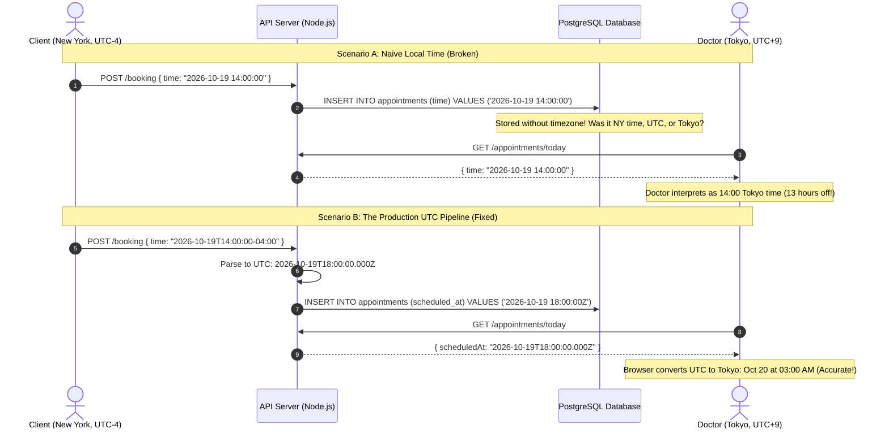

# Time, Timezones, and UTC Handling

> **In 30 seconds:** Storing local server time in your database creates chaos when Daylight Saving Time shifts clocks back an hour (generating duplicate records for the same time) or when servers in different regions compare dates. In production, always store timestamps in UTC, transmit dates using ISO 8601 strings with timezone offsets, and only convert to local time at the very last moment when displaying to the user.

---

## The story

Consider this realistic engineering scenario: A telehealth startup launches an online medical consultation platform across the United States.

The backend developer sets up a PostgreSQL database and creates an `appointments` table with a standard date column:

```sql
CREATE TABLE appointments (
  id SERIAL PRIMARY KEY,
  doctor_id INT NOT NULL,
  patient_id INT NOT NULL,
  scheduled_at TIMESTAMP NOT NULL -- Notice: TIMESTAMP WITHOUT TIME ZONE!
);
```

The database server runs on US Eastern Time (`America/New_York`).

On Sunday, November 1st, Daylight Saving Time ends at 2:00 AM. Clocks fall back by one hour to 1:00 AM.

Because the clock moves backward, the hour between 1:00 AM and 2:00 AM happens **twice** on the same night.

At 1:15 AM (before the clock shift), Patient Alice books an appointment with the night-shift doctor for 1:30 AM. The server saves `2026-11-01 01:30:00`.

Forty-five minutes later, the clock falls back one hour. At the "second" 1:15 AM, Patient Bob books an appointment with the same doctor for 1:30 AM. The server looks at the database, fails to detect any conflict because the naive string comparison matches, and saves `2026-11-01 01:30:00` for Bob as well.

At 1:30 AM, both Alice and Bob join the same video consultation room simultaneously. The doctor is confused, medical triage is delayed, and the automated billing system marks Bob's appointment as a duplicate error and cancels his insurance claim.

Even worse, when a doctor based in California logs in, the backend sends the naive string `2026-11-01 01:30:00`. The doctor's browser assumes California local time (`America/Los_Angeles`), causing the appointment to appear three hours late on the calendar.

---

## The analogy

Think of international commercial aviation:

- **The Problem:** A Boeing 777 flies from London to Tokyo. If British air traffic control, Russian airspace monitors, Japanese radar towers, and the pilots all coordinated using their own local city clocks, flight schedules would collapse. A plane departing at 2:00 PM London time and landing at 10:00 AM Tokyo time would appear to travel backward in time, making collision prediction impossible.
- **The Aviation Solution:** Aviation never uses local time for navigation. Every pilot, radar operator, and flight computer operates on **Z-time (Zulu / UTC)**. The flight departs at 14:00 UTC and lands at 01:00 UTC. The entire global system shares one unambiguous, monotonic clock.
- **Local Time as Display Only:** When the aircraft lands in Tokyo, the pilot speaks over the cabin intercom: "Welcome to Tokyo. Local time is 10:00 AM." UTC is how the system safely coordinates behind the scenes; local time is purely a convenience for human passengers.

---

## What it is

Time in software requires distinguishing between three very different concepts:

| Concept | What it represents | Example format | Best used for |
| :--- | :--- | :--- | :--- |
| **UTC (Coordinated Universal Time)** | A single, global, unambiguous reference clock with zero DST adjustments | `2026-10-19T14:30:00.000Z` | Database storage, audit logs, background jobs |
| **Unix Epoch Time** | Number of seconds (or milliseconds) elapsed since Jan 1, 1970 UTC | `1792420200` | High-performance sorting, tokens, distributed systems |
| **Local Civil Time** | What a wall clock reads in a specific geographic city | `8:00 AM in America/New_York` | Future recurring alarms, calendar UI display |

### The ISO 8601 Standard (RFC 3339)

When transmitting timestamps over JSON APIs, always use ISO 8601 formatting:

`2026-10-19T14:30:00.000Z`
- `2026-10-19`: Year, month, day.
- `T`: Separator between date and time.
- `14:30:00.000`: Hours, minutes, seconds, milliseconds.
- `Z`: Zulu time (offset of `+00:00`, meaning pure UTC).

If an offset is provided (e.g. `2026-10-19T10:30:00-04:00`), it clearly states that the local time was 10:30 AM in a zone four hours behind UTC.

---

## How it works

The sequence diagram below compares naive local timestamp storage with a robust UTC pipeline:



### Walkthrough of the Steps

1. **Client submits appointment:** The client in New York sends an unambiguous ISO 8601 string containing their local timezone offset (`-04:00`).
2. **Server normalizes to UTC:** The server parses the string and converts it directly into UTC (`18:00:00Z`).
3. **Database stores UTC:** PostgreSQL stores the timestamp using `TIMESTAMPTZ` (which stores the exact UTC epoch point on disk).
4. **Cross-region retrieval:** When a doctor in Tokyo requests appointments, the API returns the canonical UTC ISO string.
5. **Presentation conversion:** The client application uses the browser's built-in `Intl.DateTimeFormat` to render the exact equivalent local time in Tokyo (`Asia/Tokyo`).

---

## Broken vs fixed

### Broken: Naive timestamps and 24-hour arithmetic

This code uses naive strings and assumes every calendar day has exactly 24 hours (86,400,000 milliseconds):

```javascript
// Naive implementation - BREAKS DURING DST AND CROSS-REGION
app.post('/api/reminders', async (req, res) => {
  // BUG 1: String has no timezone offset
  const rawDate = req.body.date; // e.g., "2026-03-07 09:00:00"

  // BUG 2: Adding 24 hours in milliseconds to calculate tomorrow
  // During DST "spring forward" in March, the day only has 23 hours!
  // Adding 86,400,000 ms shifts the reminder from 9:00 AM to 10:00 AM!
  const todayMs = new Date(rawDate).getTime();
  const tomorrowMs = todayMs + 24 * 60 * 60 * 1000;

  await db.query(
    'INSERT INTO reminders (scheduled_for) VALUES ($1)',
    [new Date(tomorrowMs).toString()] // BUG 3: Storing server local string!
  );

  res.json({ success: true });
});
```

### Fixed: Timezone-aware UTC pipeline

Here is the production implementation using UTC timestamps and timezone-aware calendar manipulation:

```javascript
// Production implementation - SAFE AND ACCURATE
app.post('/api/reminders', async (req, res) => {
  const { isoDateString, userTimezone } = req.body;

  // 1. Parse and validate ISO 8601 string
  const date = new Date(isoDateString);
  if (Number.isNaN(date.getTime())) {
    return res.status(400).json({ error: 'Invalid ISO 8601 timestamp' });
  }

  // 2. Database stores UTC via TIMESTAMPTZ column
  const utcString = date.toISOString();

  // 3. For calendar recurrence (e.g. "every day at 9:00 AM"),
  // store the wall-clock time plus the IANA timezone string!
  await db.query(
    `INSERT INTO reminders (scheduled_at, user_timezone)
     VALUES ($1, $2)`,
    [utcString, userTimezone || 'UTC']
  );

  res.json({
    status: 'scheduled',
    scheduledUtc: utcString,
  });
});
```

---

## Try it yourself

Run the zero-dependency demonstration script included in this folder:

```bash
node docs/01-foundations/009-time-timezones-and-utc-handling/demo.mjs
```

### What the demo shows

1. **The Naive Timestamp Drift Trap:** Demonstrates two users ordering from New York and London with naive timestamps. Shows how naive string comparison inverts the actual chronological order of events.
2. **The 24-Hour Daylight Saving Time Trap:** Proves that adding `24 * 60 * 60 * 1000` milliseconds across a DST transition shifts a morning reminder to the wrong hour.
3. **The UTC Pipeline:** Demonstrates parsing a Tokyo appointment into UTC, storing it, and converting it accurately to London and San Francisco local times.

---

## Where you have seen it

- **Financial Stock Exchanges:** The New York Stock Exchange, Nasdaq, and London Stock Exchange record all trade executions in UTC with microsecond precision to determine the exact sequence of limit orders.
- **AWS and Cloud Providers:** All cloud server instances, CloudWatch logs, and S3 object versions default to UTC out of the box.
- **Flight Booking Platforms:** Booking confirmations from airlines display local departure and arrival times, but transmit and store reservations in UTC.

---

## When to use it

- **Database columns:** Always use `TIMESTAMPTZ` in PostgreSQL or store Unix epoch milliseconds in databases.
- **API communication:** Transmit all timestamps as ISO 8601 strings with timezone offset (`YYYY-MM-DDTHH:mm:ss.sssZ`).
- **Distributed logs and tracing:** All servers, log aggregators, and metrics collectors must run on UTC.

---

## When to skip it

- **Calendar dates without time:** Dates of birth (e.g. `1990-05-14`), national holidays (e.g. `2026-12-25`), and expiration dates (`2026-11-30`) represent abstract calendar dates, not a specific moment in time. If you convert a Californian's birthday (`1990-05-14 20:00:00`) to UTC, their birthday will shift to May 15th! Store these as simple SQL `DATE` types (`YYYY-MM-DD`).
- **Future recurring human alarms:** If a user sets an alarm for "every morning at 8:00 AM", do not store a static UTC timestamp. When Daylight Saving Time changes in their region, their alarm would suddenly ring at 7:00 AM or 9:00 AM. Store `08:00:00` plus the IANA timezone identifier (`America/Chicago`).

---

## Common mistakes

- **Using PostgreSQL `TIMESTAMP` instead of `TIMESTAMPTZ`:** In PostgreSQL, `TIMESTAMP` strips timezone offsets and assumes whatever timezone the database connection is currently set to. Always use `TIMESTAMPTZ` (`TIMESTAMP WITH TIME ZONE`).
- **Assuming every day has 24 hours:** During Daylight Saving Time transitions, one day per year has 23 hours, and another day has 25 hours. Never do date math by adding `86400000` milliseconds if you want "the same hour tomorrow".
- **Using 3-letter timezone abbreviations:** Abbreviations like `CST` or `EST` are ambiguous. `CST` can mean Central Standard Time (US), China Standard Time, or Cuba Standard Time. Always use IANA timezone identifiers like `America/Chicago` or `Asia/Shanghai`.
- **Relying on server host timezone:** Allowing your backend application to run in whatever timezone the physical server is located in causes bugs when servers are moved or replicated across cloud availability zones. Always set `TZ=UTC` in your environment.

---

## Self-test

<details>
<summary>Question 1: What is the difference between PostgreSQL `TIMESTAMP` and `TIMESTAMPTZ`?</summary>

`TIMESTAMP` (without timezone) stores the literal year, month, day, hour, and minute as provided, completely discarding any timezone information. `TIMESTAMPTZ` (with timezone) converts any incoming timestamp into UTC and stores the UTC epoch timestamp internally. When queried, it converts the UTC timestamp into the client's requested connection timezone. Production databases should almost always use `TIMESTAMPTZ`.
</details>

<details>
<summary>Question 2: Why should a user's date of birth NOT be converted to UTC?</summary>

A date of birth is a calendar date, not a precise instant in time. If a user is born on May 14 at 9:00 PM in Los Angeles (UTC-7), converting that timestamp to UTC shifts the date to May 15 at 04:00 AM UTC. If your application extracts the date part of the UTC timestamp, the user's birthday will permanently display as May 15 instead of May 14. Store dates of birth as SQL `DATE` strings (`1990-05-14`).
</details>

<details>
<summary>Question 3: How should you store a recurring daily alarm set by a user for "8:00 AM every morning"?</summary>

You should store the local wall-clock time (`08:00:00`) along with the user's IANA timezone identifier (`America/New_York`). If you convert "8:00 AM" to a fixed UTC timestamp, the alarm will ring an hour too early or an hour too late as soon as the user's region transitions into or out of Daylight Saving Time.
</details>

---

## Interview angle

1. **"How do you design a global scheduling service that schedules meetings across participants in Tokyo, London, and San Francisco?"**
   - Model answer:
     - Store the proposed meeting start time as an absolute UTC timestamp (`TIMESTAMPTZ`).
     - Store the meeting organizer's IANA timezone identifier (e.g. `America/Los_Angeles`) so the meeting can preserve its original intent if rescheduled.
     - When sending calendar invites or API responses, return the UTC timestamp formatted as an ISO 8601 string (`2026-10-19T17:00:00.000Z`).
     - Allow client applications to render the meeting in each participant's local timezone using standard date libraries.
     - To compute participant availability during scheduling, convert each participant's working hours (e.g. 9:00 AM to 5:00 PM local) into corresponding UTC intervals for that specific day.

2. **"What happens to cron jobs scheduled to run at 2:30 AM on the night Daylight Saving Time ends?"**
   - Model answer:
     - When DST ends in regions like the US, the clock moves from 1:59:59 AM back to 1:00:00 AM. The hour between 1:00 AM and 2:00 AM repeats.
     - However, at 2:00 AM (during the spring forward transition in March), the clock jumps directly from 1:59:59 AM to 3:00:00 AM, skipping 2:30 AM entirely!
     - If a cron daemon evaluates schedules against local server time, a 2:30 AM job might run twice in November and be completely skipped in March.
     - Production solution: Configure the cron daemon and server operating system strictly to UTC (`TZ=UTC`), where clocks never skip or repeat.

---

## Cheat sheet

- **Store UTC:** Always store timestamps in UTC (`TIMESTAMPTZ` or epoch milliseconds).
- **Transmit ISO 8601:** Always pass dates across APIs formatted as `YYYY-MM-DDTHH:mm:ss.sssZ`.
- **Display locally:** Convert UTC to the user's local timezone only at the presentation layer.
- **Use IANA identifiers:** Never use 3-letter abbreviations (`EST`); use IANA strings (`America/New_York`).
- **Dates of birth are not timestamps:** Store calendar dates as plain SQL `DATE` without time or timezone conversion.

---

## Related concepts

- [001: HTTP Status Codes and Error Semantics](../001-http-status-codes-and-error-semantics/README.md)
- [003: Serialization (JSON, Protobuf, and BigInt Precision)](../003-serialization-json-protobuf-and-bigint-precision/README.md)
- [010: Money Handling and Fixed-Point Math](../010-money-handling-and-fixed-point-math/README.md)

---

## Sources

- [RFC 3339: Date and Time on the Internet](https://www.rfc-editor.org/rfc/rfc3339)
- [PostgreSQL Documentation: Date/Time Types](https://www.postgresql.org/docs/current/datatype-datetime.html)
- [MDN Web Docs: Intl.DateTimeFormat](https://developer.mozilla.org/en-US/docs/Web/JavaScript/Reference/Global_Objects/Intl/DateTimeFormat)
