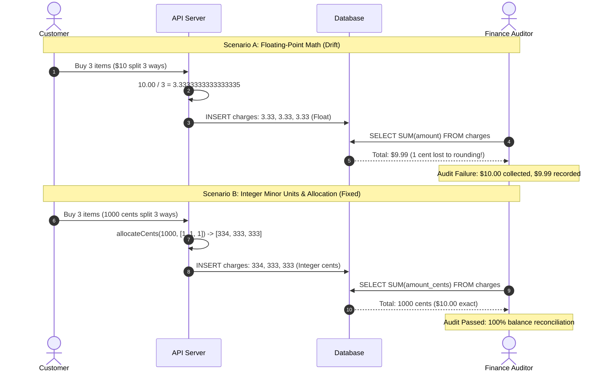

# Money Handling and Fixed-Point Math

> **In 30 seconds:** Computer hardware cannot accurately represent decimals like `0.1` or `0.2` using standard floating-point numbers. In JavaScript, `0.1 + 0.2` equals `0.30000000000000004`. If you store money as floats, tiny rounding errors compound across thousands of transactions until accounting books do not balance and audits fail. In production, always store money as integer cents (minor currency units) or use exact decimal types.

---

## The story

Consider this realistic engineering scenario: A software-as-a-service (SaaS) billing platform processes subscriptions for 100,000 corporate customers.

The database schema stores prices using standard SQL floating-point columns:

```sql
CREATE TABLE subscriptions (
  id SERIAL PRIMARY KEY,
  user_id INT NOT NULL,
  monthly_price FLOAT NOT NULL, -- DANGER: Floating-point money!
  tax_rate FLOAT NOT NULL
);
```

When customers upgrade their plans mid-month, the backend computes prorated refunds using JavaScript floating-point numbers:

```javascript
const daysRemaining = 19;
const daysInMonth = 30;
const originalPlanPrice = 49.99;

const refund = originalPlanPrice * (daysRemaining / daysInMonth);
// In JavaScript, refund evaluates to: 31.660333333333334
```

The system rounds the number to two decimal places when charging the credit card: `$31.66`. But the database keeps storing the raw floating-point numbers with trailing fractional cents (`$0.000333...`).

At the end of the fiscal quarter, the finance team runs a reconciliation audit. They sum all customer payments recorded in the database and compare that number against the bank's actual deposit total.

The database ledger says the company received:
`$4,892,118.47`

The bank account statement says the company deposited:
`$4,892,115.19`

There is an unexplained discrepancy of **$3.28**.

While three dollars sounds tiny, in financial accounting, any unbalanced ledger is an immediate red flag. Financial auditors freeze quarterly reporting. Engineers spend three weeks writing forensic scripts across 400,000 transactions trying to prove whether money was stolen by an employee or lost to floating-point rounding errors.

---

## The analogy

Think of measuring fabric with a rubber measuring tape:

- **Floating-point math:** A rubber tape measure that stretches and contracts slightly depending on room temperature and how hard you pull. When you measure 10 inches, it reads 10.00002 inches. When you measure 1,000 yards, those tiny micro-stretches compound until your tailored suit is three inches too short.
- **Integer minor units (Fixed-point):** A solid steel ruler marked with indivisible millimeter notches. You never measure "half a millimeter"; you count exact physical ticks: 1 tick, 2 ticks, 100 ticks. A solid integer tick mark cannot stretch, shrink, or drift.
- **The Golden Rule:** In finance, money is discrete. You cannot hand a store clerk a coin worth $0.000333 dollars. The smallest physical unit in US currency is 1 cent. Your code should count cents, not fractional dollars.

---

## What it is

### Why computers fail at `0.1 + 0.2`

Computer processors store numbers in binary (base-2), using powers of 2 ($1/2, 1/4, 1/8, 1/16, 1/32$).

In base-10, fractions like $1/10$ ($0.1$) look clean. But in binary, $1/10$ is an infinitely repeating fraction:
`0.00011001100110011...`

Because hardware registers have a finite number of bits (64 bits in IEEE 754 double-precision floats), the computer chops off the repeating sequence. That tiny truncation creates precision loss:

```javascript
0.1 + 0.2 === 0.30000000000000004
0.1 + 0.2 === 0.3 // false!
```

If your code checks `if (userBalance === checkoutTotal)`, the comparison can fail even when both numbers appear identical on screen!

### The Two Production Solutions

1. **Minor Currency Units (The Integer Pattern):**
   - Store all monetary values as integer amounts of the currency's smallest indivisible unit (cents, pence, yen).
   - $10.00 USD is stored as `1000`.
   - $19.99 USD is stored as `1999`.
   - ¥500 JPY is stored as `500` (Japanese Yen has no minor unit).
   - This is the exact pattern used by Stripe, Adyen, and modern payment APIs.

2. **Fixed-Point Decimal Types (Database SQL):**
   - In databases, use `NUMERIC(precision, scale)` or `DECIMAL(precision, scale)`.
   - `NUMERIC(12, 2)` stores up to 12 total digits with exactly 2 digits after the decimal point, performing exact base-10 arithmetic without floating-point drift.

---

## How it works

The sequence diagram below compares floating-point calculation drift with integer minor-unit ledger reconciliation:



### Walkthrough of the Steps

1. **Customer splits a payment:** A customer splits a $10.00 charge equally across 3 recipients.
2. **Scenario A (Float division):** $10 / 3 = 3.3333...$ Rounded to two decimals, each recipient receives $3.33. Summing $3.33 \times 3$ yields $9.99$. Exactly 1 cent has vanished into thin air.
3. **Scenario B (Integer allocation):** $10.00 is represented as 1,000 cents.
4. **Remainder distribution:** The allocation algorithm computes the base share ($1000 / 3 = 333$), calculates the remaining 1 cent ($1000 - 999 = 1$), and distributes the leftover penny to the first recipient.
5. **Exact reconciliation:** The database records charges of 334, 333, and 333 cents. The total sum is exactly 1,000 cents ($10.00). Not a single penny is lost.

---

## Broken vs fixed

### Broken: Storing money as floats and using naive division

```javascript
// DANGEROUS: Using JavaScript floats for billing
function calculateInvoice(items, taxRate) {
  let subtotal = 0;
  for (const item of items) {
    // BUG 1: Floating-point accumulation drift
    subtotal += item.price; // e.g. 19.99
  }

  // BUG 2: Floating multiplication produces fractional pennies
  const tax = subtotal * taxRate; // e.g. 19.99 * 0.0825 = 1.649175
  const total = subtotal + tax;   // e.g. 21.639175

  // BUG 3: Simple toFixed() does naive rounding that skews ledgers
  return {
    subtotal: Number(subtotal.toFixed(2)),
    tax: Number(tax.toFixed(2)),
    total: Number(total.toFixed(2)),
  };
}
```

### Fixed: Using integer cents and explicit remainder allocation

```javascript
// PRODUCTION SAFE: Integer cents arithmetic (Stripe pattern)
export function calculateInvoiceSafe(itemsInCents, taxRateBps) {
  // taxRateBps = Basis points (1% = 100 bps, 8.25% = 825 bps)
  let subtotalCents = 0;
  for (const item of itemsInCents) {
    subtotalCents += item.priceCents; // Exact integer addition
  }

  // Exact tax calculation using integer division and rounding half-up
  const rawTax = (subtotalCents * taxRateBps) / 10000;
  const taxCents = Math.round(rawTax);

  const totalCents = subtotalCents + taxCents;

  return {
    subtotalCents,
    taxCents,
    totalCents,
    // Format for display only
    formattedTotal: `$${(totalCents / 100).toFixed(2)}`,
  };
}

// Remainder allocation: splits cents across ratios without losing remainder
export function allocateCents(totalCents, ratios) {
  const totalWeight = ratios.reduce((acc, r) => acc + r, 0);
  let remainder = totalCents;

  const shares = ratios.map((ratio) => {
    const share = Math.floor((totalCents * ratio) / totalWeight);
    remainder -= share;
    return share;
  });

  // Distribute leftover pennies one by one
  for (let i = 0; i < remainder; i++) {
    shares[i % shares.length] += 1;
  }

  return shares;
}
```

---

## Try it yourself

Run the zero-dependency demonstration script included in this folder:

```bash
node docs/01-foundations/010-money-handling-and-fixed-point-math/demo.mjs
```

### What the demo shows

1. **The Equality Trap:** Proves why `0.1 + 0.2 === 0.3` evaluates to `false` in JavaScript.
2. **Line Item Accumulation:** Shows how fractional pennies drift when calculating sales tax across multiple items.
3. **Remainder Allocation:** Demonstrates splitting a $10.00 bill (1,000 cents) between 3 people without losing a single penny.

---

## Where you have seen it

- **Stripe API:** Every currency amount in Stripe's API is an integer in minor units (e.g., `amount: 1000` means $10.00 USD, or ¥1000 JPY).
- **Adyen and Square:** Payment gateways refuse floating-point numbers in API payloads to prevent rounding ambiguities between client and server.
- **Double-Entry Bookkeeping:** Enterprise accounting engines require that the sum of debits equals the sum of credits to the exact integer penny for every transaction.

---

## When to use it

- **Every price, charge, fee, discount, or tax calculation:** Never use floats for money.
- **Database storage:** Always use integer cents (`BIGINT` or `INT`) or SQL `NUMERIC(15, 2)`.
- **E-commerce carts, invoices, and accounting ledgers:** Every financial calculation must use integer minor units or fixed-point arithmetic.

---

## When to skip it

- **Scientific simulations and 3D graphics:** Physics engines, video games, and 3D rendering rely on continuous floating-point math where sub-decimal precision and fast GPU matrix operations matter more than exact equality.
- **Machine learning weight updates:** Neural network training requires continuous float tensors (e.g. `float32` or `bfloat16`), where tiny decimal gradients are essential.

---

## Common mistakes

- **Using SQL `FLOAT` or `REAL` for money:** Never use `FLOAT` in PostgreSQL or MySQL for financial data. Always use `BIGINT` (cents) or `NUMERIC(15, 2)`.
- **Assuming all currencies have two decimals:** Most currencies have 100 cents in a dollar (2 decimals), but the Japanese Yen (JPY) has 0 decimals, and the Kuwaiti Dinar (KWD) has 1,000 fils (3 decimals). Hardcoding `* 100` breaks international currencies. Use ISO 4217 currency metadata.
- **Naive division without remainder allocation:** Dividing 1,000 cents by 3 gives 333.33 cents. Rounding everyone down to 333 cents leaves 1 cent unassigned. Always distribute the remainder.
- **Displaying minor units to users without formatting:** Forgetting to divide cents by 100 before rendering a receipt, causing a customer to see "You were charged $1999" instead of "$19.99".

---

## Self-test

<details>
<summary>Question 1: Why does `0.1 + 0.2 === 0.3` evaluate to false in JavaScript and many other languages?</summary>

Because modern processors implement IEEE 754 floating-point arithmetic in base-2 (binary). Just as $1/3$ cannot be represented with a finite number of decimal digits in base-10 ($0.3333...$), $1/10$ ($0.1$) cannot be represented with a finite number of bits in binary ($0.000110011...$). When the computer truncates the repeating binary sequence to fit 64 bits, precision is lost, producing `0.30000000000000004`.
</details>

<details>
<summary>Question 2: What is the "minor currency unit" pattern, and why is it preferred by APIs like Stripe?</summary>

The minor currency unit pattern represents money as integers of the smallest indivisible unit of that currency (e.g., cents in USD, pence in GBP, yen in JPY). Because integers do not suffer from floating-point rounding errors, basic addition and subtraction are exact, database storage is compact and fast, and API payloads are completely unambiguous across different programming languages.
</details>

<details>
<summary>Question 3: How does the Remainder Allocation Algorithm prevent money from vanishing when splitting an amount?</summary>

When an amount cannot be divided cleanly (such as $10.00 / 3 = 333.333...$ cents), standard division would either create fractional pennies or lose a penny to rounding. The Remainder Allocation Algorithm calculates the integer floor for each recipient ($333$ cents each) and computes the remainder ($1000 - (333 \times 3) = 1$ cent). It then distributes the remaining cents one by one across the recipients until the remainder is zero, guaranteeing the sum of parts exactly equals the original total.
</details>

---

## Interview angle

1. **"How do you design a database schema and API to support multi-currency payments globally?"**
   - Model answer:
     - Store amounts as integers in minor currency units (`amount_cents BIGINT`).
     - Store the 3-letter ISO 4217 currency code (`currency VARCHAR(3)` such as `'USD'`, `'EUR'`, `'JPY'`).
     - Store a currency metadata lookup table that maps currency codes to their minor unit exponent (e.g., USD has 2 decimals, JPY has 0, KWD has 3).
     - In API requests and responses, require both `amount` and `currency` together (e.g. `{ amount: 2500, currency: "USD" }`).
     - For currency conversions, store the exact exchange rate used at the time of the transaction with high precision (`DECIMAL(18, 8)`), and always record both the original currency amount and the settled currency amount in the ledger.

2. **"What is Banker's Rounding (Round-Half-to-Even), and why do financial systems use it instead of standard round-half-up?"**
   - Model answer:
     - Standard rounding (`Math.round()` in JS) always rounds `0.5` up to the next integer ($1.5 \to 2$, $2.5 \to 3$). Over millions of transactions, rounding up every midpoint introduces a positive statistical bias that inflates ledger sums.
     - Banker's Rounding rounds half-way values (`0.5`) to the nearest **even** number ($1.5 \to 2$, but $2.5 \to 2$).
     - Because half the numbers round up and half round down, the rounding errors cancel each other out over large datasets, maintaining statistical neutrality across millions of transactions.

---

## Cheat sheet

- **Never use floats for money:** Avoid `float`, `double`, or raw JavaScript `Number` for financial arithmetic.
- **Store integer minor units:** Store money as integer cents (`1000` for $10.00 USD) or SQL `NUMERIC(15, 2)`.
- **Always allocate remainders:** When dividing money across accounts, distribute leftover pennies so the sum matches the original total.
- **Respect currency exponents:** Not all currencies use 2 decimal places (JPY uses 0; KWD uses 3).
- **Format only at display:** Keep values as integers throughout your entire backend pipeline; format as decimal strings only in the UI.

---

## Related concepts

- [001: HTTP Status Codes and Error Semantics](../001-http-status-codes-and-error-semantics/README.md)
- [003: Serialization (JSON, Protobuf, and BigInt Precision)](../003-serialization-json-protobuf-and-bigint-precision/README.md)
- [009: Time, Timezones, and UTC Handling](../009-time-timezones-and-utc-handling/README.md)

---

## Sources

- [Stripe API Documentation: Handling Currency Amounts in Minor Units](https://docs.stripe.com/currencies#zero-decimal)
- [Martin Fowler: Money Pattern](https://martinfowler.com/eaaCatalog/money.html)
- [IEEE 754 Standard for Floating-Point Arithmetic](https://en.wikipedia.org/wiki/IEEE_754)
