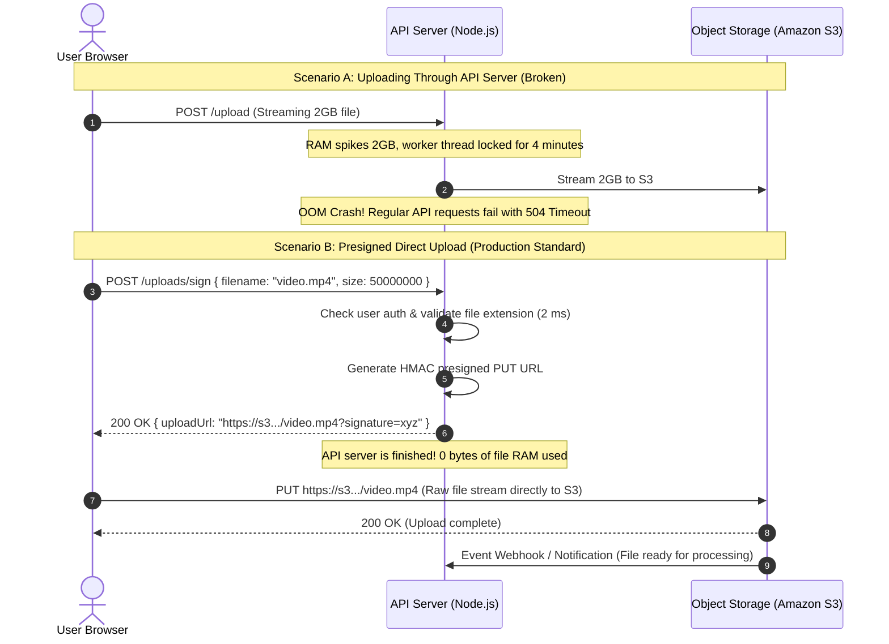

# File Uploads and Presigned Object Storage

> **In 30 seconds:** Sending large file uploads through your application backend forces your server to buffer hundreds of megabytes of raw bytes in memory, tying up worker threads and crashing processes with out-of-memory errors. The production pattern uses presigned object storage URLs: your API generates a short-lived signed link (to Amazon S3, Google Cloud Storage, or Cloudflare R2), and the client browser uploads the file directly to storage without touching your application servers.

---

## The story

Consider this realistic engineering scenario: An online education platform allows professors to upload high-definition video recordings of their college lectures.

The developer writes a standard file upload endpoint using Express and a multipart form parser (`multer`):

```javascript
app.post('/api/upload-video', upload.single('video'), async (req, res) => {
  const filePath = req.file.path; // Saved to local disk on the server
  // Upload file from server disk to Amazon S3
  await s3.upload({ Bucket: 'course-videos', Key: req.file.filename, Body: fs.createReadStream(filePath) });
  res.json({ success: true });
});
```

During initial local testing with 10MB test clips, everything works smoothly.

Then the university semester begins. At 11:00 AM on Monday, 80 professors simultaneously upload 1.5-gigabyte video files from their laptops.

A cascade of production failures strikes:

1. **Memory Exhaustion:** As multiple gigabyte streams hit the Node.js process, memory consumption skyrockets past the 2GB container limit. The process crashes instantly with `JavaScript heap out of memory`.
2. **Worker Starvation:** Because uploading a 1.5GB video on home internet takes three to five minutes, all HTTP worker threads in the reverse proxy and API containers are held open waiting for slow bytes to arrive. Normal students trying to load simple JSON text endpoints receive `504 Gateway Timeout` errors.
3. **Container Eviction:** The backend runs inside Kubernetes pods with ephemeral local disk drives. Saving large temporary files into `/tmp` fills up the container disk, causing the Kubernetes node to evict and kill the application pods.
4. **Double Bandwidth Costs:** The company pays for cloud network ingress from the professor to the API server, and then pays egress bandwidth to re-upload the same bytes from the server to Amazon S3.

The solution was not buying larger servers. It was removing the application server from the file path entirely using **presigned direct uploads**.

---

## The analogy

Think of dropping off a 500-pound shipping crate at a corporate high-rise office building:

- **Proxying Uploads Through Your API:** You carry your 500-pound wooden shipping crate through the front revolving doors and dump it onto the executive receptionist's desk on the 20th floor. The receptionist must stop answering phone calls, hold the heavy crate in their tiny cubicle, and then manually carry it down the freight elevator to the basement warehouse. The front lobby is completely blocked by shipping crates, and normal visitors cannot enter the building.
- **Presigned Direct Uploads:** You walk up to the receptionist and ask: "Where can I drop off my shipping crate?" The receptionist checks your ID in two seconds and hands you a pre-stamped barcode security pass that says: "Take your crate directly to Loading Dock Bay 4 in the alley." You drive directly to the loading dock, which has giant cranes, forklifts, and unlimited warehouse floor space. The receptionist never touches a single box, and normal lobby visitors are never interrupted.

---

## What it is

### The Presigned URL Architecture

A presigned URL is a temporary, cryptographically signed web address generated by your API server that gives a client permission to perform a specific action (like an HTTP `PUT` upload) directly against an object storage bucket (such as Amazon S3, Google Cloud Storage, or Cloudflare R2).

| Component | Role in direct upload | Resource consumption |
| :--- | :--- | :--- |
| **Client (Browser/Mobile App)** | Requests upload ticket, then streams raw file bytes directly to object storage | Bandwidth to storage bucket |
| **API Server (Your Backend)** | Validates user authorization, checks file metadata, and generates signed URL | 0 MB file memory, ~2 ms CPU time |
| **Object Storage (S3 / GCS / R2)** | Ingests raw file bytes, scales to terabytes, stores data durably | Built specifically for high-throughput streaming |

### How Presigned URLs Ensure Security

You might wonder: "If the client uploads directly to S3, how do we stop attackers from uploading malware or 500GB files?"

The API server signs the URL using its private cloud credentials (HMAC-SHA256). The signature locks down:
- **Exact HTTP Method:** Only `PUT` is allowed (the client cannot read or delete existing bucket files).
- **Exact Object Path:** The client can only write to a specific key (e.g. `uploads/usr_101/lecture_99.mp4`). They cannot overwrite another user's files.
- **Short Lifetime:** The URL expires automatically after 5 to 15 minutes.
- **Maximum File Size:** The signature can enforce a strict `content-length-range` header, causing S3 to abort the upload immediately if the file exceeds the limit.

---

## How it works

The sequence diagram below compares proxying file uploads through an API server against direct-to-storage presigned uploads:



### Walkthrough of the Steps

1. **Client requests upload permission:** The user selects a file in their browser. Before sending any bytes, the client sends a small JSON metadata request to the API: `POST /api/uploads/sign` with `{ filename: "lecture.mp4", fileSize: 52428800 }`.
2. **API validates and signs:** The API server verifies that the user is logged in, checks that the file size is within acceptable limits, and generates an Amazon S3 presigned PUT URL using its AWS SDK credentials.
3. **Client streams directly to storage:** The client receives the presigned URL and sends the file directly to Amazon S3 using a standard HTTP `PUT` request. The API server handles zero file bytes.
4. **Storage notifies backend:** Once Amazon S3 receives and stores the entire file, it emits an S3 Event Notification (via AWS SQS or an HTTP webhook) notifying the backend that the file is safely stored and ready for background video transcoding.

---

## Broken vs fixed

### Broken: Streaming large files through application memory

```javascript
// routes/upload.js - DANGEROUS AT SCALE
import multer from 'multer';
import AWS from 'aws-sdk';
import fs from 'node:fs';

const upload = multer({ dest: '/tmp/uploads/' });
const s3 = new AWS.S3();

app.post('/api/upload', upload.single('file'), async (req, res) => {
  // DANGER: The entire file was written to the local server disk!
  // Concurrent uploads will exhaust server disk space and crash the container.
  const fileStream = fs.createReadStream(req.file.path);

  await s3.upload({
    Bucket: 'my-bucket',
    Key: req.file.originalname,
    Body: fileStream,
  }).promise();

  // Clean up local temp file
  fs.unlinkSync(req.file.path);

  res.json({ success: true });
});
```

### Fixed: Generating a short-lived presigned upload URL

```javascript
// routes/upload.js - PRODUCTION SAFE AND SCALABLE
import { S3Client, PutObjectCommand } from '@aws-sdk/client-s3';
import { getSignedUrl } from '@aws-sdk/s3-request-presigner';
import crypto from 'node:crypto';

const s3Client = new S3Client({ region: 'us-east-1' });

app.post('/api/uploads/sign', authenticateUser, async (req, res) => {
  const { fileName, contentType, fileSizeBytes } = req.body;

  // 1. Validate file size (e.g. maximum 100MB)
  const MAX_SIZE = 100 * 1024 * 1024;
  if (fileSizeBytes > MAX_SIZE) {
    return res.status(400).json({ error: 'File exceeds maximum 100MB limit' });
  }

  // 2. Generate a secure, unique object key tied to the authenticated user
  const sanitizedName = fileName.replace(/[^a-zA-Z0-9.-]/g, '_');
  const uniqueKey = `users/${req.user.id}/${crypto.randomUUID()}-${sanitizedName}`;

  // 3. Create the S3 PutObject command
  const command = new PutObjectCommand({
    Bucket: 'my-secure-bucket',
    Key: uniqueKey,
    ContentType: contentType,
  });

  // 4. Generate presigned URL valid for exactly 15 minutes (900 seconds)
  const presignedUrl = await getSignedUrl(s3Client, command, {
    expiresIn: 900,
  });

  // Server responds in < 5 milliseconds without buffering any file data
  res.json({
    uploadUrl: presignedUrl,
    objectKey: uniqueKey,
    expiresInSeconds: 900,
  });
});
```

---

## Try it yourself

Run the zero-dependency demonstration script included in this folder:

```bash
node docs/01-foundations/011-file-uploads-and-presigned-object-storage/demo.mjs
```

### What the demo shows

1. **Proxying Bottleneck:** Explains the mathematical reality of memory exhaustion when streaming multi-gigabyte uploads through Node.js.
2. **Cryptographic Presigning:** Shows how an API server signs a temporary URL using HMAC-SHA256 with an exact object key, size limit, and expiration timestamp.
3. **Direct Upload Execution:** Executes an HTTP `PUT` upload directly against the simulated object storage service.
4. **Signature Verification:** Demonstrates how tampering with the presigned URL signature is rejected immediately by the storage service with `403 Forbidden`.

---

## Where you have seen it

- **YouTube and Vimeo:** Video creator dashboards generate signed direct upload links so creators upload 20GB 4K videos directly to Google Cloud Storage or AWS S3 without overloading web application servers.
- **Stripe Identity:** Identity verification portals ask users to upload passport photos directly to encrypted S3 buckets via presigned links.
- **Cloudflare R2 and Google Cloud Storage:** Cloud platforms offer native signed URL APIs specifically to eliminate server bandwidth costs.

---

## When to use it

- **Any file larger than 1 to 2 megabytes:** Profile pictures, audio files, PDF invoices, video recordings, and database export archives.
- **Serverless architectures (AWS Lambda / Google Cloud Functions):** Serverless runtimes have hard request payload limits (e.g. 6MB in AWS Lambda). Presigned URLs are mandatory for file uploads in serverless applications.
- **Applications on ephemeral containers (Docker / Kubernetes):** Containers have limited local disk space and can be terminated at any moment. Direct-to-storage uploads guarantee durability.

---

## When to skip it

- **Tiny data payloads (< 50KB):** Uploading a tiny 5-line CSV configuration file that your backend immediately parses into memory and inserts into a database.
- **Immediate server-side virus scanning or transcoding requirements where client-to-storage isolation is not permitted:** In some high-security air-gapped defense networks, files must pass through a hardware security appliance before entering storage.

---

## Common mistakes

- **Signing URLs with long expiration windows:** Generating presigned URLs that remain valid for 24 hours. If a signed URL leaks, anyone with the link can write to that object. Keep expiration times between 5 and 15 minutes.
- **Forgetting file size limits:** Generating an unrestricted presigned URL without checking or enforcing file size limits allows malicious users to upload massive files and incur massive storage charges.
- **Trusting the client-reported file name directly:** Using `req.body.fileName` directly as the S3 object key allows path traversal (`../../secret.txt`) or overwriting other users' files. Always prefix keys with a unique ID and the authenticated user's ID (`users/usr_101/uuid-filename.png`).
- **Storing files on local container disks:** Saving uploads to `/uploads` on the server filesystem. The next time Kubernetes redeploys the pod, all uploaded files vanish forever.

---

## Self-test

<details>
<summary>Question 1: Why does routing file uploads through an API server create a major performance bottleneck for other users of the API?</summary>

Uploading large files over typical consumer internet connections takes seconds or minutes. While the file streams into the server, HTTP worker threads and sockets are held open, and file chunks buffer in server memory. Under concurrent uploads, worker pools become exhausted, RAM exceeds limits, and normal, lightweight API requests (like loading a user profile) time out waiting for an available server thread.
</details>

<details>
<summary>Question 2: How does a presigned URL prevent an attacker from modifying another user's files in the storage bucket?</summary>

The API server signs the URL using its private cloud secret key. The cryptographic signature covers the specific bucket name, the exact target object key (which includes the authenticated user's ID), and the allowed HTTP method (`PUT`). If an attacker alters the object key in the URL to target another user's file, the signature verification fails and the storage service rejects the request with `403 Forbidden`.
</details>

<details>
<summary>Question 3: How does your backend know when a direct client upload to object storage has completed?</summary>

There are two primary patterns:
1. **Event Notifications (The Best Practice):** Object storage services (like AWS S3) emit an event notification whenever an object is created. This event is delivered to an asynchronous queue (like AWS SQS) or an HTTP webhook that triggers your backend worker to process the file.
2. **Client Completion Call:** The client uploads to S3, and upon receiving `200 OK` from S3, makes a confirmation call (`POST /api/uploads/complete`) to your backend. The backend verifies the object's existence and size in S3 before recording it in the database.
</details>

---

## Interview angle

1. **"How would you design a scalable system that allows millions of users to upload photos and automatically generates thumbnails?"**
   - Model answer:
     - The client requests a presigned upload URL from the API backend.
     - The API authenticates the user, generates a short-lived S3 presigned PUT URL tied to `uploads/raw/{userId}/{uuid}.jpg`, and returns it.
     - The client uploads the raw photo directly to Amazon S3.
     - The S3 `ObjectCreated` event automatically publishes a message to an AWS SQS queue.
     - A fleet of background worker processes (or AWS Lambda functions) pulls messages from SQS, downloads the raw photo, resizes it into thumbnail variants, saves the thumbnails to `thumbnails/{uuid}.jpg`, and updates the database with the image URLs.
     - This architecture keeps the web API completely decoupled from CPU-intensive image processing and memory-heavy file uploads.

2. **"What security controls must you enforce before issuing a presigned upload URL?"**
   - Model answer:
     - Verify user authentication and check permissions (e.g. ensure the user has not exceeded their storage quota).
     - Restrict the target object key by prefixing it with the user's ID (`users/{userId}/...`) to prevent object overwriting.
     - Validate the file extension and MIME type against an allowlist.
     - Set a short expiration time (5 to 15 minutes).
     - Enforce maximum content-length policies so the client cannot upload a file larger than permitted.

---

## Cheat sheet

- **Direct to storage:** Never proxy large file uploads through your API server; upload directly to S3 or GCS.
- **Presigned URLs:** Generate temporary, HMAC-signed URLs from your backend in milliseconds.
- **Short expiration:** Keep presigned URL lifetimes between 5 and 15 minutes.
- **Prefix keys by user:** Always scope object paths by user ID (`users/{userId}/{uuid}-{filename}`) to prevent overwrites.
- **Asynchronous processing:** Use object storage event notifications to trigger background jobs like image resizing or video transcoding.

---

## Related concepts

- [001: HTTP Status Codes and Error Semantics](../001-http-status-codes-and-error-semantics/README.md)
- [004: Authentication vs Authorization](../004-authentication-vs-authorization/README.md)
- [014: Rate Limiting](../../02-api-reliability/014-rate-limiting/README.md)

---

## Sources

- [AWS S3 Documentation: Uploading objects using presigned URLs](https://docs.aws.amazon.com/AmazonS3/latest/userguide/PresignedUrlUploadObject.html)
- [Google Cloud Storage Documentation: Signed URLs](https://cloud.google.com/storage/docs/access-control/signed-urls)
- [Cloudflare R2 Documentation: Presigned URLs](https://developers.cloudflare.com/r2/api/s3/presigned-urls/)
