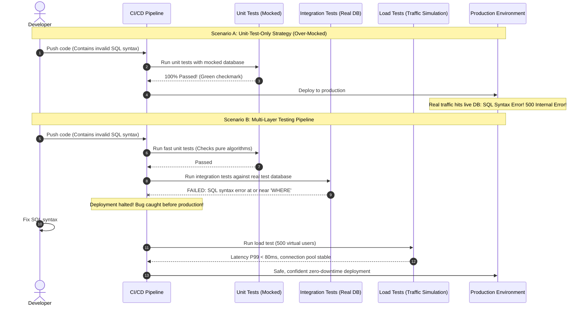

# Testing Strategy (Unit vs Integration vs Contract vs Load)

> **In 30 seconds:** Having 100% unit test coverage does not protect you if your database queries fail against a real PostgreSQL instance, if an API field rename crashes your mobile app, or if your server freezes under 500 concurrent users. A production testing strategy balances four layers: unit tests verify pure logic in milliseconds, integration tests test real databases, contract tests stop API breaking changes, and load tests prove your system will not crash on Black Friday.

---

## The story

Consider this realistic engineering scenario: A fintech banking startup proudly boasts 98% code coverage across their continuous integration pipeline.

Management requires every pull request to maintain green unit tests before merging. To make tests run in under 30 seconds, engineers heavily mock external dependencies:

```javascript
// A typical unit test in their repository
jest.spyOn(db, 'query').mockResolvedValue([{ id: 101, balance: 500 }]);
```

Every database call, Redis cache lookup, and third-party payment gateway request was replaced with an in-memory mock. The team has 2,800 unit tests, and every single one passes with flying colors.

On Thursday morning, the team deploys a major platform upgrade to production. Five minutes later, three separate disasters strike simultaneously:

1. **The Database Syntax Crash:** A developer wrote a new SQL query using PostgreSQL JSON extraction syntax (`user_data->>'tier'`). But in the unit tests, the query was completely mocked out. In production against a live database, the query contained a syntax typo. Every customer attempting to view their balance received a `500 Internal Server Error`.
2. **The Connection Pool Meltdown:** Unit tests ran sequentially, executing one mock at a time. In production, 4,000 active customers logged in simultaneously at 9:00 AM. The backend opened an unpooled connection per request, exhausting the PostgreSQL connection limit in eight seconds.
3. **The Mobile App Contract Crash:** The backend team renamed a response field from `full_name` to `name`. The backend unit tests passed because they only checked that `name` was returned. But the iOS mobile app expected `full_name`. The moment the mobile app launched, it crashed for 350,000 smartphone users.

The company suffered a four-hour production outage despite having 98% test coverage. They tested their mocks, but they never tested reality.

---

## The analogy

Think of designing, assembling, and certifying a commercial passenger airplane:

- **Unit Testing (Testing the Bolt):** You place an individual steel bolt into a hydraulic press in a laboratory. You verify that the bolt can withstand 2,000 pounds of pressure without snapping. Fast, cheap, and essential. But a green test on a bolt does not prove the airplane can fly.
- **Integration Testing (Testing the Engine System):** You connect the fuel line, the fuel pump, the throttle wire, and the jet turbine together. You turn the throttle to verify that fuel actually flows through the pipe and ignites the engine. If the bolt is strong but the fuel line diameter is two millimeters too small for the engine valve, the engine will never start.
- **Contract Testing (Testing the Electrical Wiring Harness):** The avionics cockpit was manufactured in France, and the main fuselage was manufactured in the United States. Contract testing verifies that the 50-pin electrical plug built in France snaps perfectly into the 50-pin socket built in the US without crossed wires or blown fuses.
- **Load Testing (The Wind Tunnel and Flight Test):** You put the fully assembled airplane with all 300 passenger seats filled inside a wind tunnel with freezing ice, crosswinds, and gale-force turbulence. Testing an airplane in a quiet, air-conditioned laboratory tells you nothing about how it handles a real thunderstorm.

---

## What it is

A production-ready test suite uses the **Testing Pyramid**, balancing four distinct testing tiers:

| Test Tier | What it tests | Execution Speed | Cost | Catches in production |
| :--- | :--- | :--- | :--- | :--- |
| **Unit Tests** | Pure business logic, math, data transformations, validators in isolation | Milliseconds (< 1 ms per test) | Very Low | Logic bugs, edge cases, formula errors |
| **Integration Tests** | Real database queries, transactions, cache reads, repository layers | Seconds (50 to 500 ms per test) | Medium | SQL syntax errors, migration bugs, constraint failures |
| **Contract Tests** | API request and response schemas between backend and frontend/microservices | Milliseconds to Seconds | Low | Breaking field renames, missing required keys |
| **Load Tests** | System throughput, latency, memory limits under heavy concurrent traffic | Minutes to Hours | High | Connection pool exhaustion, memory leaks, event loop lag |

---

## How it works

The sequence diagram below compares the false confidence of relying solely on mocked unit tests against a complete multi-tier testing pipeline:



### Walkthrough of the Steps

1. **Scenario A (Over-Mocking):** The developer writes a query with a syntax typo. Because unit tests replace the database with a fake JavaScript object, the unit test passes. The broken SQL deploys to production and immediately crashes for live users.
2. **Scenario B (Multi-Layer Testing):**
   - **Unit Layer:** Fast unit tests verify input validators and business math without touching a network or disk.
   - **Integration Layer:** Integration tests run the query against a real, ephemeral database container (using Docker or Testcontainers). The database parser immediately flags the SQL syntax error and halts CI before deployment.
   - **Load Layer:** Before major releases, an automated load test sends simulated concurrent traffic to ensure database connection pools, memory usage, and response times remain stable under pressure.

---

## Broken vs fixed

### Broken: Testing mocks instead of real behavior

This unit test mocks the database so aggressively that it provides zero assurance that the SQL query actually works:

```javascript
// userRepo.test.js - OVER-MOCKED (USELESS FOR SQL ERRORS)
import { UserRepository } from './userRepo.js';

test('finds active user by id', async () => {
  // BUG: The mock returns whatever we tell it to return!
  // If the real SQL query has syntax errors or references deleted columns,
  // this test will STILL pass!
  const mockDb = {
    query: jest.fn().mockResolvedValue([{ id: 101, email: 'test@example.com' }]),
  };

  const repo = new UserRepository(mockDb);
  const user = await repo.findActiveUser(101);

  expect(user.id).toBe(101);
  expect(mockDb.query).toHaveBeenCalled(); // Tests your mock, not your database!
});
```

### Fixed: Multi-layer testing strategy

Here is the production approach: keep unit tests for pure logic, and use real database instances for repository integration tests:

```javascript
// 1. UNIT TEST: Pure business calculation (Fast, zero dependencies, in-memory)
// feeCalculator.test.js
import { calculateTransactionFee } from './feeCalculator.js';

test('calculates correct interchange fee for international cards', () => {
  const result = calculateTransactionFee({
    amountCents: 10000,
    cardCountry: 'GB',
    merchantCountry: 'US',
  });
  expect(result.feeCents).toBe(390); // $3.90
});

// 2. INTEGRATION TEST: Runs real SQL against an isolated test database container
// userRepo.integration.test.js
import { dbClient } from '../test-helpers/db.js'; // Real PostgreSQL connection
import { UserRepository } from './userRepo.js';

describe('UserRepository Integration', () => {
  let repo;

  beforeAll(async () => {
    repo = new UserRepository(dbClient);
    // Seed real test row in the database
    await dbClient.query('INSERT INTO users (id, email, is_active) VALUES ($1, $2, $3)', [
      202,
      'alice@example.com',
      1,
    ]);
  });

  afterAll(async () => {
    await dbClient.query('DELETE FROM users WHERE id = $1', [202]);
  });

  test('executes real SQL against live database engine without syntax errors', async () => {
    // If the SQL query has syntax errors or bad column names, this test fails immediately!
    const user = await repo.findActiveUser(202);
    expect(user).toBeDefined();
    expect(user.email).toBe('alice@example.com');
  });
});
```

---

## Try it yourself

Run the zero-dependency demonstration script included in this folder:

```bash
node docs/01-foundations/012-testing-strategy-unit-vs-integration-vs-contract-vs-load/demo.mjs
```

### What the demo shows

1. **The Over-Mocking Trap:** Runs a unit test with a mocked database. The test passes with a green checkmark even though the SQL query contains a fatal syntax error (`WHERE WHERE`).
2. **The Integration Test:** Runs the exact same query against a simulated SQL engine parser. The test catches the syntax error and halts execution.
3. **The Concurrent Load Test:** Simulates 9 concurrent requests against a connection pool capped at 3 connections. Shows how requests #4 through #9 suffer queue delays, proving why load testing is necessary to detect connection bottlenecks.

---

## Where you have seen it

- **Stripe:** Famous for their comprehensive testing infrastructure that combines thousands of fast unit tests with real ephemeral containerized test databases and automated contract tests for all public API endpoints.
- **Netflix:** Pioneers of automated chaos and load testing, using tools to inject simulated traffic spikes and network failures directly into test environments to verify fault tolerance.
- **Pact Framework:** Used by enterprise engineering organizations worldwide to enforce consumer-driven contract testing between backend microservices and mobile apps.

---

## When to use it

- **Unit tests:** Every pure algorithm, validation schema, discount calculator, state machine, and data transformation.
- **Integration tests:** Every database repository, database migration script, Redis cache manager, and external webhook handler.
- **Contract tests:** Any API boundary shared between different teams (e.g., backend API consumed by an iOS/Android team or a separate microservice).
- **Load tests:** Before product launches, before Black Friday sales events, and when re-architecting connection pooling or database schemas.

---

## When to skip it

- **Do not write integration tests for pure math:** Testing a string formatting function against a database container adds unnecessary slow test execution time.
- **Do not write end-to-end browser tests for every edge case:** Testing 50 variations of form validation via slow Selenium or Playwright browser clicks creates an unmaintainable, flaky test suite. Test UI edge cases in fast component unit tests.

---

## Common mistakes

- **The Ice Cream Cone Anti-Pattern:** Writing hundreds of slow, brittle end-to-end UI tests, few integration tests, and almost no unit tests. Test runs take two hours and constantly fail due to network timeouts.
- **Testing the Mocks:** Mocking so much of a class that your test is simply asserting that `mockFunction.toHaveBeenCalled()`. The test gives a false sense of security while testing nothing about production behavior.
- **Shared Remote Staging Database:** Running integration tests against a shared staging database on AWS where tests collide, overwrite each other's test data, and fail randomly. Always run integration tests against isolated ephemeral containers (such as Testcontainers).
- **Never Testing Under Concurrency:** Assuming that because an endpoint works for one user, it will work for 1,000 concurrent users. Concurrency reveals race conditions, deadlocks, and connection pool starvation that single-threaded tests never expose.

---

## Self-test

<details>
<summary>Question 1: What is the primary limitation of unit tests when testing database repositories?</summary>

Unit tests mock external dependencies. If you mock the database, the test only verifies that your code calls the mock function with expected arguments. It cannot verify whether the SQL syntax is valid for your specific database engine, whether the referenced columns exist in the current schema, whether foreign key constraints are satisfied, or whether database transactions commit or roll back properly.
</details>

<details>
<summary>Question 2: What is Contract Testing, and how does it prevent production outages between backend and mobile teams?</summary>

Contract testing verifies that the API provider (backend) and the API consumer (frontend or mobile app) agree on the exact request and response schemas without having to run full end-to-end systems. If the backend team renames a field, deletes a key, or changes a type, the contract test fails during the backend pull request build, preventing breaking API changes from shipping to production.
</details>

<details>
<summary>Question 3: Why can unit and integration tests never uncover connection pool exhaustion bugs?</summary>

Unit and integration tests typically execute sequentially or under minimal concurrency in local development environments. Connection pool exhaustion only occurs when the number of concurrent incoming requests exceeds the pool size, forcing requests to wait in line or time out. Only load and stress testing under realistic concurrent traffic can expose pool saturation, lock contention, and event loop delays.
</details>

---

## Interview angle

1. **"How do you strike the right balance between test speed and test confidence in a CI/CD pipeline?"**
   - Model answer:
     - Follow the Testing Pyramid: the majority of tests should be fast, deterministic unit tests (running in seconds in memory).
     - Use integration tests with ephemeral database containers (e.g. Testcontainers) to verify database repositories, migrations, and transactions.
     - Run unit tests and contract tests on every single commit and pull request.
     - Run the heavier integration test suite on pull requests before merging.
     - Run comprehensive end-to-end tests and automated load tests on nightly builds or staging deployment pipelines to verify performance without slowing down daily developer pull request velocity.

2. **"What is the difference between a load test and a stress test?"**
   - Model answer:
     - A **load test** verifies that the system meets its Service Level Objectives (SLOs) under expected normal and peak traffic (e.g., verifying that the API maintains a P99 response time under 100ms with 1,000 requests per second).
     - A **stress test** pushes the system beyond its breaking point to discover how it fails (e.g. ramping up traffic to 10,000 requests per second until CPU saturates).
     - The goal of stress testing is to ensure graceful degradation: does the system shed load cleanly with `429 Too Many Requests` or `503 Service Unavailable`, or does it suffer cascading database crashes and memory corruption?

---

## Cheat sheet

- **Unit tests for logic:** Fast, isolated in-memory tests for pure business rules, validation, and math.
- **Integration tests for reality:** Test against real database containers to verify SQL syntax, migrations, and constraints.
- **Contract tests for interfaces:** Enforce request and response schemas to prevent breaking client changes.
- **Load tests for scale:** Test concurrency, connection pools, and memory limits before peak traffic events.
- **Avoid over-mocking:** If your test mocks everything, you are testing your mocks, not your software.

---

## Related concepts

- [001: HTTP Status Codes and Error Semantics](../001-http-status-codes-and-error-semantics/README.md)
- [002: API Contract Drift and Schema Validation](../002-api-contract-drift-and-schema-validation/README.md)
- [029: Connection Pooling](../../03-performance-and-caching/029-connection-pooling/README.md)

---

## Sources

- [Martin Fowler: The Practical Test Pyramid](https://martinfowler.com/articles/practical-test-pyramid.html)
- [Pact Foundation: Introduction to Contract Testing](https://docs.pact.io/)
- [k6 Documentation: Load Testing Fundamentals](https://k6.io/docs/)
