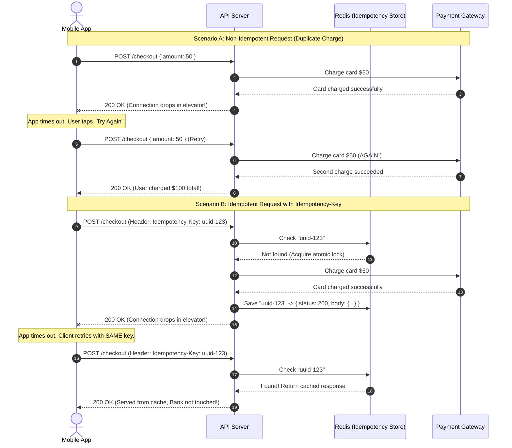

# Idempotency Keys

> **In 30 seconds:** An idempotency key is a unique ID (like a UUID) sent by a client in an HTTP header to make sure that repeating a request has the exact same effect as calling it once. If a weak internet connection drops right after your server charges a credit card, the mobile app can safely retry without charging the customer twice.

---

## The story

Consider this realistic engineering scenario: A popular food delivery app processes thousands of dinner orders on a busy Friday evening.

A customer named Alice orders $45.00 worth of sushi. She stands in her apartment elevator and taps "Place Order". Her mobile phone sends an HTTP request:

```http
POST /api/orders/checkout HTTP/1.1
Host: delivery.example.com
Content-Type: application/json

{ "items": ["sushi_combo"], "amount": 45.00 }
```

The request reaches the backend API server. The server contacts the credit card payment gateway, charges Alice's card $45.00, and inserts the order into the database.

Then the disaster happens: just as the server prepares to send back `200 OK`, the elevator doors close. Alice's phone loses cellular signal for three seconds. The TCP connection drops.

Alice's phone never receives the `200 OK` response. After five seconds, the mobile app hits its internal network timeout. The screen shows an error banner: *"Connection timed out. Tap to try again."*

Alice taps "Try Again".

Because the backend endpoint is not idempotent, the server receives the second request as a brand new order. It charges Alice's card another $45.00 and creates a second order for the exact same sushi.

Worse, modern mobile HTTP libraries often retry network errors automatically in the background. If the client library retried three times, Alice would be charged four times ($180.00) for a single dinner. Alice calls her bank, files a credit card dispute, and leaves a 1-star review.

---

## The analogy

Think of a busy roadside diner ticket system:

- **The Non-Idempotent Diner:** You walk up to the diner counter and order a cheeseburger. The waiter writes your order on a piece of paper and hands it to the cook. You step outside for a minute to take a phone call. When you come back inside, you don't see any burger on your table. You ask the waiter: "Can I get a cheeseburger?" The waiter assumes this is a second order, writes a second ticket, and hands it to the cook. You end up with two cheeseburgers and two bills.
- **The Idempotent Diner (The Order Ticket):** When you first place your order, the waiter stamps your receipt with an order number: **Ticket #402**. When you come back inside from your phone call, you say: "What is the status of Ticket #402?" The waiter checks the grill: "Ticket #402 is already cooking. It will be ready in three minutes." The cook does not make a second burger, and you are only billed once.

The ticket number is your **idempotency key**.

---

## What it is

In mathematics and computer science, an operation is **idempotent** if applying it multiple times produces the exact same result as applying it once:

$$f(f(x)) = f(x)$$

### HTTP Methods and Idempotency

HTTP specifications define which methods should be idempotent by default:

| HTTP Method | Is it Idempotent? | Why? |
| :--- | :--- | :--- |
| **GET / HEAD** | **Yes** (Safe & Read-Only) | Fetching `/users/101` ten times does not change the user's data. |
| **PUT** | **Yes** | Replacing a user record with `{ "name": "Alice" }` ten times leaves the name as `"Alice"`. |
| **DELETE** | **Yes** | Deleting `/orders/99` ten times results in order 99 being gone. (First call returns 200 or 204; subsequent calls return 404, but server state is unchanged). |
| **POST** | **No** | Calling `POST /charges` ten times creates ten distinct charges and drains the customer's balance. |

### The Idempotency Key Pattern

To make non-idempotent `POST` requests safe against retries, the client generates a unique UUID before sending the request and includes it in an HTTP header:

```http
Idempotency-Key: 9b1deb4d-3b7d-4bad-9bdd-2b0d7b3dcb6d
```

When the server receives the request:
1. **First attempt:** The server checks its cache (like Redis) for the key. The key does not exist. The server acquires an atomic lock, processes the charge, saves the response status and body in Redis with a 24-hour expiration time, and returns the response to the user.
2. **Retry attempt (Same Key):** If the client retries with the exact same key, the server finds the key in Redis. It skips payment processing completely and returns the saved response immediately.

---

## How it works

The sequence diagram below compares a non-idempotent duplicate billing disaster with an idempotent cached retry:



### Walkthrough of the Steps

1. **Client creates unique key:** Before making the network call, the client generates a unique UUID (e.g. `uuid-123`) and attaches it to the `Idempotency-Key` header.
2. **Server checks cache:** The API queries Redis for `uuid-123`. Because it is the first call, the key does not exist.
3. **Atomic lock:** The server writes `uuid-123` with status `IN_PROGRESS` using an atomic command (like Redis `SET NX`). This prevents two identical requests from running at the exact same millisecond.
4. **Execution:** The server calls the payment processor and creates the order.
5. **Cache response:** The server updates `uuid-123` in Redis, saving the HTTP status code (200) and response body JSON.
6. **Network failure:** The mobile network drops before the client receives the 200 response.
7. **Safe retry:** The mobile app retries the exact same request with `Idempotency-Key: uuid-123`.
8. **Instant replay:** The server sees that `uuid-123` is already completed in Redis. It returns the stored 200 response immediately. The payment gateway is never contacted a second time.

---

## Broken vs fixed

### Broken: Naive POST handler without idempotency

```javascript
// routes/checkout.js - VULNERABLE TO DUPLICATE BILLING
app.post('/api/checkout', async (req, res) => {
  const { userId, amount } = req.body;

  // DANGER: Every incoming HTTP request creates a brand new bank charge!
  // If the client retries on timeout, the user is charged twice.
  const charge = await paymentGateway.charge({
    userId,
    amount,
  });

  const order = await db.orders.create({
    userId,
    chargeId: charge.id,
    amount,
  });

  res.status(200).json({ success: true, orderId: order.id });
});
```

### Fixed: Idempotency middleware with atomic locks and response caching

```javascript
// routes/checkout.js - PRODUCTION SAFE WITH IDEMPOTENCY
import { redis } from '../lib/redis.js';

app.post('/api/checkout', async (req, res) => {
  const idempotencyKey = req.headers['idempotency-key'];

  if (!idempotencyKey) {
    return res.status(400).json({
      error: 'Missing required Idempotency-Key header',
    });
  }

  const cacheKey = `idempotency:${idempotencyKey}`;

  // 1. Check if this key was already processed
  const cached = await redis.get(cacheKey);
  if (cached) {
    const parsed = JSON.parse(cached);

    if (parsed.status === 'IN_PROGRESS') {
      // Another request with this key is currently executing
      return res.status(409).json({
        error: 'A request with this idempotency key is currently processing. Please wait.',
      });
    }

    // Return the cached response directly
    res.setHeader('X-Cache-Lookup', 'HIT');
    return res.status(parsed.statusCode).json(parsed.body);
  }

  // 2. Acquire atomic lock (expires in 60s in case server crashes mid-flight)
  const acquired = await redis.set(
    cacheKey,
    JSON.stringify({ status: 'IN_PROGRESS' }),
    'NX',
    'EX',
    60
  );

  if (!acquired) {
    return res.status(409).json({ error: 'Concurrent request in progress' });
  }

  try {
    const { userId, amount } = req.body;

    // 3. Perform the side-effect (charge card and save order)
    const charge = await paymentGateway.charge({ userId, amount });
    const order = await db.orders.create({ userId, chargeId: charge.id, amount });

    const responseBody = { success: true, orderId: order.id, chargeId: charge.id };

    // 4. Cache completed response for 24 hours (86,400 seconds)
    await redis.set(
      cacheKey,
      JSON.stringify({
        status: 'COMPLETED',
        statusCode: 200,
        body: responseBody,
      }),
      'EX',
      86400
    );

    return res.status(200).json(responseBody);
  } catch (err) {
    // If the charge failed, delete the key so the user can retry cleanly
    await redis.del(cacheKey);
    return res.status(500).json({ error: 'Payment failed' });
  }
});
```

---

## Try it yourself

Run the zero-dependency demonstration script included in this folder:

```bash
node docs/02-api-reliability/013-idempotency-keys/demo.mjs
```

### What the demo shows

1. **The Duplicate Charge Disaster:** Simulates a client timing out after 80ms while the server finishes charging a card. When the mobile app retries on the non-idempotent endpoint, the bank ledger shows two distinct charges for the same order ($100 total).
2. **The Idempotent Production Fix:** Re-runs the exact same network timeout failure using a unique `Idempotency-Key` header. When the client retries, the server identifies the key, returns the cached 200 response, and creates exactly one charge in the bank ledger.

---

## Where you have seen it

- **Stripe API:** Stripe requires an `Idempotency-Key` header on all `POST` requests to create charges, transfers, and refunds. If a request is re-sent with the same key within 24 hours, Stripe returns the exact original response.
- **AWS APIs:** AWS services (like EC2 and SQS) accept a `ClientRequestToken` parameter to ensure creating virtual machines or sending messages is idempotent.
- **Shopify and Square:** Payment processing endpoints reject mutation requests that omit idempotency tokens to protect merchant accounts against accidental double clicks.

---

## When to use it

- **Financial transactions:** Credit card charges, refunds, bank transfers, and wallet balance deductions.
- **Order creation and booking:** Hotel room reservations, airline ticket purchases, and e-commerce checkouts.
- **Third-party integrations:** Sending notifications, transactional emails, or SMS alerts where duplicate messages annoy users.
- **Client automated retry policies:** Any API consumed by mobile apps or background job runners that automatically retry on network timeouts.

---

## When to skip it

- **Read-only requests (`GET`, `HEAD`, `OPTIONS`):** These requests are already naturally idempotent and safe.
- **High-throughput metrics and telemetry:** Streaming analytics events (like user mouse movements) where an occasional duplicate metric has zero financial consequence.
- **Pure `PUT` requests:** If your endpoint already replaces the entire resource (`UPDATE users SET name = $1 WHERE id = $2`), it is naturally idempotent without an extra key.

---

## Common mistakes

- **Locking keys without an expiration (TTL):** If your server crashes while processing an order, the key remains permanently marked `IN_PROGRESS`. The user can never retry their order. Always set a short expiration (e.g. 60 seconds) on the initial lock.
- **Payload mismatch ignored:** An attacker or buggy client sends the same idempotency key for two completely different payments (e.g. key `abc` for $10, and key `abc` for $500). The server must hash the request body alongside the key and return `422 Unprocessable Entity` if the payload changes.
- **Caching only the status code:** Caching status `200` but forgetting to cache the JSON response body. When the client retries, it receives an empty body, causing frontend UI parsers to crash.
- **Generating keys on the server:** The idempotency key must be generated by the **client** before sending the request. If the server generates the key, a dropped connection on the initial request means the client has no key to send on retry.

---

## Self-test

<details>
<summary>Question 1: Why must the client generate the idempotency key instead of the server?</summary>

Because if the server generates the key, the key only exists after the server receives the request. If the network connection drops before the client receives the server response, the client has no way of knowing what key was generated. The client must generate the key (e.g., a UUIDv4) before sending the request so that any subsequent retries can transmit the exact same key.
</details>

<details>
<summary>Question 2: What should the server do if a request arrives with an idempotency key that is currently marked IN_PROGRESS?</summary>

It should return `409 Conflict` (or hold the connection briefly with a short wait) indicating that a concurrent request with this key is already executing. The server must never execute the side-effect a second time concurrently, as that would cause a race condition leading to duplicate charges.
</details>

<details>
<summary>Question 3: What should happen if a client reuses an existing idempotency key, but changes the request body from amount: 10 to amount: 500?</summary>

The server must reject the request with `422 Unprocessable Entity` or `400 Bad Request`. When saving an idempotency record, the server should store a hash of the original request body. If a request arrives with the same key but a different body hash, it indicates a client-side programming error where two distinct actions shared the same key.
</details>

---

## Interview angle

1. **"How would you implement end-to-end idempotency for a payment API across multiple microservices?"**
   - Model answer:
     - The mobile client generates a unique UUID `Idempotency-Key` and sends it to the API Gateway.
     - The Order Service validates the key and writes an `order` record in PostgreSQL with a unique constraint on `(user_id, idempotency_key)`.
     - When the Order Service calls the Payment Service over HTTP, it forwards the same idempotency key.
     - The Payment Service passes the key down to the external bank (like Stripe's `Idempotency-Key` header).
     - If any network hop fails and the client retries, the unique constraint in the database and the cached tokens at each microservice boundary prevent duplicate work from reaching the payment gateway.

2. **"What storage backend would you choose for storing idempotency keys, and how do you handle storage growth over time?"**
   - Model answer:
     - Use a distributed in-memory key-value store like Redis for sub-millisecond lookups and atomic locking (`SET key value NX EX seconds`).
     - For long-term financial audit trails, store the idempotency key in a primary database column with a `UNIQUE` index.
     - To prevent unbounded storage growth, set a Time-To-Live (TTL) on Redis keys (typically 24 to 72 hours). After 72 hours, clients must generate a new key if starting a fresh payment.

---

## Cheat sheet

- **Client generates:** The client creates a unique UUID for each user action before sending the request.
- **Atomic locks:** Use atomic operations (`SET NX EX`) to lock keys and prevent concurrent race conditions.
- **Cache full responses:** Store both the HTTP status code and response body JSON to replay exact responses.
- **Verify payload hash:** Reject requests if the same key is reused with a different request body.
- **Always expire keys:** Set a 24 to 72 hour TTL so idempotency records do not fill storage indefinitely.

---

## Related concepts

- [001: HTTP Status Codes and Error Semantics](../../01-foundations/001-http-status-codes-and-error-semantics/README.md)
- [017: Timeouts](../017-timeouts/README.md)
- [018: Retries](../018-retries/README.md)

---

## Sources

- [Stripe API Reference: Idempotent Requests](https://docs.stripe.com/api/idempotent_requests)
- [IETF Draft: The Idempotency-Key HTTP Header Field](https://datatracker.ietf.org/doc/draft-ietf-httpapi-idempotency-key-header/)
- [AWS Architecture: Making Retries Safe with Idempotent APIs](https://aws.amazon.com/builders-library/making-retries-safe-with-idempotent-APIs/)
