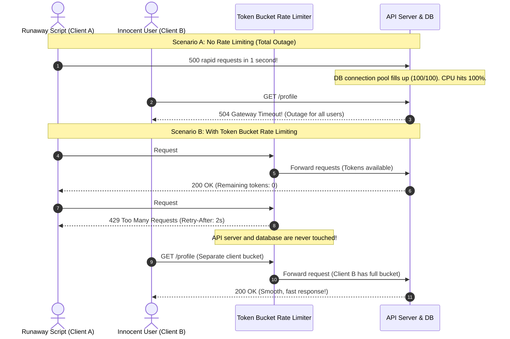

# Rate Limiting

> **In 30 seconds:** Rate limiting caps the number of requests a client can make in a given timeframe (like 60 requests per minute). Without rate limiting, a single runaway while-loop script, scraping bot, or brute-force attacker can consume all your database connections and crash the entire API for all paying customers.

---

## The story

Consider this realistic engineering scenario: A B2B software startup launches an AI document analysis and summarization API for corporate clients.

The startup charges clients on a monthly subscription and issues private API keys. Everything runs smoothly during early beta testing.

Then, an engineering intern at an enterprise customer writes a Python script to import and analyze historical documents:

```python
# A customer's script running in a loop with 40 worker threads
while True:
    doc = get_next_document()
    requests.post("https://api.startup.example.com/analyze", json=doc)
```

The intern forgets to add a delay or sleep between iterations, starts the script on a powerful cloud server on Friday afternoon, and leaves for the weekend.

The script hammers the startup's backend with 4,000 requests per second.

The startup has no rate limiting middleware in place. The backend servers attempt to service every single incoming request. Within 90 seconds, disaster strikes:

1. **Database Sockets Exhausted:** The PostgreSQL connection pool reaches its 100-connection limit.
2. **Cascading Timeouts:** Normal, paying human users trying to log in or use the web dashboard receive `504 Gateway Timeout` errors. The entire platform is dead.
3. **Surge in Cloud Costs:** The runaway script runs for 48 hours over the weekend, generating $9,000 in unexpected third-party cloud compute bills.

The startup suffered a complete multi-day outage not because of a sophisticated cyberattack, but because a single customer made a typo in a loop.

---

## The analogy

Think of a popular nightclub and the bouncer at the door:

- **The Unthrottled Nightclub:** Imagine a nightclub with an open doorway and no bouncer. A tour bus arrives with 300 rowdy partygoers who all charge through the front door at the exact same second. The bar is swarmed, bartenders are overwhelmed, drinks are spilled, and regular patrons are trampled. The club is ruined for everyone.
- **The Rate-Limited Nightclub (The Bouncer with a Velvet Rope):** A bouncer stands at the door with a clicker and a velvet rope. The bouncer only allows 5 people through the door every 30 seconds. Even if 300 people arrive at once, they wait outside in an orderly line. Inside the club, the dance floor stays comfortable, bartenders serve drinks efficiently, and the building never exceeds safe occupancy limits.

A rate limiter is the bouncer for your API.

---

## What it is

Rate limiting restricts how frequently an entity (a user, an IP address, or an API key) can call your application within a specific time window.

### Standard HTTP Rate-Limiting Headers

When an API enforces rate limits, it communicates limits to clients using standardized HTTP headers:

| Header | Meaning | Example |
| :--- | :--- | :--- |
| `RateLimit-Limit` | Maximum requests allowed in the current window | `100` |
| `RateLimit-Remaining` | How many requests you have left in this window | `14` |
| `RateLimit-Reset` | Seconds remaining until the quota resets | `26` |
| `Retry-After` | (Sent with `429 Too Many Requests`) Seconds to wait before retrying | `12` |

When a client exceeds their quota, the server responds with **`429 Too Many Requests`** and includes the `Retry-After` header.

---

## The 4 Rate Limiting Algorithms

There are four primary algorithms used in production. Here is how they work in simple terms:

### 1. Fixed Window Counter
- Divides time into fixed buckets (e.g., 12:00 to 12:01, 12:01 to 12:02).
- **Flaw (The Boundary Burst):** If a user sends 100 requests at 12:00:59 and another 100 requests at 12:01:01, they sent 200 requests in two seconds without violating the 100/minute rule.

### 2. Sliding Window Log
- Keeps a timestamp of every single request in an in-memory sorted set (like Redis ZSET).
- Computes the exact number of requests made in the rolling last 60 seconds.
- **Flaw:** High memory usage because it stores a timestamp for every single request.

### 3. Sliding Window Counter
- Combines the simplicity of fixed windows with the accuracy of sliding logs.
- Calculates an estimate based on a weighted average of the current minute and the previous minute.
- Very low memory usage, very smooth boundary enforcement.

### 4. Token Bucket (The Industry Standard)
- Imagine a bucket with a fixed capacity (e.g., 10 tokens).
- New tokens are added to the bucket at a constant rate (e.g., 2 tokens per second).
- Each API request takes 1 token out of the bucket.
- If the bucket has tokens, the request is allowed. If the bucket is empty, the request is rejected with `429`.
- **Why it wins:** It naturally allows short bursts of traffic (up to the bucket size) while enforcing a strict steady-state average rate. This is the exact algorithm used by Stripe and AWS.

---

## How it works

The sequence diagram below compares an unthrottled server outage against an API protected by a Token Bucket rate limiter:



### Walkthrough of the Steps

1. **Incoming burst:** A client fires a burst of requests in a split second.
2. **Tokens consumed:** The rate limiter checks the client's token bucket. The first 5 requests consume available tokens and are forwarded to the API backend.
3. **Bucket empty:** When request #6 arrives, the bucket has 0 tokens left.
4. **Immediate rejection:** The rate limiter intercepts the request and immediately returns `429 Too Many Requests` with a `Retry-After: 2` header.
5. **Backend protected:** The database, AI models, and worker threads never see request #6.
6. **Fairness preserved:** When a regular user (Client B) makes a request, they use their own separate token bucket, receiving an instant `200 OK`.

---

## Broken vs fixed

### Broken: No rate limiting on expensive routes

```javascript
// routes/search.js - UNPROTECTED AGAINST LOOPS AND DOS
app.post('/api/search', async (req, res) => {
  const { query } = req.body;

  // DANGER: Running expensive full-text database search with zero rate limiting!
  // A single client loop can overwhelm PostgreSQL connections in seconds.
  const results = await db.query(
    'SELECT * FROM articles WHERE to_tsvector(content) @@ plainto_tsquery($1)',
    [query]
  );

  res.json({ results });
});
```

### Fixed: Token Bucket rate limiting middleware with Redis

```javascript
// middleware/rateLimiter.js - PRODUCTION SAFE TOKEN BUCKET
import { redis } from '../lib/redis.js';

export function createTokenBucketLimiter({ capacity, refillRatePerSecond }) {
  return async function rateLimit(req, res, next) {
    // Identify client by authenticated API key, user ID, or IP address
    const clientId = req.headers['x-api-key'] || req.ip;
    const bucketKey = `ratelimit:${clientId}`;
    const now = Date.now();

    // Fetch current bucket state from Redis (or initialize)
    const data = await redis.hgetall(bucketKey);
    let tokens = data.tokens ? parseFloat(data.tokens) : capacity;
    let lastRefill = data.lastRefill ? parseInt(data.lastRefill, 10) : now;

    // Refill tokens based on elapsed time
    const elapsedSeconds = (now - lastRefill) / 1000;
    tokens = Math.min(capacity, tokens + elapsedSeconds * refillRatePerSecond);

    if (tokens >= 1) {
      // Consume 1 token
      tokens -= 1;
      await redis.hset(bucketKey, { tokens, lastRefill: now });
      await redis.expire(bucketKey, 3600); // 1-hour cleanup

      res.setHeader('RateLimit-Limit', capacity);
      res.setHeader('RateLimit-Remaining', Math.floor(tokens));
      return next();
    }

    // Bucket is empty: reject with 429
    const missing = 1 - tokens;
    const retryAfter = Math.ceil(missing / refillRatePerSecond);

    res.setHeader('RateLimit-Limit', capacity);
    res.setHeader('RateLimit-Remaining', 0);
    res.setHeader('Retry-After', retryAfter);

    return res.status(429).json({
      error: 'Too Many Requests',
      message: `Rate limit exceeded. Please retry in ${retryAfter} seconds.`,
    });
  };
}
```

---

## Try it yourself

Run the zero-dependency demonstration script included in this folder:

```bash
node docs/02-api-reliability/014-rate-limiting/demo.mjs
```

### What the demo shows

1. **Unthrottled Flood:** Fires 10 rapid requests in 50ms at an unprotected endpoint. Shows how all 10 requests hit the backend without restriction.
2. **Token Bucket Enforcement:** Sends 8 rapid requests against a protected endpoint (capacity: 5, refill: 2/sec). The first 5 succeed with `200 OK`, while requests #6, #7, and #8 are immediately stopped with `429 Too Many Requests` and a `Retry-After: 1s` header.
3. **Refill in Action:** Pauses for 1.2 seconds to allow tokens to replenish, and proves that Request #9 succeeds immediately.

---

## Where you have seen it

- **GitHub API:** Allows 5,000 requests per hour for authenticated personal access tokens, but only 60 requests per hour for unauthenticated IP addresses.
- **OpenAI API:** Enforces both Requests-Per-Minute (RPM) and Tokens-Per-Minute (TPM) limits across tier levels.
- **Cloudflare WAF:** Protects millions of websites at the edge by blocking IP addresses that exceed request thresholds before traffic ever reaches the origin server.

---

## When to use it

- **Every public API endpoint:** Protect against bot scrapers and accidental client while-loops.
- **Authentication routes:** Login, password resets, and 2FA verification endpoints must have strict limits (e.g. 5 attempts per 15 minutes) to block brute-force attacks.
- **Expensive compute operations:** PDF rendering, video conversion, and AI inference endpoints.
- **Multi-tenant SaaS platforms:** Prevent one noisy neighbor customer from monopolizing shared server resources.

---

## When to skip it

- **Health check endpoints (`/healthz`):** Load balancers and Kubernetes kubelets probe health endpoints every few seconds. Never rate limit internal health checks.
- **Trusted internal service-to-service communication:** When two microservices in the same private network communicate over gRPC, use circuit breakers and bulkheads instead of crude rate limiting.

---

## Common mistakes

- **Rate limiting solely by IP address in B2B applications:** Multiple corporate employees working in the same office building share a single outbound corporate proxy IP. If you rate limit by IP alone, one employee's test script will block the entire company. Use authenticated API keys or User IDs whenever possible.
- **Forgetting the `Retry-After` header:** Returning `429` without telling the client when to retry causes client scripts to immediately hammer your server in a tight retry loop, making the traffic spike worse.
- **Using in-memory counters in multi-server setups:** If your app runs across 4 Docker containers and you store rate limits in local memory, a client can send 4 times their allowed limit by load-balancing across instances. Store rate limits in a centralized Redis instance.

---

## Self-test

<details>
<summary>Question 1: What is the primary difference between the Fixed Window algorithm and the Token Bucket algorithm?</summary>

Fixed Window resets a counter at the top of each clock interval (e.g. at the start of each minute). It suffers from the "boundary burst" problem, where a user can send their full quota at 11:59:59 and another full quota at 12:00:01, doubling their allowed rate in two seconds. Token Bucket adds tokens continuously at a smooth rate, allowing bursts only up to the bucket capacity while strictly enforcing the average rate over time.
</details>

<details>
<summary>Question 2: Why should login endpoints have much stricter rate limits than standard read endpoints?</summary>

Login endpoints are vulnerable to credential stuffing and brute-force dictionary attacks, where an attacker attempts thousands of common password combinations. While an API read endpoint might permit 100 requests per minute, a login endpoint should typically permit only 5 to 10 failed attempts per 15-minute window per IP or username.
</details>

<details>
<summary>Question 3: Why is rate limiting solely by IP address problematic for corporate B2B customers?</summary>

Corporate networks use NAT (Network Address Translation). Thousands of employees inside an office building often share a single public IP address when communicating with the internet. If you rate limit based only on IP, one engineer running an automated script can consume the entire office's quota, blocking all their coworkers from using your application. Rate limit by authenticated API key, account ID, or user session instead.
</details>

---

## Interview angle

1. **"How would you design a distributed rate limiter that handles 100,000 requests per second across multiple data centers?"**
   - Model answer:
     - Use Redis with Lua scripts to evaluate and consume tokens atomically in a single network round-trip.
     - To avoid network latency bottlenecks across distant data centers, use local in-memory token batching: each API worker instance acquires a batch of 50 tokens from Redis at once and consumes them locally in memory.
     - If Redis becomes unavailable, configure the rate limiter to fail open (allow traffic) so that a monitoring failure does not trigger a self-inflicted outage for paying customers.

2. **"What is the difference between Rate Limiting and Load Shedding?"**
   - Model answer:
     - **Rate Limiting** is client-centric and contract-driven. It protects against individual abusers and enforces pricing tiers based on predetermined limits (e.g., "Customer A gets 100 req/min"), regardless of whether the server is currently idle or busy.
     - **Load Shedding** is server-centric and resource-driven. It activates when the server itself is running out of CPU, memory, or database sockets. The server rejects low-priority requests to keep core functionality alive, regardless of who is sending the requests.

---

## Cheat sheet

- **Return 429:** Always return `429 Too Many Requests` when limits are exceeded, never `500` or `200`.
- **Include Retry-After:** Always send `Retry-After: <seconds>` so clients know how long to pause.
- **Use Token Bucket:** Token Bucket allows natural short bursts while strictly controlling average throughput.
- **Centralize with Redis:** Use Redis for distributed rate limiting across multiple server containers.
- **Rate limit by API key:** In B2B SaaS, rate limit by authenticated API key or User ID, not raw IP addresses.

---

## Related concepts

- [001: HTTP Status Codes and Error Semantics](../../01-foundations/001-http-status-codes-and-error-semantics/README.md)
- [013: Idempotency Keys](../013-idempotency-keys/README.md)
- [022: Load Shedding](../022-load-shedding/README.md)

---

## Sources

- [RFC 6585: Additional HTTP Status Codes (Section 4: 429 Too Many Requests)](https://www.rfc-editor.org/rfc/rfc6585.html#section-4)
- [IETF Draft: RateLimit Header Fields for HTTP](https://datatracker.ietf.org/doc/draft-ietf-httpapi-ratelimit-headers/)
- [Stripe Engineering: How we built rate limiting to scale into millions of requests](https://stripe.com/blog/rate-limiters)
