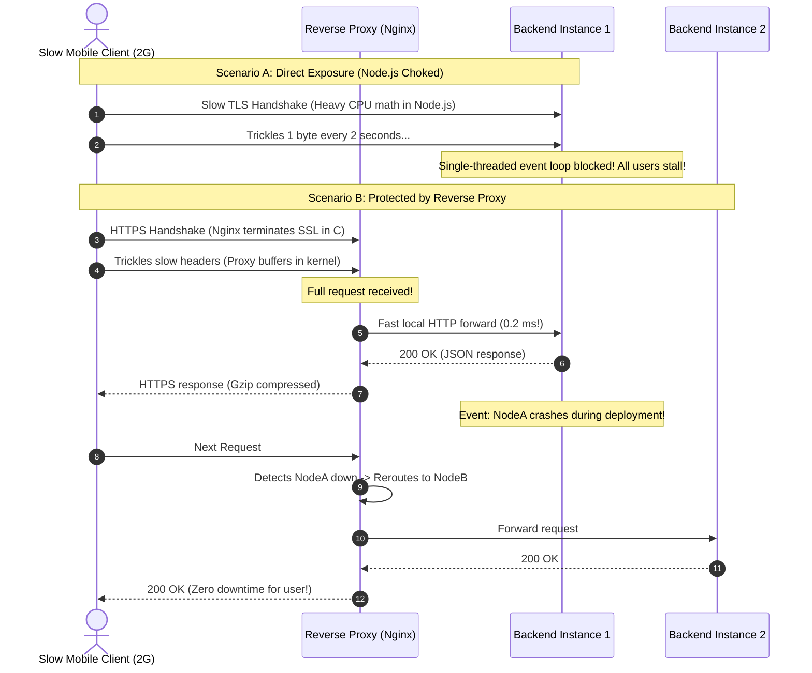

# Reverse Proxies

> **In 30 seconds:** A reverse proxy sits between the public internet and your backend servers like a security checkpoint at a building entrance. Instead of exposing raw Node.js or Python processes directly to the internet, all traffic hits a reverse proxy (like Nginx, Envoy, or Caddy) to terminate SSL encryption, buffer slow client connections, and distribute traffic across healthy servers.

---

## The story

Consider this realistic engineering scenario: A developer deploys a new Node.js web application to a public cloud virtual machine.

Because Node.js has a built-in HTTP module, the developer binds the application directly to public port 80 and port 443 with an SSL certificate. They think: *"Why bother installing Nginx or Caddy? Node.js can handle HTTP on its own."*

Within the first month of production traffic, three major failures strike:

1. **The Slowloris Socket Freeze:** A visitor on a slow 2G mobile connection uploads a form. Because the cellular connection is weak, the phone uploads request headers one byte every two seconds. In Node.js, an open socket occupies an active connection handle and event loop memory. A tiny script opening 400 slow connections simultaneously ties up all available sockets, freezing Node.js completely for other users.
2. **TLS Handshake CPU Starvation:** Encrypting and decrypting HTTPS traffic requires heavy mathematical calculations (asymmetric cryptography). Performing thousands of TLS handshakes directly inside single-threaded Node.js chokes the JavaScript event loop, pushing CPU to 100% and delaying database queries.
3. **Deployment Dropouts:** Whenever the team deploys a new version of the app, restarting the Node.js process abruptly severs open TCP connections with `ECONNRESET`. Customers in the middle of completing checkout receive broken pages.

The team fixed all three problems by placing **Nginx** in front of Node.js. Nginx terminates SSL in optimized C code, buffers slow mobile uploads in kernel memory before forwarding complete requests to Node.js in milliseconds, and performs zero-downtime rolling reloads during deployments.

---

## The analogy

Think of the security checkpoint and reception desk at an embassy:

- **Forward Proxy (Travels with the Client):** A bodyguard that travels *with you* when you walk around the city. The bodyguard protects your identity, hides where you live, and stops you from entering dangerous streets.
- **Reverse Proxy (Stands at the Server Entrance):** The security checkpoint stationed *at the front door of the embassy*. Foreign visitors are never allowed to wander directly into private back offices. The security guard checks passports (SSL decryption), inspects luggage (WAF / security filtering), holds heavy winter coats (request buffering), and directs visitors to whichever meeting room is currently empty (load balancing).

---

## What it is

A **reverse proxy** is a server that sits in front of one or more web servers, intercepting all incoming client requests and coordinating communication with the backend.

### Forward Proxy vs Reverse Proxy

| Dimension | Forward Proxy | Reverse Proxy |
| :--- | :--- | :--- |
| **Who it protects** | The **Client** (Browser / User) | The **Servers** (Your Backend) |
| **Where it sits** | In front of the client's network (e.g. corporate VPN) | In front of the application web servers |
| **What it hides** | The client's true IP address | The server's true internal IP and topology |
| **Typical examples** | Corporate content filters, Tor, Squid | Nginx, Envoy, Caddy, HAProxy, AWS ALB |

### The 5 Core Jobs of a Reverse Proxy

1. **TLS / SSL Termination:** The reverse proxy decrypts HTTPS traffic using hardware-accelerated crypto. It forwards clean, plain HTTP to your internal backend servers over private local networks, saving CPU cycles on your application servers.
2. **Connection and Request Buffering:** Slow clients (like a phone on a train) upload data slowly. The reverse proxy buffers the entire payload in memory or disk. Once the full request is received, it sends it to your backend over local loopback at Gigabit speed in under 1 millisecond.
3. **Load Balancing:** Automatically distributes requests across multiple instances of your application (using Round Robin, Least Connections, or IP Hash algorithms).
4. **Health Checks and Failover:** Continuously monitors backend instances. If Instance A crashes, the reverse proxy instantly stops sending traffic to Instance A and routes 100% of requests to Instance B with zero downtime.
5. **Static File Offloading & Compression:** Serves static files (images, CSS, JS bundles) directly from disk and compresses responses with Gzip or Brotli without waking up Node.js or Python runtimes.

---

## How it works

The sequence diagram below compares direct exposure against a reverse proxy shield:



### Walkthrough of the Steps

1. **SSL Handshake:** The client connects over HTTPS. The reverse proxy handles the TLS handshake at the network edge.
2. **Buffering slow bytes:** The client sends data slowly over cellular networks. The reverse proxy buffers the bytes without bothering the application backend.
3. **Fast local dispatch:** Once the request is complete, the proxy forwards it to Backend Instance 1 over local loopback (`127.0.0.1`) in fractions of a millisecond.
4. **Automatic failover:** If Backend Instance 1 crashes, the reverse proxy detects the failure and instantly routes all subsequent requests to Backend Instance 2. The client never sees a `502 Bad Gateway`.

---

## Broken vs fixed

### Broken: Exposing Node.js directly to the public internet

```javascript
// server.js - DANGEROUS IN PRODUCTION
import https from 'node:https';
import fs from 'node:fs';

const options = {
  key: fs.readFileSync('/etc/ssl/private.key'),
  cert: fs.readFileSync('/etc/ssl/certificate.crt'),
};

// DANGER: Node.js handles TLS handshakes and slow sockets directly!
// Slow clients and SSL negotiation consume the single-threaded event loop.
https.createServer(options, (req, res) => {
  res.writeHead(200, { 'Content-Type': 'application/json' });
  res.end(JSON.stringify({ message: 'Hello World' }));
}).listen(443, '0.0.0.0');
```

### Fixed: Standard Nginx reverse proxy configuration

Here is the industry-standard Nginx reverse proxy configuration running in front of two backend instances:

```nginx
# /etc/nginx/nginx.conf - PRODUCTION REVERSE PROXY SHIELD
upstream backend_cluster {
    server 127.0.0.1:3001 max_fails=3 fail_timeout=10s;
    server 127.0.0.1:3002 max_fails=3 fail_timeout=10s;
    keepalive 32;
}

server {
    listen 443 ssl http2;
    server_name api.example.com;

    # 1. High-performance TLS termination
    ssl_certificate /etc/letsencrypt/live/api.example.com/fullchain.pem;
    ssl_certificate_key /etc/letsencrypt/live/api.example.com/privkey.pem;
    ssl_protocols TLSv1.2 TLSv1.3;

    # 2. Gzip compression offloading
    gzip on;
    gzip_types application/json text/plain text/css;

    # 3. Connection and request buffering
    proxy_buffering on;
    proxy_buffer_size 8k;
    proxy_buffers 8 8k;

    location / {
        proxy_pass http://backend_cluster;

        # 4. Forward original client headers to the backend
        proxy_set_header Host $host;
        proxy_set_header X-Real-IP $remote_addr;
        proxy_set_header X-Forwarded-For $proxy_add_x_forwarded_for;
        proxy_set_header X-Forwarded-Proto $scheme;

        # 5. Connection reuse
        proxy_http_version 1.1;
        proxy_set_header Connection "";
    }
}
```

---

## Try it yourself

Run the zero-dependency demonstration script included in this folder:

```bash
node docs/02-api-reliability/015-reverse-proxies/demo.mjs
```

### What the demo shows

1. **Load Balancing across Backends:** Starts two independent backend servers (Backend A and Backend B). A reverse proxy server load balances 4 client requests evenly (50/50) across both instances using Round Robin.
2. **Zero-Downtime Failover:** Simulates an unexpected crash on Backend B. The reverse proxy detects the failure and seamlessly reroutes 100% of user traffic to Backend A without dropping a single connection.

---

## Where you have seen it

- **Nginx:** Powers over 30% of the world's top websites as the primary edge reverse proxy.
- **Envoy Proxy:** Developed by Lyft and adopted by Kubernetes, Istio, and Google Cloud as the default service mesh reverse proxy.
- **Caddy Server:** Popular modern reverse proxy written in Go that automatically provisions and renews Let's Encrypt SSL certificates with zero configuration.
- **Cloudflare and AWS ALB:** Global managed reverse proxies that inspect, cache, and route billions of requests daily before traffic reaches customer origins.

---

## When to use it

- **Every production web server:** Never expose raw Node.js, Python (Django/Flask), Ruby (Rails), or PHP runtimes directly to the public internet.
- **Zero-downtime rolling deployments:** Reroute traffic away from an instance while updating its code, then route traffic back when healthy.
- **Microservice front-ends:** Consolidate multiple internal microservices under a single public domain (e.g. `/api/users` routes to Service 1, `/api/billing` routes to Service 2).

---

## When to skip it

- **Local development on localhost:** When testing code locally on your laptop, running `npm run dev` on port 3000 is fine.
- **Serverless architectures (AWS Lambda, Vercel, Cloudflare Workers):** Cloud providers already operate managed reverse proxies in front of your serverless handlers.

---

## Common mistakes

- **Forgetting `X-Forwarded-For` headers:** If your reverse proxy does not forward client headers, all backend application logs will show `127.0.0.1` as the client IP address. Fraud prevention, analytics, and IP rate limiters will break.
- **Disabling proxy buffering without a streaming use case:** Turning `proxy_buffering off` forces backend processes to wait synchronously on slow mobile networks, resurrecting the Slowloris vulnerability. Only disable buffering for Server-Sent Events (SSE) or streaming endpoints.
- **Single Point of Failure (SPOF):** Running a single reverse proxy instance on one virtual machine. If that VM dies, your entire platform drops. In production, place multiple reverse proxy instances behind a managed cloud load balancer (like AWS NLB) or use DNS Anycast (like Cloudflare).

---

## Self-test

<details>
<summary>Question 1: What is the difference between a forward proxy and a reverse proxy?</summary>

A forward proxy represents and protects the client (browser or user), hiding the client's identity from external websites (like a corporate internet filter or VPN). A reverse proxy represents and protects the server (backend infrastructure), intercepting incoming public traffic to terminate SSL, buffer connections, and distribute load across internal application instances.
</details>

<details>
<summary>Question 2: Why does SSL termination at the reverse proxy improve backend performance?</summary>

TLS/SSL cryptographic handshakes require complex asymmetric mathematics that consume significant CPU time. Performing handshakes inside application runtimes (like single-threaded Node.js) slows down the execution of application code. High-performance reverse proxies (like Nginx written in optimized C) terminate SSL in hardware-accelerated worker threads, forwarding fast, unencrypted HTTP to backend servers over secure local private networks.
</details>

<details>
<summary>Question 3: Why must a reverse proxy forward the `X-Forwarded-For` header to application backends?</summary>

Because the TCP connection to the backend server originates from the reverse proxy itself, the backend sees the reverse proxy's IP (e.g. `127.0.0.1` or a private subnet IP) as the remote address. The reverse proxy injects the `X-Forwarded-For: <client-ip>` header so backend code, security logs, and rate limiters can identify the original client who sent the request.
</details>

---

## Interview angle

1. **"What is the Slowloris attack, and how does a reverse proxy protect Node.js applications against it?"**
   - Model answer:
     - Slowloris is a denial-of-service attack where an attacker opens hundreds of HTTP connections and sends headers extremely slowly (e.g. one byte every 10 seconds), never completing the request.
     - Single-threaded or connection-limited application servers (like Node.js or Apache with prefork) keep sockets open waiting for the request to complete, quickly exhausting all file descriptors.
     - A reverse proxy (like Nginx) uses an asynchronous, event-driven architecture designed to hold tens of thousands of idle connections in minimal kernel memory. Nginx buffers the request completely and only forwards it to Node.js once the entire HTTP header and body have arrived, rendering Slowloris harmless.

2. **"How do you implement zero-downtime deployments using a reverse proxy?"**
   - Model answer:
     - Run at least two backend instances behind the reverse proxy.
     - To deploy, take Instance A out of the reverse proxy pool (drain connections).
     - Deploy the new release to Instance A and run health checks.
     - Once Instance A is confirmed healthy, add it back to the reverse proxy pool.
     - Repeat the process for Instance B.
     - Nginx or Envoy seamlessly shifts traffic between instances so users never experience dropped connections or `502 Bad Gateway` errors during code deploys.

---

## Cheat sheet

- **Never expose raw runtimes:** Always run Nginx, Envoy, or Caddy in front of Node.js, Python, or Ruby in production.
- **Terminate SSL at the edge:** Let the reverse proxy handle TLS handshakes and certificate renewals.
- **Buffer slow connections:** Keep proxy buffering enabled to protect backend event loops from slow mobile clients.
- **Forward client headers:** Always pass `X-Forwarded-For`, `X-Forwarded-Proto`, and `Host` to backend services.
- **Enable health checks:** Configure reverse proxies to detect dead backends and reroute traffic automatically.

---

## Related concepts

- [001: HTTP Status Codes and Error Semantics](../../01-foundations/001-http-status-codes-and-error-semantics/README.md)
- [014: Rate Limiting](../014-rate-limiting/README.md)
- [016: API Gateways](../016-api-gateways/README.md)

---

## Sources

- [Nginx Documentation: Reverse Proxy Guide](https://docs.nginx.com/nginx/admin-guide/web-server/reverse-proxy/)
- [Envoy Proxy Architecture Overview](https://www.envoyproxy.io/docs/envoy/latest/intro/arch_overview/arch_overview)
- [Cloudflare: What is a Reverse Proxy?](https://www.cloudflare.com/learning/cdn/glossary/reverse-proxy/)
